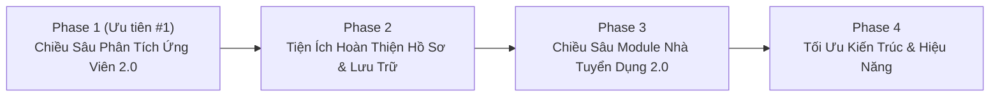
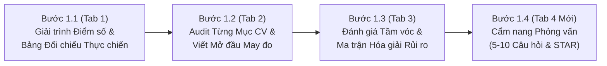

# Lộ Trình Phát Triển Sản Phẩm & Kỹ Thuật — RoleMatch 2 (Đã Chốt)

> [!IMPORTANT]
> **Chiến lược Thực thi Đã Chốt (28/10/2026):**
> - **Ưu tiên số 1 (Phase 1):** Nâng cấp toàn diện chiều sâu phân tích kết quả của **Ứng Viên** trước khi mở rộng sang Module Nhà Tuyển Dụng.
> - **Chia nhỏ thành 4 Bước triển khai tuần tự (`Bước 1.1` → `1.4`):** Mỗi bước hoàn thiện trọn vẹn từ Backend AI Schema → Giao diện Frontend → Kiểm thử → Commit lên nhánh `staging`.
> - **Tách riêng Tab thứ 4 (`Cẩm nang Phỏng vấn`):** Linh hoạt tạo **5–10 câu hỏi phỏng vấn xoáy sâu** mà Nhà tuyển dụng / Hiring Manager có thể hỏi dựa trên độ phức tạp của JD và khoảng trống thực tế trong CV.

---

## 1. Chẩn đoán Hiện trạng: Vì sao Kết quả Phân tích Ứng viên hiện tại còn sơ sài?

Qua rà soát `analysisResponseSchema` trong `server.ts` và 3 tab hiển thị kết quả của Ứng viên (`KeywordMatchTab.tsx`, `BulletPointRewriteTab.tsx`, `RecruiterScanTab.tsx`), có **4 điểm nghẽn chính** khiến kết quả chưa đủ sâu:

1. **Điểm số thiếu lời giải trình (Black-box Scoring)**:
   - Ứng viên nhìn thấy 4 con số (`Overall Score`, `Keyword Match`, `Skill Match`, `Experience & Outcome`) nhưng **không biết vì sao mình bị trừ điểm** ở từng hạng mục, tiêu chí nào là **Bắt buộc (Must-Have / Knock-out)** và tiêu chí nào chỉ là **Điểm cộng (Nice-to-Have)**.
2. **Bảng đối chiếu JD vs CV chỉ dừng lại ở mức "Tìm từ khóa"**:
   - Bảng `comparisonTable` trong `KeywordMatchTab.tsx` mới chỉ báo `Có / Một phần / Thiếu` và nhận xét ngắn, chưa đưa ra **Câu văn mẫu gợi ý (Ready-to-use CV Snippet)** và **Vị trí cụ thể cần chèn vào CV** để lấp khoảng trống đó.
3. **Chưa có Đánh giá Tầm vóc (Seniority & Scope Fit) và Từng phần của CV (Section-by-Section Audit)**:
   - Một ứng viên Senior/Manager hoặc Specialist cần biết: *Quy mô dự án, độ phức tạp hệ thống, phạm vi trách nhiệm (Scope of Ownership) và số năm kinh nghiệm trong CV đang ở mức nào so với kỳ vọng thực sự của JD?*
   - Tab `BulletPointRewriteTab.tsx` mới chỉ nhặt ra 3–5 dòng bullet lẻ tẻ để viết lại, hoàn toàn thiếu **Đoạn Tóm tắt Mở đầu (Executive Summary / Professional Pitch)** viết riêng cho công ty & vị trí đó, cũng như chưa chấm điểm cấu trúc từng phần của CV (*Summary, Work Experience theo từng công ty, Skills, Education/Certifications, Độ tương thích ATS*).
4. **Góc nhìn Nhà tuyển dụng (`RecruiterScanTab.tsx`) còn quá ngắn và thiếu hướng hóa giải**:
   - Hiện chỉ trả về vài câu ngắn (`firstImpression10s`, `biggestDoubt`, `top3MustFix`). Ứng viên chưa biết **Chiến lược hóa giải (Mitigation Plan)** cho các điểm yếu/rủi ro trong hồ sơ (nhảy việc, trái ngành, thiếu số liệu, hụt cấp bậc) và **Bộ câu hỏi phỏng vấn xoáy sâu** mà Hiring Manager chắc chắn sẽ hỏi dựa trên những điểm nghi ngờ đó.

---

## 2. Lộ Trình Triển Khai Tổng Thể (4 Giai Đoạn)

---

## 🔥 PHASE 1 (Ưu tiên #1): Nâng Cấp Chiều Sâu Phân Tích Kết Quả Cho Ứng Viên (4 Bước Tuần Tự)

### 🔹 Bước 1.1 — Giải trình Điểm số Đa chiều & Nâng cấp Bảng Đối chiếu (Tab 1: `KeywordMatchTab.tsx`)
1. **Giải trình Điểm số (Score Breakdown & Rationale)**:
   - Dưới 4 chỉ số (`Overall`, `Từ khóa`, `Kỹ năng`, `Kinh nghiệm & Kết quả`), bổ sung giải thích chi tiết: *Vì sao đạt mức điểm này? Yếu tố nào kéo điểm xuống? Nếu tối ưu lại cách trình bày CV hiện tại thì có thể tăng lên khoảng bao nhiêu % (`projectedOverallScore`)?*
2. **Phân tách Tiêu chí Bắt buộc (Must-Have / Knock-out) vs. Điểm cộng (Nice-to-Have)**:
   - Đánh dấu rõ các yêu cầu cốt lõi bắt buộc phải có trong JD để ứng viên ưu tiên xử lý trước.
3. **Nâng cấp Bảng Đối chiếu JD vs CV (`comparisonTable`)**:
   - Bổ sung trường **"Gợi ý câu mẫu & Vị trí chèn vào CV (`suggestedPhrasing` & `targetSection`)"**: Với mỗi tiêu chí đang ở mức `Cần bổ sung` hoặc `Thiếu`, AI hướng dẫn cụ thể nên chèn vào mục nào (*Tóm tắt mở đầu, Kinh nghiệm tại công ty X, hay mục Kỹ năng*) kèm câu mẫu gợi ý sát ngữ cảnh.

### 🔹 Bước 1.2 — Audit Chi tiết Từng Mục CV & Viết sẵn Tóm tắt Mở đầu (Tab 2: `BulletPointRewriteTab.tsx`)
1. **Viết sẵn Mở đầu CV May đo (Tailored Executive Summary / Pitch)**:
   - Tự động tạo **2 phiên bản Mở đầu CV (3–4 câu)** khớp với `[Company Name] - [Vị trí ứng tuyển]` (1 bản nhấn mạnh Chuyên môn/Kỹ thuật, 1 bản nhấn mạnh Tác động Quản lý/Kinh doanh) kèm nút Copy nhanh.
2. **Khám bệnh Từng Phần của CV (Section-by-Section CV Audit)**:
   - Chấm trạng thái (`Tốt / Cần cải thiện / Điểm yếu nghiêm trọng`) và nhận xét chi tiết cho 4 phần: *Tóm tắt mở đầu*, *Kinh nghiệm làm việc*, *Cấu trúc Kỹ năng*, *Học vấn/Chứng chỉ & Định dạng chuẩn ATS*.
3. **Nâng cấp Viết lại Bullet Point (STAR / XYZ Formula)**:
   - Mở rộng lên 5–8 bullet quan trọng nhất, hiển thị rõ **Từ khóa JD đã lồng ghép (`embeddedKeywords`)** và **Gợi ý chỗ điền số liệu (`metricPlaceholders`)**.

### 🔹 Bước 1.3 — Đánh giá Tầm vóc (Seniority Fit) & Ma trận Hóa giải Rủi ro (Tab 3: `RecruiterScanTab.tsx`)
1. **Seniority & Scope Fit Assessment (Đối chiếu Tầm vóc & Cấp bậc)**:
   - So sánh trực diện **Kỳ vọng của JD vs. Thực tế CV** qua 4 trục: *Cấp bậc & Thâm niên*, *Quy mô & Độ phức tạp hệ thống/dự án*, *Phạm vi tự chủ/Lãnh đạo*, *Độ khớp Ngành nghề/Domain*.
   - Kết luận mức độ khớp tầm vóc (`Chưa tới tầm / Đúng tầm / Vượt tầm`) kèm lời khuyên định vị.
2. **Risk Radar & Mitigation Plan (Ma trận Rủi ro Hồ sơ & Cách Hóa giải)**:
   - Chỉ ra các điểm nghi ngại / Red Flags khi HR đọc lướt kèm **Cách hóa giải trên CV** và **Cách giải thích khi phỏng vấn**.

### 🔹 Bước 1.4 — Tách Tab Thứ 4: Cẩm nang Phỏng vấn Thực chiến (`InterviewPrepTab.tsx`)
1. **Giao diện Tab thứ 4 riêng biệt trên màn hình kết quả Ứng viên**:
   - Đặt cạnh 3 tab hiện có: `(1) Đối chiếu Từ khóa & Điểm số` | `(2) Tối ưu & Viết lại CV` | `(3) Góc nhìn Nhà tuyển dụng` | **`(4) Cẩm nang Phỏng vấn (5–10 câu)`**.
2. **Bộ 5–10 Câu hỏi Phỏng vấn Xoáy sâu Linh hoạt**:
   - Số lượng câu hỏi linh động từ **5 đến 10 câu** tùy theo độ phức tạp của JD và số lượng khoảng trống/nghi ngờ trong CV, phân theo nhóm (*Kiểm chứng Khoảng trống CV, Chuyên môn/Tình huống Thực tế, Tầm vóc/Cách làm việc*).
   - Mỗi câu hỏi đi kèm:
     - **Mục đích ẩn sau câu hỏi của Nhà tuyển dụng (`interviewerIntent`)**
     - **Khung trả lời gợi ý theo mô hình STAR dựa trên kinh nghiệm thực của ứng viên (`starAnswerGuide`)**
     - **Bẫy cần tránh khi trả lời (`pitfallToAvoid`)**

---

## 🛠️ PHASE 2: Tiện Ích Hoàn Thiện Hồ Sơ & Đồng Bộ Đám Mây Cho Ứng Viên
1. **Chế độ "Chấm điểm lại nhanh (Quick Re-evaluate / Before vs. After)"**:
   - Cho phép ứng viên sửa trực tiếp văn bản CV hoặc áp dụng các câu Bullet/Summary gợi ý rồi bấm **"Chấm điểm lại"** với cùng JD để xem điểm số cải thiện từ `X% -> Y%`.
2. **Xuất Báo cáo Phân tích & Bản nháp CV tối ưu (Export PDF / DOCX)**:
   - Tải xuống toàn bộ cẩm nang phân tích + câu hỏi phỏng vấn hoặc xuất nội dung CV đã tối ưu ra file Word/PDF chuẩn ATS.
3. **Đồng bộ Lịch sử Phân tích lên Cloud Database**:
   - Lưu lịch sử phân tích của Ứng viên lên SQLite/PostgreSQL theo tài khoản (thay vì chỉ lưu `localStorage`), kèm thanh **Tìm kiếm & Lọc theo Công ty / Vị trí** trong `HistorySidebar.tsx`.

---

## 🏢 PHASE 3: Nâng Cấp Chiều Sâu Cho Module Nhà Tuyển Dụng (Recruiter Module 2.0)
1. **Tùy chỉnh Trọng số Chấm điểm & Tiêu chí Knock-out (Custom Scoring Weights)**:
   - Cho phép HR đặt trọng số trước khi lọc hàng loạt (VD: *Kinh nghiệm 50%, Kỹ năng 30%, Domain 20%*) và gắn cờ các điều kiện bắt buộc.
2. **Báo cáo So sánh Chuyên sâu Ứng viên & Bộ Câu hỏi Phỏng vấn cho HR**:
   - Ma trận so sánh Top 3–5 ứng viên xuất sắc nhất theo từng tiêu chí của JD và gợi ý câu hỏi thẩm định riêng cho từng ứng viên.
3. **Quản lý Pipeline Tuyển dụng (Shortlist / Interview / Offer / Reject) & Ghi chú nội bộ**.

---

## ⚙️ PHASE 4: Tối Ưu Kiến Trúc & Hiệu Năng Hệ Thống
1. **Tách nhỏ `server.ts`** thành các module độc lập (`routes/`, `services/aiAnalysis.ts`, `services/jdExtractor.ts`, `schemas/`) để dễ bảo trì và mở rộng unit test.
2. **Streaming / Progressive Analysis**: Hiển thị tiến trình phân tích theo từng bước thời gian thực để giảm cảm giác chờ đợi khi AI phân tích sâu.
