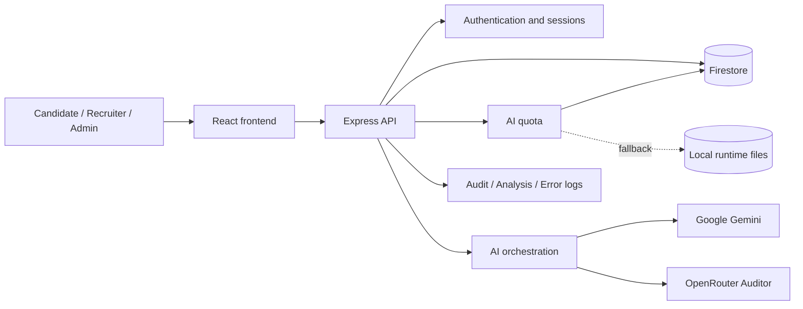
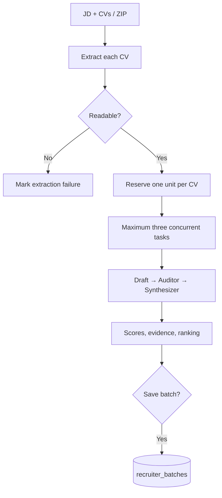
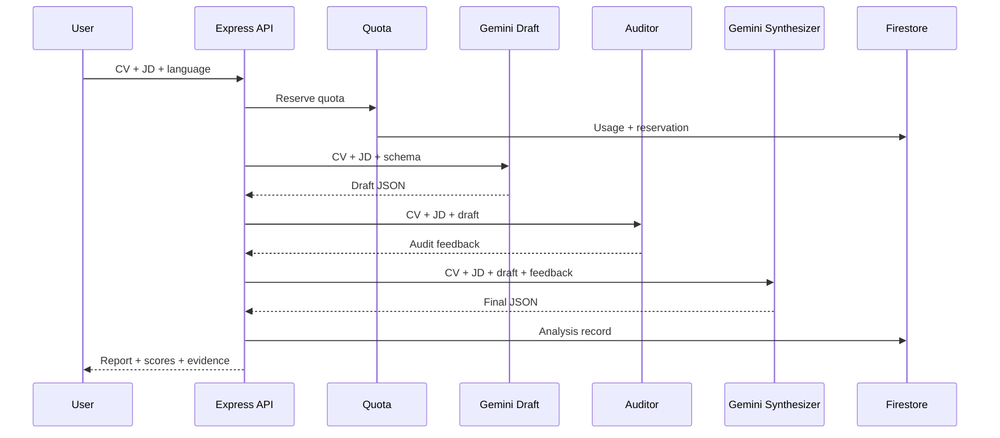
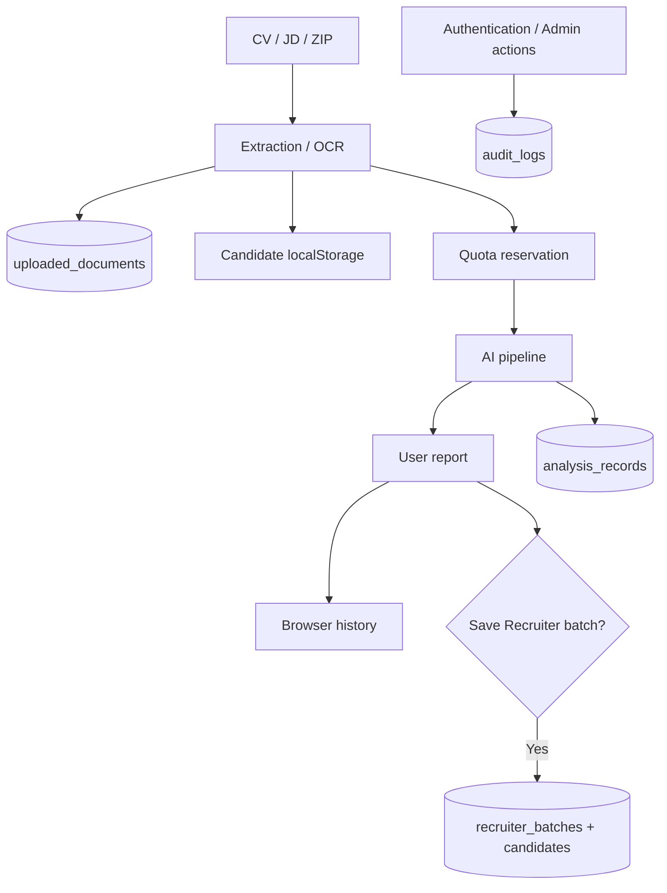
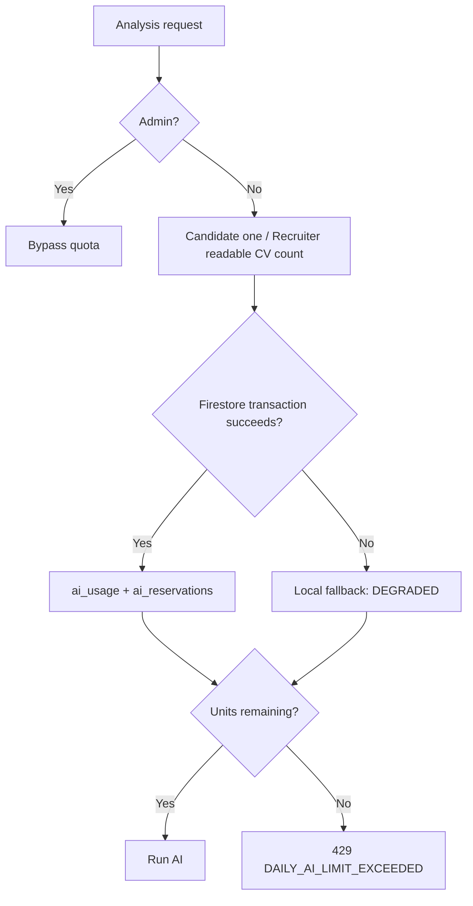

# RoleMatch Operations and Technical Architecture Guide for Administrators and CTOs

> **Document status:** Draft for review and approval. Not yet imported into the repository.
>
> **Reviewed source:** `staging` branch (fully integrating Phase 1: Steps 1.1 -> 1.4 — Candidate Analysis Depth 2.0).
>
> **Purpose:** help administrators operate RoleMatch safely while giving CTOs a complete view of product architecture, backend processing, the AI pipeline, data lifecycle, deployment, and production risks.

## CTO architecture brief

RoleMatch analyzes the fit between a CV and a job description through **Candidate** and **Recruiter** modes. These are product modes, not security roles; the source defines only `normal` and `admin`.



Sections 1–16 explain Admin Dashboard operations. Sections 17–29 cover architecture, backend processing, AI behavior, data storage, and production readiness.

## 1. Admin scope and responsibilities

The Admin Dashboard supports management of:

- Overall application status.
- User accounts and login sessions.
- Daily AI analysis limits.
- CV and JD files received by the application.
- Candidate and Recruiter analysis records.
- Audit and error logs.
- AI provider connectivity.
- Selected system configuration controls.

The Dashboard is not a complete infrastructure monitoring platform. Some values are held in application-instance memory or local files and may not represent the whole system when Cloud Run runs multiple instances.

## 2. Accessing the Admin Dashboard

Only users with the `admin` role can see the Admin Dashboard button and call administrative APIs.

After signing in:

1. Select **Admin Dashboard** in the header.
2. Confirm that you are using the intended account and environment.
3. Open the required functional tab.
4. Use **Refresh** after any data-changing action.

The frontend signs out after approximately **30 minutes of inactivity**, but the backend expires an inactive session after **15 minutes**; bearer tokens have a maximum lifetime of **24 hours**. These policies are inconsistent, so an API authorization failure can occur before the frontend signs out.

## 3. Admin Dashboard structure

| Tab | Primary purpose |
|---|---|
| **System Overview** | Review accounts, sessions, memory, analysis latency, and AI status |
| **User Database** | Create, edit, lock, unlock, delete users, terminate sessions, and reset quota |
| **CV/JD Files Repository** | Search, preview, export, or delete uploaded documents |
| **Analysis Records** | Inspect Candidate/Recruiter results, latency, pipeline errors, and exports |
| **Audit Trail Logs** | Review authentication, administration, AI, system, and security actions |
| **Error Logs** | Inspect client/server failures and diagnostic details |
| **System Settings** | Manage AI quota and display additional controls that are not yet enforced by the backend |

## 4. System Overview

### 4.1. Overview metrics

The Dashboard may show:

- Total accounts and the `admin`/`normal` distribution.
- Active login sessions.
- Node.js process heap memory.
- Average analysis duration.
- Analyses taking longer than 120 seconds.
- Gemini and other AI provider configuration status.

Memory and active-session values describe the application instance serving the request. In a multi-instance Cloud Run environment, they are not system-wide totals.

### 4.2. Login sessions

The session list may include username, role, login time, most recent activity, and IP address.

Use **Terminate Session / Kick** when:

- A user cannot sign in because another session exists.
- A session appears suspicious.
- An account has just been locked or access must be revoked immediately.

Sessions are currently kept in memory. An application restart can clear the list, and one instance may not see a session stored on another instance.

### 4.3. AI provider status

The Dashboard tracks three provider groups:

- **Gemini:** the primary provider for draft and synthesis under the current configuration.
- **OpenRouter:** an optional provider commonly used for the Auditor step.
- **OpenAI:** an optional or standby provider.

**Configured/Ready** means that the application received the expected configuration. It does not prove that an end-to-end analysis will succeed.

**Ping AI** sends a real request to the provider and may consume a small amount of API quota or cost. Use Ping for connection verification, then check the error log and run one controlled analysis when end-to-end confirmation is required.

## 5. User Management

### 5.1. Search and filtering

Administrators can filter by role or online status and search by username or full name. Before changing an account, verify the username, role, and current status to avoid acting on the wrong user.

### 5.2. Creating an account

When creating an account:

- A username must contain at least 3 characters and must be unique.
- A password must contain at least 4 characters under the current validation.
- Select the correct `normal` or `admin` role.
- Do not send passwords through unsecured email or chat.
- Require a password change when the operating process supports it.

Passwords are stored as bcrypt hashes. The runtime user file is still sensitive and must not be committed to Git.

### 5.3. Editing an account

An administrator can change the full name, role, password, and lock status. The username is normally disabled in the edit form.

Changing a role to `admin` grants access to all administrative functions. Do this only with appropriate approval and a recorded reason.

### 5.4. Locking and unlocking

A `normal` account can be locked automatically after five consecutive incorrect passwords or manually by an administrator.

When an account is locked:

- Sessions known to the current server are revoked.
- The user cannot sign in again until the account is unlocked.
- The action is written to the audit log.

Unlocking resets the failed-login counter. Verify the user's identity and the reason for the lock before unlocking the account.

### 5.5. Terminating a session

Terminating a session does not delete the account or change its password. The user can sign in again if the account is not locked.

### 5.6. Deleting an account

Deleting a user is destructive. An administrator cannot delete the currently signed-in Admin account, but at least one other working Admin account should be confirmed before deleting another administrator.

Deleting a user does not necessarily delete all related CVs, JDs, analysis records, audit logs, or saved batches. A personal-data deletion request requires checking every relevant collection and storage source.

## 6. Daily AI analysis quota

### 6.1. How quota is counted

Quota applies to `normal` accounts and is shared by both application tabs:

- **Cand:** analysis units used in the Candidate tab.
- **Batch:** analysis units used in the Recruiter tab.
- **Total:** `Cand + Batch`.
- **Daily Limit:** maximum units allowed for the day.

The quota date uses the `Asia/Ho_Chi_Minh` timezone and resets at 00:00 according to the system date.

A Recruiter batch containing several CVs can consume several quota units. One button click in the Recruiter tab should not always be interpreted as one unit.

### 6.2. Enabling, disabling, and changing the limit

The AI quota control in **System Settings** is connected to the backend. When changing it:

1. Enable or disable the limit.
2. Select the daily limit.
3. Wait for the success response.
4. Refresh the Dashboard.
5. Verify the test user and run one controlled analysis.

The intended product default is **5 runs per day**. The reviewed source is still inconsistent: some fallback/backend paths use `5`, while the UI and runtime file use or label `10` as the default. Until this is corrected, treat the value read back from the backend after Refresh as the active value; do not rely only on the “Default” label in the dropdown.

### 6.3. Quota health states

| State | Meaning | Administrator action |
|---|---|---|
| **HEALTHY** | Firestore is the primary source and counters are valid | Continue normal monitoring |
| **DEGRADED (Local Fallback)** | The system is using or prioritizing local data | Check Firestore, environment configuration, and application logs; do not treat it as a stable state |
| **NORMALIZED** | The system found inconsistent data and normalized it or selected the safer source | Refresh, verify the user, and monitor the next analysis |
| **ERROR** | Reliable quota data cannot be read or determined | Pause quota testing for the user and repair the backend/storage issue |

`DEGRADED` does not mean quota has completely stopped. It means quota depends on a local file that is not reliably shared across Cloud Run instances and may change after a restart or deployment.

### 6.4. Resetting one user's quota

**Reset AI Usage** applies only to `normal` accounts and resets the current day's usage to:

```text
Cand 0 | Batch 0 | Total 0
```

Safe procedure:

1. Record the usage before reset.
2. Select the correct user and choose **Reset AI Usage**.
3. Confirm the dialog.
4. Wait for the response to complete.
5. Refresh the user list.
6. Confirm that Cand, Batch, and Total are all zero.
7. Check `storageSource` and `quotaHealth`.
8. If necessary, ask the user to run exactly one test analysis and refresh again.

If the API returns a partial failure, the UI must not report a successful reset. Firestore and local storage must be checked before the user continues because the two sources may contain different counters.

A quota reset does not change the daily limit and does not delete existing analysis records.

## 7. CV/JD Files Repository

This tab displays documents received by the application, including filename, CV/JD type, format, size, character count, uploader, and upload time.

An administrator can:

- Search and filter by type or format.
- Preview extracted content.
- Export content or metadata for diagnostics.
- Delete one file or clear all files.

CVs and JDs may contain personal data, employment history, email addresses, telephone numbers, and internal hiring information. Export data only for a clear operational purpose and do not share exports through public channels.

Before clearing all files:

1. Confirm that filters have not caused a misunderstanding of the scope.
2. Export any information that must be retained.
3. Confirm the test or production environment.
4. Perform the deletion.
5. Refresh and verify the result.

## 8. Analysis Records

This tab contains centralized records from both Candidate and Recruiter analyses.

### 8.1. Record states

| State | Meaning |
|---|---|
| **COMPLETED** | The pipeline returned a valid result |
| **NO_SCORE** | A response exists but has no valid Overall Score |
| **FAILED** | The pipeline or a provider failed |

### 8.2. Latency classification

| Level | Duration |
|---|---:|
| **FAST** | Under 60 seconds |
| **NORMAL** | 60 to 120 seconds |
| **SLOW** | Over 120 seconds |

A slow record is not automatically a failure. Compare provider status, CV count, document length, pipeline step, and error logs.

### 8.3. AI pipeline

A detailed record may show three stages:

1. **Draft Analysis:** produces the initial analysis.
2. **Auditor Check:** reviews and challenges the draft.
3. **Synthesizer:** creates the final report.

When investigating an unusual result, identify the failed or incomplete stage before running the analysis again.

### 8.4. Deleting records and clearing cache

Deleting an analysis record destroys centralized data. It does not guarantee removal of Candidate history stored in a browser or a saved Recruiter batch.

**Clear Cache** removes only in-memory caches from the application instance serving the request. It does not delete Firestore records, CV/JD files, or saved batches. Other instances may still hold their own cache.

## 9. Audit Trail Logs

Audit logs answer: **who performed which action, when, and with what result**.

Categories include:

- `AUTH`
- `USER_MGMT`
- `AI_SERVICE`
- `SYSTEM`
- `SECURITY`

Common statuses include `success`, `warning`, and `error`.

For incident investigation:

1. Filter by username or action.
2. Select the relevant time period.
3. Review status and details.
4. Compare with error logs and analysis records.
5. Export necessary logs before clearing them.

The current audit log is not an immutable or compliance-grade log system. Depending on environment status, data may rely on Firestore or local/runtime storage.

## 10. Error Logs

Error logs answer: **which technical component failed and where the failure occurred**.

A log can include:

- Level: `error`, `warn`, or `info`.
- Source: `client` or `server`.
- Related endpoint.
- Message, details, and stack trace.
- Timestamp and user agent.

Remember the distinction:

- Audit logs record user and administrative actions.
- Error logs record technical failures.

Do not copy stack traces or logs containing CV/JD content, tokens, or sensitive details into a public ticket.

In the reviewed source, the backend endpoints for reading, submitting, and clearing error logs do not fully enforce Admin authorization. The UI says “Admin Only,” but it is not yet a complete security boundary. This must be corrected before production.

## 11. System Settings: operational and UI-only controls

| Control | State in the reviewed source |
|---|---|
| **AI Analysis Quota** | Stored and updated through the backend; affects Candidate and Recruiter |
| **Maintenance Mode** | Changes frontend state only; not enforced by the backend |
| **API Rate Limit** | The dropdown does not control the backend; actual middleware is fixed at **50 requests/minute/IP** |
| **Max Upload Size** | The dropdown does not control the backend; Multer enforces **15 MB per file** |

Do not rely on the message “Maintenance mode enabled” as evidence that normal users have been blocked. Changes to API Rate Limit and Max Upload Size also do not currently create reliable operational changes.

## 12. Incident runbooks

### 12.1. A user is blocked by quota

1. Confirm the username and current date.
2. Review Cand, Batch, Total, and Daily Limit.
3. Check `quotaHealth` and `storageSource`.
4. If counters are correct, explain the limit or reset it with approval.
5. If counters are wrong or `DEGRADED`, inspect Firestore and logs before performing repeated resets.

### 12.2. The Dashboard still shows old values after reset

1. Refresh the user list.
2. Close and reopen the Admin Dashboard.
3. Check whether the reset response returned `success: true` or a partial failure.
4. Check the storage source.
5. Ask the user to run one test request only.
6. If values diverge again, stop testing and repair Firestore/local reconciliation.

### 12.3. An AI provider fails

1. Confirm that the provider is configured.
2. Run Ping AI once.
3. Review HTTP status, error message, and provider quota.
4. Check the analysis record to identify Draft, Auditor, or Synthesizer failure.
5. Do not retry in bulk because this may create cost and duplicate records.

### 12.4. A user cannot sign in

1. Confirm that the account exists and is not locked.
2. Review failed login attempts.
3. Check the active session.
4. Terminate an old session when appropriate.
5. Unlock the account or change the password after user verification.
6. Review audit logs and Firestore status.

## 13. Security and personal data

- Never share bearer tokens, API keys, or password hashes.
- Do not place real CV/JD documents in public tickets or tools.
- Grant the Admin role according to least privilege.
- Exports must have a clear purpose and retention period.
- Maintain at least two controlled Admin accounts to reduce lockout risk.
- Do not commit runtime user, quota, audit-log, or recruiter-batch files.
- Review Firestore Rules before every deployment.

The Firestore Rules in the reviewed source allow public read/write access to major collections until `2026-09-30`. This is a test/development configuration and is not production-safe.

## 14. Verified technical limitations

1. Authentication and quota still support local fallback.
2. Sessions and caches are in memory and are not synchronized across instances.
3. Runtime data is still tracked in Git.
4. One quota-test group still reads, deletes, and writes `data/ai_usage.json` directly.
5. The quota defaults of `5` and `10` are inconsistent.
6. Maintenance Mode is UI-only; the Rate Limit and Max Upload dropdowns do not control the fixed backend limits.
7. Error-log endpoints do not fully enforce backend authorization.
8. Firestore Rules remain open for testing until `2026-09-30`.
9. The `main` branch currently has no branch protection.
10. The reviewed commit has no GitHub status checks or workflow runs proving that lint, tests, and build passed.

## 15. Daily operations checklist

### Start of day

- Review System Overview.
- Check AI providers and new errors.
- Look for unexpectedly locked accounts.
- Check for `DEGRADED` or `ERROR` quota states.

### Before an important change

- Confirm the environment.
- Record the state before the change.
- Export any data that must be retained.
- Make one change at a time.
- Refresh and verify the result.

### End of day or after a large test

- Review failed and slow analyses.
- Check audit and error logs.
- Reconcile test-user quota.
- Remove test data only through an approved process; do not perform casual bulk deletion.

## 16. Administrator decision principles

- Do not treat a success message in the UI as the only evidence; read the data back after an important action.
- Do not treat `DEGRADED` as an acceptable long-term state.
- Do not retry AI operations in bulk before understanding the failure.
- Do not delete data without confirming scope and recovery options.
- Do not use UI-only controls as real security or operational controls.
- When Firestore and local data differ, preserve data and stop changes until the authoritative source is identified.

## 17. Product architecture and backend

| Layer | Component | Responsibility |
|---|---|---|
| Browser | React 19, TypeScript, Vite 6, Tailwind CSS 4 | Candidate, Recruiter, and Admin interfaces; local history; API requests |
| Backend | Node.js, Express, primarily `server.ts` | Authentication, APIs, files, AI orchestration, audit, and persistence |
| Quota | `quotaService.ts` | Limits, reservations, usage, health, and resets |
| Primary AI | Google Gemini | Draft, synthesis, OCR, and text processing |
| Audit AI | OpenRouter, with Gemini fallback | Reviews drafts when an external provider is available |
| Central storage | Firestore | Users, settings, usage, records, documents, audit, and batches |
| Fallback storage | Runtime files and process memory | Temporary continuity; not durable production storage |

One application serves the frontend and backend. Development uses Vite middleware; production serves frontend assets from `dist` and runs `dist/server.cjs`. The source does not include a durable queue or separate AI worker: batches execute during the HTTP request lifecycle. Startup loads local data, begins listening, and synchronizes Firestore asynchronously, so observed state may change after startup synchronization completes.

## 18. Authentication, sessions, and authorization

Accounts use username/password authentication and bcrypt password hashes. The backend signs bearer tokens with HMAC-SHA256 using `JWT_SECRET`, while active sessions remain in an instance-local `Map`.

| Mechanism | Source value | Impact |
|---|---|---|
| Backend inactivity timeout | 15 minutes | APIs can reject a session before the UI signs out |
| Frontend inactivity timeout | 30 minutes | The UI can display a session already expired in the backend |
| Bearer token lifetime | 24 hours | A valid token does not prove an active session |
| Active sessions | Per-instance memory | Not automatically shared across Cloud Run instances |

Administrative routes generally verify `getUserFromRequest(req)` and `role === 'admin'`. Normal users can access only their own Recruiter batches; administrators can inspect all batches.

**Risk:** `JWT_SECRET` has a hardcoded fallback. Production must use a strong unique secret stored in a secret manager and should fail startup when it is absent. Error-log APIs also lack complete backend Admin authorization.

## 19. Document ingestion and text extraction

`POST /api/extract-text` uses `multer.memoryStorage()` and enforces **15 MB per file**. Each CV/JD text field is limited to **100,000 characters**.

| File | Processing |
|---|---|
| DOCX | `mammoth` |
| Text-based PDF | `pdf-parse` |
| Scanned PDF or insufficient extracted text | Gemini Vision OCR |
| Image | Gemini Vision OCR |
| TXT, MD, CSV, RTF | Text/UTF-8 processing |
| Legacy DOC | Available text-extraction or OCR fallback |
| Recruiter ZIP | Accepts `.pdf`, `.docx`, `.doc`, `.txt`, `.rtf`, `.md` |

Recruiter supports up to **15 CVs per batch**. Only successfully extracted CVs count toward `requestedUnits`. Metadata and extracted full text may be stored in `uploaded_documents` and must be classified as sensitive personal data.

## 20. End-to-end Candidate workflow

1. The user enters or uploads a CV and JD; the frontend may store content and history in browser `localStorage`.
2. Uploaded files are extracted; scanned PDFs or images can invoke Gemini OCR.
3. The frontend calls `POST /api/analyze-cv` with the CV, JD, language, and optional clarifications.
4. The backend authenticates and reserves **one unit** for a normal user; administrators bypass quota.
5. The backend executes Draft → Auditor → Synthesizer.
6. The response conforms to the upgraded schema with 4 comprehensive feature groups and metadata:
   - `companyName`, `jobTitle`: Extracted directly from JD / AI.
   - `feature1`: `scores` (including `projectedOverallScore` and 4 `rationale` score breakdowns), `jdKeywords` (with `isMustHave` tracking), `comparisonTable` (`isMustHave` flag, `targetSection` placement guidance, `suggestedPhrasing` snippets with 1-Click copy), `summary`.
   - `feature2`: `tailoredSummaries` (2 tailored pitches: Technical & Domain Excellence vs Management & Business Impact, 50–200 words), `sectionAudit` (4-section structural CV audit, completion scores 0–100%, statuses, observations, recommendations, grounded `suggestedSnippets`), `rewrittenBullets` (XYZ/STAR formula with `embeddedKeywords` and `metricPlaceholders`), `clarifyingQuestions`.
   - `feature3`: `recruiterQuickScan` (10s scan, YES/MAYBE/NO decision, strengths, biggest doubt, top 3 fixes), `seniorityFitAssessment` (4-dimension assessment: Seniority Level, Project Complexity, Autonomy/Leadership, Domain Fit), `riskMitigationMatrix` (Identified risks, Recruiter concerns, CV mitigation, Interview talking points).
   - `feature4`: `interviewPrep` (5–10 practical deep-dive interview questions across 3 categories, including `interviewerIntent`, `starAnswerGuide` grounded in CV, and `pitfallToAvoid`).
7. The backend saves an `analysis_records` entry; the frontend renders the report and may store browser history.

Quota is currently reserved **before** maximum-length validation and before a cache hit is returned. Oversized requests or cached results can therefore consume units without a corresponding new AI execution.

## 21. End-to-end Recruiter batch workflow

1. The recruiter provides one JD and uploads multiple CVs or one ZIP archive.
2. The backend extracts each file and excludes unreadable documents from requested units.
3. It reserves one unit per successfully extracted CV.
4. Valid CVs run through a concurrency pool of up to **three** tasks.
5. Each CV follows its own AI pipeline against the shared JD.
6. The frontend creates a leaderboard, match levels, details, and recommendations.
7. Saved batches may contain JD text, CV text, and full analysis; access is restricted by ownership.



Quota is reserved before every AI task finishes. The source does not show a reliable automatic refund if a candidate fails later in the workflow.

## 22. Three-stage AI pipeline

### 22.1. Draft Analysis — Gemini

Gemini receives the CV, JD, application language, and optional clarifications. The prompt requests JSON matching `analysisResponseSchema`, uses a temperature around `0.2`, and extracts keywords, comparisons, scores, gaps, rewritten bullets, and the initial recruiter scan.

### 22.2. Auditor — OpenRouter or Gemini

The Auditor receives the original CV/JD and draft to inspect missed requirements, score consistency, supporting evidence, risks, and rewritten-bullet accuracy. When `OPENROUTER_API_KEY` exists, the backend tries a hardcoded model list with an approximately **four-second timeout per model**; failures fall back to Gemini Auditor. Although `OPENROUTER_MODEL` may appear in the Dashboard, it does not control the actual hardcoded model list in `runAuditorStep`.

### 22.3. Synthesizer — Gemini

Gemini combines the original CV/JD, draft, and audit feedback into final structured JSON. Explanations follow the application language; rewritten bullets should preserve the language of the corresponding original CV bullet.



`pipelineMetadata` records providers, durations, step status, and feedback. However, some branches still report `completed` when the Auditor fails or the Synthesizer returns the draft. Metadata is not yet conclusive evidence that all three stages succeeded.

## 23. Results, scoring, and evidence integrity

| Group | Contents | Meaning |
|---|---|---|
| `feature1` | JD keywords, comparison table, scores, summary | Role fit, strengths, and gaps |
| `feature2` | Clarifying questions and rewritten bullets | Factual, evidence-based CV improvement |
| `feature3` | Invite decision, 10-second impression, doubts, priority fixes | Recruiter screening perspective |

Scores include `keywordMatchScore`, `skillMatchScore`, `experienceOutcomeScore`, and `overallRoleScore`. Overall score is assigned by AI; the source does not establish that it is a hiring probability or fixed-weight average. Recruiter thresholds are 85–100 Very High, 70–84 High, 50–69 Medium, below 50 Low, and NOT_AVAILABLE when no valid score exists.

- **EVIDENCE:** directly supported by the CV/JD.
- **INFERENCE:** reasonable interpretation that remains unconfirmed.
- **MISSING:** insufficient information; ask instead of inventing.
- **GROUNDED ANTI-HALLUCINATION GUARD:** All tailored pitches, suggested snippets, rewritten bullets, and STAR interview answer guides are strictly bound by prompt and schema constraints: *MUST be strictly grounded on authentic CV experience, tools, and projects; NEVER fabricate skills, credentials, metrics, or achievements outside the CV*.

Current fallback code can create default skills or achievements such as a **“25% efficiency gain”** and **“saving 15 hours weekly”** without supporting CV evidence. Some paths still label records `COMPLETED`. This is a **P0 product-integrity risk**: never insert unverified achievements, certifications, or skills into a real CV. Some Candidate logs also substitute scores of `75`/`65` when the original score is missing or zero; compare the original report during investigation.

## 24. Data lifecycle



| Storage | Contents | Risk |
|---|---|---|
| Browser `localStorage` | Token, activity, CV, JD, Candidate history | Server deletion does not imply browser deletion |
| Process memory | Sessions, rate-limit counters, caches, selected logs | Lost on restart; isolated per instance |
| Firestore | Users, records, documents, batches, quota, audit | Requires appropriate rules/IAM, backup, and retention |
| Runtime files | Users, usage, settings, audit, batches | Ephemeral, inconsistent across instances, unsuitable for Git |

Primary collections are `users`, `analysis_records`, `audit_logs`, `uploaded_documents`, `recruiter_batches`, the `candidates` subcollection, `system_settings/ai_quota`, `ai_usage`, and `ai_reservations`. CV/JD text, extracted full text, and full analysis can contain sensitive information. Deleting one analysis record does not ensure deletion of uploads, browser history, saved batches, or audit copies.

## 25. Quota and reservations

Quota is keyed by **user + day**, uses the `Asia/Ho_Chi_Minh` timezone, and is shared between Candidate and Recruiter. The intended default is **five units per day**, although legacy branches still contain `10`; read the effective backend configuration.



Reservations use hashed request identifiers to reduce duplicate charging. `DEGRADED` means quota depends on local storage, is not atomic across instances, and can disappear after deployment. Permanent remediation requires restoring Firestore connectivity, IAM/authentication, and project configuration; verifying transactions; reconciling usage; and only then reducing or removing fallback. A reset succeeds only when the enforcement source writes and verifies `candidateUnits = recruiterUnits = totalUnits = 0`.

## 26. API map

| Group | Main endpoints |
|---|---|
| Authentication | `POST /api/auth/login`, `/register`, `GET /api/auth/me`, `POST /api/auth/logout` |
| Files | `POST /api/extract-text` |
| Candidate | `POST /api/analyze-cv`; `GET/POST/PUT/DELETE /api/candidate/history` (Phase 2 Cloud Sync) |
| Recruiter | `POST /api/batch-analyze`; `GET/POST/DELETE /api/recruiter/batches` |
| CV utilities | `POST /api/format-cv-text`, `/api/generate-updated-cv` |
| Admin users | `GET/POST/DELETE /api/admin/users`; lock, unlock, terminate-session, reset-limit |
| Admin data | `/api/admin/stats`, `/audit-logs`, `/documents`, `/analyses` |
| Admin settings | `POST /api/admin/settings`, `/ping-ai`, `/clear-cache` |
| Health/logs | `GET /api/health`, `GET/POST /api/logs`, `POST /api/logs/clear` |

`/api` has a fixed **50 requests/minute/IP** limit backed by an instance-local `Map`; it is not distributed and the Admin dropdown cannot modify it.

## 27. Deployment and environment variables

| Item | Purpose |
|---|---|
| `npm run build` | Build Vite assets and bundle the backend into `dist/server.cjs` |
| `npm start` | Run the production server |
| `PORT` | Cloud Run container port; server listens on `0.0.0.0` |
| `NODE_ENV=production` | Enable production serving |
| `GEMINI_API_KEY` | Gemini Draft, Synthesizer, and OCR; verify with a real request |
| `OPENROUTER_API_KEY` | OpenRouter Auditor; otherwise Gemini fallback |
| `JWT_SECRET` | Sign tokens; must be a unique managed secret |
| `OPENAI_API_KEY` | Relevant provider/configuration paths; not proven to be the primary Auditor |
| `APP_URL` | Provider referrer/metadata when needed |

`GET /api/health` returns process status and a timestamp; it does not validate Firestore, AI, quota transactions, rules, or secrets. This is liveness, not readiness. Cloudflare Access/Zero Trust, SSO, or a reverse proxy must be documented as additional architecture if introduced; the reviewed source does not establish their deployment.

## 28. CTO risk register

| Severity | Risk | Priority action |
|---|---|---|
| P0 | Public Firestore read/write rules until `2026-09-30` | Lock rules; use least-privilege IAM/service identity |
| P0 | Hardcoded `JWT_SECRET` fallback | Use secret manager; fail startup if missing |
| P0 | AI fallback invents skills or metrics | Eliminate fabrication; enforce EVIDENCE/INFERENCE/MISSING |
| P0 | Error-log APIs lack full Admin authorization | Enforce authentication and roles in the backend |
| P1 | Critical state resides in local files/memory | Move to shared durable storage |
| P1 | Inconsistent 15m/30m/24h session policies | Align session behavior |
| P1 | Quota reserved before validation/cache; refunds incomplete | Reorder reservation or implement safe refunds |
| P1 | Default quota mixes `5` and `10` | Standardize the intended default of `5` |
| P1 | Tests touch runtime files; Git tracks runtime data | Isolate fixtures; safely stop tracking runtime |
| P1 | AI steps can falsely report completed | Record truthful provider and execution status |
| P1 | Health omits dependencies; rate limit is instance-local | Add readiness probes and shared rate limiting |

## 29. Production-readiness checklist

1. Firestore and service identities enforce least privilege; public rules are removed.
2. Provider keys and `JWT_SECRET` are managed securely.
3. Default quota is consistently **five units/day**, shared across Candidate/Recruiter, with transactional reservations and verified resets.
4. `HEALTHY` requires working Firestore; `DEGRADED` has a documented response and resolution deadline.
5. AI never invents achievements, skills, or certifications; fallback is never represented as a fully verified result.
6. Logs, sessions, uploads, and batches have authorization, retention, backup, and deletion policies.
7. CI runs lint/test/build; tests never touch runtime files; the production branch is protected.
8. Multi-instance tests cover quota, sessions, caches, rate limits, and saved batches.
9. Readiness probes verify Firestore/providers; monitoring covers errors, latency, costs, and quota anomalies.
10. Documentation distinguishes **implemented capabilities**, **current limitations**, and **target architecture**.
