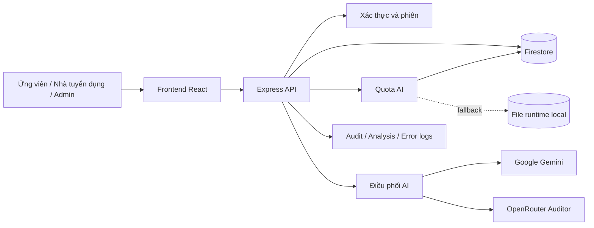
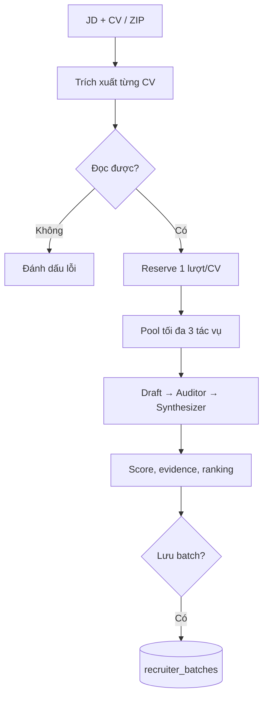
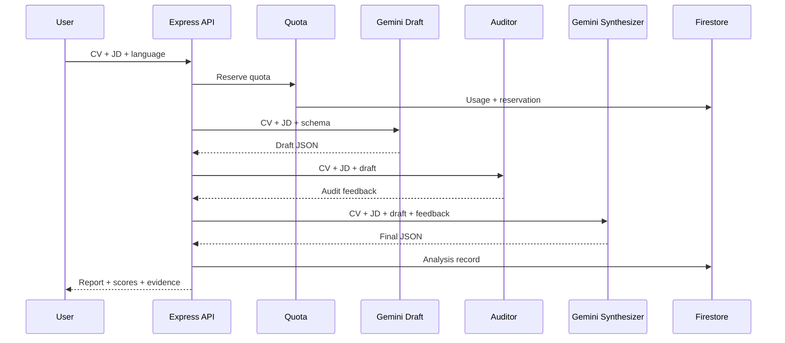
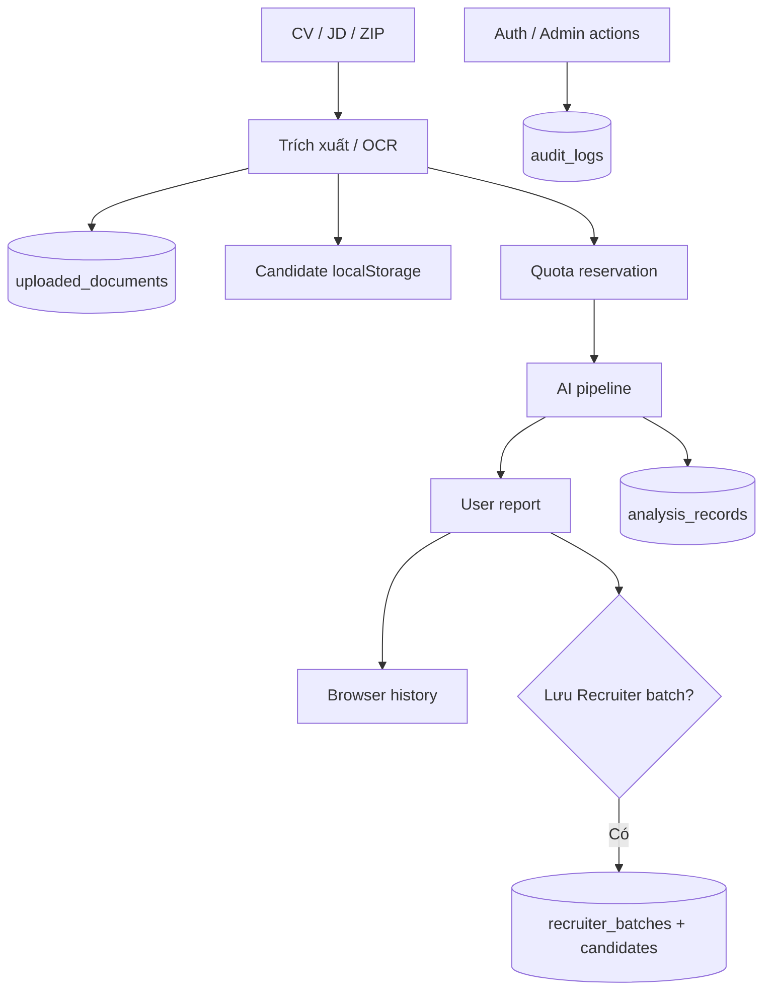
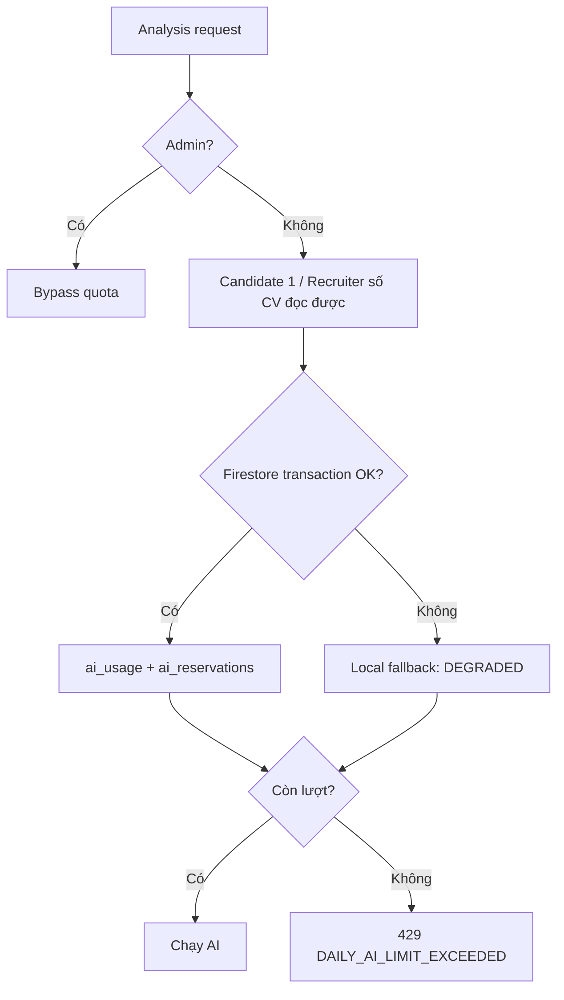

# Tài liệu vận hành và kiến trúc kỹ thuật RoleMatch dành cho Admin và CTO

> **Trạng thái tài liệu:** Bản nháp để review và phê duyệt. Chưa import vào repository.
>
> **Source được đối chiếu:** Nhánh `staging` (tích hợp đầy đủ Phase 1: Bước 1.1 -> 1.4 — Chiều Sâu Phân Tích Ứng Viên 2.0).
>
> **Mục tiêu:** giúp Admin vận hành RoleMatch an toàn; đồng thời giúp CTO hiểu kiến trúc sản phẩm, backend, pipeline AI, vòng đời dữ liệu, mô hình triển khai và các rủi ro trước production.

## Tóm tắt kiến trúc dành cho CTO

RoleMatch phân tích mức độ phù hợp giữa CV và mô tả công việc qua hai chế độ **Ứng viên** và **Nhà tuyển dụng**. Đây là hai chế độ sản phẩm, không phải role bảo mật; source chỉ phân biệt `normal` và `admin`.



Các mục 1–16 hướng dẫn vận hành Admin Dashboard; các mục 17–29 giải thích kiến trúc, backend, dữ liệu, AI và production readiness.

## 1. Phạm vi và trách nhiệm của Admin

Admin Dashboard hỗ trợ quản lý:

- Tình trạng hoạt động tổng thể của ứng dụng.
- Tài khoản người dùng và phiên đăng nhập.
- Giới hạn lượt phân tích AI hằng ngày.
- Tệp CV/JD đã được hệ thống tiếp nhận.
- Kết quả phân tích Candidate và Recruiter.
- Audit log và error log.
- Trạng thái kết nối các nhà cung cấp AI.
- Một số tùy chọn cấu hình hệ thống.

Admin không nên xem Dashboard là công cụ giám sát hạ tầng hoàn chỉnh. Một số dữ liệu được giữ trong bộ nhớ của application instance hoặc file local, nên có thể không phản ánh toàn bộ hệ thống khi Cloud Run chạy nhiều instance.

## 2. Truy cập Admin Dashboard

Chỉ tài khoản có role `admin` mới thấy nút mở Admin Dashboard và được phép gọi các API quản trị.

Sau khi đăng nhập:

1. Chọn nút **Admin Dashboard** trên header.
2. Kiểm tra đúng tài khoản và môi trường đang vận hành.
3. Chọn tab chức năng cần sử dụng.
4. Dùng nút **Làm mới / Refresh** sau các thao tác thay đổi dữ liệu.

Frontend tự động đăng xuất sau khoảng **30 phút không tương tác**, nhưng backend hết hạn session sau **15 phút không hoạt động**; bearer token có thời hạn tối đa **24 giờ**. Ba mốc chưa đồng nhất, nên API có thể từ chối session trước khi frontend tự đăng xuất.

## 3. Cấu trúc Admin Dashboard

| Tab | Mục đích chính |
|---|---|
| **Thống Kê System** | Xem số tài khoản, session, bộ nhớ, thời gian phân tích và trạng thái AI |
| **Quản Lý Người Dùng** | Tạo, sửa, khóa, mở khóa, xóa user, ngắt session và reset quota |
| **Quản Lý File CV & JD** | Tìm kiếm, xem trước, xuất hoặc xóa tài liệu đã tải lên |
| **Kết Quả Phân Tích** | Xem kết quả Candidate/Recruiter, độ trễ, lỗi pipeline và xuất dữ liệu |
| **Audit Log** | Theo dõi hành động xác thực, quản trị, AI, system và security |
| **Nhật Ký Lỗi** | Xem lỗi client/server và thông tin chẩn đoán kỹ thuật |
| **Cấu Hình System** | Quản lý quota AI; hiển thị thêm một số control đang chưa được backend thực thi |

## 4. Thống Kê System

### 4.1. Các chỉ số tổng quan

Dashboard có thể hiển thị:

- Tổng số tài khoản và phân bố `admin`/`normal`.
- Số phiên đăng nhập đang hoạt động.
- Heap memory của tiến trình Node.js.
- Thời gian phân tích trung bình.
- Số phân tích chậm hơn 120 giây.
- Trạng thái cấu hình Gemini và các provider AI khác.

Các chỉ số memory và active session chỉ phản ánh application instance đang phục vụ request. Khi Cloud Run chạy nhiều instance, số liệu này không phải số liệu tổng hợp toàn hệ thống.

### 4.2. Phiên đăng nhập

Danh sách session có thể gồm username, role, thời điểm đăng nhập, hoạt động gần nhất và địa chỉ IP.

Chỉ chọn **Ngắt phiên / Kick** khi:

- User báo không thể đăng nhập vì đã có session khác.
- Có dấu hiệu session bất thường.
- Tài khoản vừa bị khóa hoặc cần thu hồi quyền truy cập ngay.

Session hiện được giữ trong memory. Khi application restart, danh sách có thể bị xóa; ở môi trường nhiều instance, một instance có thể không thấy session nằm trên instance khác.

### 4.3. Trạng thái nhà cung cấp AI

Dashboard theo dõi ba nhóm provider:

- **Gemini:** provider chính cho draft và synthesis theo cấu hình hiện hành.
- **OpenRouter:** provider tùy chọn, thường dùng cho bước Auditor.
- **OpenAI:** provider tùy chọn hoặc dự phòng.

Trạng thái **Configured/Ready** chỉ xác nhận ứng dụng đã nhận cấu hình cần thiết. Nó không chứng minh một lượt phân tích hoàn chỉnh sẽ thành công.

Nút **Ping AI** gửi request thật tới provider và có thể sử dụng một lượng nhỏ quota hoặc chi phí API. Dùng Ping khi cần xác minh kết nối, sau đó kiểm tra cả error log và một lượt phân tích test có kiểm soát.

## 5. Quản Lý Người Dùng

### 5.1. Tìm kiếm và lọc

Admin có thể lọc theo role, trạng thái online hoặc tìm theo username/họ tên. Trước khi thay đổi một tài khoản, hãy đối chiếu cả username, role và trạng thái để tránh thao tác nhầm user.

### 5.2. Tạo tài khoản

Khi tạo tài khoản:

- Username cần tối thiểu 3 ký tự và không được trùng.
- Password cần tối thiểu 4 ký tự theo validation hiện tại.
- Chọn đúng role `normal` hoặc `admin`.
- Không gửi password qua email/chat không bảo mật.
- Yêu cầu người dùng đổi password khi quy trình vận hành hỗ trợ.

Password được lưu dưới dạng bcrypt hash, nhưng file user runtime hiện vẫn là dữ liệu nhạy cảm và không nên được commit vào Git.

### 5.3. Sửa tài khoản

Admin có thể thay đổi họ tên, role, password và trạng thái khóa. Username thường không thay đổi trong modal chỉnh sửa.

Việc đổi role thành `admin` cấp quyền truy cập toàn bộ chức năng quản trị. Chỉ thực hiện khi có phê duyệt phù hợp và ghi nhận lý do.

### 5.4. Khóa và mở khóa

Tài khoản `normal` có thể tự động bị khóa sau 5 lần nhập sai password liên tiếp hoặc bị Admin khóa thủ công.

Khi khóa user:

- Các session mà server hiện biết sẽ bị thu hồi.
- User không thể đăng nhập lại cho đến khi được mở khóa.
- Audit log ghi nhận hành động quản trị.

Khi mở khóa, hệ thống đặt lại số lần đăng nhập sai. Trước khi mở khóa, nên xác minh danh tính user và nguyên nhân bị khóa.

### 5.5. Ngắt phiên

Ngắt phiên không xóa tài khoản và không đổi password. User có thể đăng nhập lại nếu tài khoản không bị khóa.

### 5.6. Xóa tài khoản

Xóa user là thao tác phá hủy. Admin không thể tự xóa tài khoản đang đăng nhập, nhưng vẫn cần bảo đảm còn ít nhất một tài khoản Admin hoạt động trước khi xóa Admin khác.

Việc xóa user không đồng nghĩa toàn bộ CV, JD, analysis record, audit log hoặc saved batch liên quan đã được xóa. Nếu cần đáp ứng yêu cầu xóa dữ liệu cá nhân, phải kiểm tra từng collection và nguồn lưu trữ liên quan.

## 6. Giới hạn lượt phân tích AI

### 6.1. Cách quota được tính

Quota áp dụng cho tài khoản `normal` và dùng chung cho cả hai tab:

- **Cand:** số đơn vị phân tích ở tab Ứng viên.
- **Batch:** số đơn vị phân tích ở tab Nhà tuyển dụng.
- **Total:** `Cand + Batch`.
- **Daily Limit:** số đơn vị tối đa trong ngày.

Ngày quota được tính theo timezone `Asia/Ho_Chi_Minh` và reset vào 00:00 theo ngày hệ thống.

Một batch nhiều CV có thể sử dụng nhiều đơn vị quota. Admin không nên hiểu một lần bấm nút ở tab Recruiter luôn chỉ bằng một đơn vị.

### 6.2. Bật, tắt và thay đổi hạn mức

Control quota AI trong tab **Cấu Hình System** có kết nối backend. Khi thay đổi:

1. Chọn bật hoặc tắt giới hạn.
2. Chọn daily limit.
3. Chờ thông báo thành công.
4. Làm mới Dashboard.
5. Kiểm tra lại user test và chạy một lượt phân tích có kiểm soát.

Sản phẩm xác định hạn mức mặc định mong muốn là **5 lượt/ngày**. Tuy nhiên source được review vẫn không nhất quán: một số fallback/backend dùng `5`, trong khi UI và file runtime đang ghi hoặc gắn nhãn `10` là mặc định. Trước khi vấn đề này được sửa, hãy xem giá trị đã đọc lại từ backend sau Refresh là giá trị đang có hiệu lực; không chỉ dựa vào nhãn “Mặc định” trên dropdown.

### 6.3. Ý nghĩa trạng thái quota

| Trạng thái | Ý nghĩa | Hành động Admin |
|---|---|---|
| **HEALTHY** | Firestore là nguồn chính và counters hợp lệ | Tiếp tục theo dõi bình thường |
| **DEGRADED (Local Fallback)** | Hệ thống đang dùng hoặc ưu tiên dữ liệu local | Kiểm tra Firestore, environment và application logs; không coi đây là trạng thái ổn định |
| **NORMALIZED** | Hệ thống phát hiện dữ liệu không nhất quán và đã chuẩn hóa hoặc chọn nguồn an toàn hơn | Refresh, đối chiếu lại user và theo dõi lượt phân tích tiếp theo |
| **ERROR** | Không thể đọc hoặc xác định quota đáng tin cậy | Tạm dừng test quota cho user và xử lý backend/storage |

`DEGRADED` không có nghĩa quota hoàn toàn ngừng hoạt động. Nó có nghĩa quota đang phụ thuộc vào file local, vốn không chia sẻ ổn định giữa nhiều Cloud Run instance và có thể thay đổi sau restart/deploy.

### 6.4. Reset quota cho một user

Nút **Reset AI** chỉ áp dụng cho tài khoản `normal` và đặt lại số lượt của ngày hiện tại:

```text
Cand 0 | Batch 0 | Total 0
```

Quy trình an toàn:

1. Ghi nhận quota trước reset.
2. Chọn đúng user và bấm **Reset AI**.
3. Xác nhận modal.
4. Chờ response hoàn tất.
5. Refresh danh sách user.
6. Xác nhận cả Cand, Batch và Total đều bằng 0.
7. Kiểm tra `storageSource` và `quotaHealth`.
8. Nếu cần, cho user chạy đúng một lượt test rồi Refresh lại.

Nếu API trả partial failure, giao diện không được coi reset là thành công. Khi đó cần kiểm tra Firestore và local storage trước khi cho user tiếp tục sử dụng, vì hai nguồn có thể chứa counters khác nhau.

Reset quota không thay đổi daily limit và không xóa analysis record đã tạo trước đó.

## 7. Quản Lý File CV & JD

Tab này hiển thị các tài liệu hệ thống đã tiếp nhận, gồm tên tệp, loại CV/JD, định dạng, kích thước, số ký tự, người tải lên và thời điểm tải.

Admin có thể:

- Tìm kiếm và lọc theo loại hoặc định dạng.
- Xem trước nội dung đã trích xuất.
- Xuất nội dung hoặc metadata khi cần chẩn đoán.
- Xóa từng tệp hoặc xóa toàn bộ.

CV và JD có thể chứa dữ liệu cá nhân, lịch sử nghề nghiệp, email, số điện thoại và thông tin tuyển dụng nội bộ. Chỉ xuất dữ liệu khi có mục đích vận hành rõ ràng; không chia sẻ bản export qua kênh công cộng.

Trước khi xóa toàn bộ:

1. Kiểm tra bộ lọc không làm Admin hiểu sai phạm vi.
2. Xuất dữ liệu cần giữ lại.
3. Xác nhận môi trường test/production.
4. Thực hiện xóa.
5. Refresh và kiểm tra lại.

## 8. Kết Quả Phân Tích

Tab này tập hợp analysis records từ cả Candidate và Recruiter.

### 8.1. Trạng thái record

| Trạng thái | Cách hiểu |
|---|---|
| **COMPLETED** | Pipeline trả kết quả hợp lệ |
| **NO_SCORE** | Có response nhưng không có Overall Score hợp lệ |
| **FAILED** | Pipeline hoặc provider gặp lỗi |

### 8.2. Phân loại độ trễ

| Mức | Thời gian |
|---|---:|
| **FAST** | Dưới 60 giây |
| **NORMAL** | Từ 60 đến 120 giây |
| **SLOW** | Trên 120 giây |

Một record chậm không nhất thiết là lỗi. Hãy đối chiếu provider, số lượng CV, độ dài tài liệu, pipeline step và error log.

### 8.3. Pipeline AI

Chi tiết record có thể thể hiện ba bước:

1. **Draft Analysis:** tạo phân tích ban đầu.
2. **Auditor Check:** phản biện và kiểm tra kết quả draft.
3. **Synthesizer:** tổng hợp báo cáo cuối cùng.

Khi điều tra một kết quả bất thường, xác định bước nào thất bại hoặc thiếu dữ liệu trước khi chạy lại.

### 8.4. Xóa record và xóa cache

Xóa analysis record là thao tác phá hủy dữ liệu tập trung. Nó không bảo đảm xóa candidate history trong browser hoặc saved recruiter batch.

**Clear Cache** chỉ xóa cache trong memory của instance đang xử lý request. Nó không xóa Firestore records, CV/JD hay saved batch; ở môi trường nhiều instance, cache trên instance khác có thể vẫn còn.

## 9. Audit Log

Audit log dùng để trả lời: **ai đã thực hiện hành động gì, khi nào và kết quả ra sao**.

Các category gồm:

- `AUTH`
- `USER_MGMT`
- `AI_SERVICE`
- `SYSTEM`
- `SECURITY`

Các status thường gồm `success`, `warning` và `error`.

Khi điều tra sự cố:

1. Lọc theo username hoặc action.
2. Chọn khoảng thời gian liên quan.
3. Đối chiếu status và details.
4. So sánh với error log và analysis record.
5. Export log cần thiết trước khi xóa.

Audit log hiện không phải hệ thống log bất biến hoặc compliance-grade. Dữ liệu có thể phụ thuộc vào Firestore hoặc file/runtime storage theo trạng thái môi trường.

## 10. Nhật Ký Lỗi

Error log dùng để trả lời: **thành phần kỹ thuật nào gặp lỗi và lỗi xảy ra ở đâu**.

Log có thể gồm:

- Level: `error`, `warn`, `info`.
- Source: `client` hoặc `server`.
- Endpoint liên quan.
- Message, details và stack trace.
- Timestamp và user agent.

Khác biệt cần nhớ:

- Audit log ghi hành động người dùng/quản trị.
- Error log ghi lỗi kỹ thuật.

Không đưa stack trace hoặc log chứa CV/JD, token hay thông tin nhạy cảm vào ticket công khai.

Theo source hiện tại, các endpoint đọc, gửi và xóa error log chưa kiểm tra quyền Admin đầy đủ ở backend. Vì vậy tab có nhãn “Admin Only” nhưng chưa thể được xem là ranh giới bảo mật hoàn chỉnh. Đây là vấn đề cần sửa trước production.

## 11. Cấu Hình System: tính năng thật và control UI-only

| Control | Trạng thái trong source được review |
|---|---|
| **AI Analysis Quota** | Có lưu/cập nhật qua backend và ảnh hưởng Candidate + Recruiter |
| **Maintenance Mode** | Chỉ thay đổi state trên giao diện; chưa được backend thực thi |
| **API Rate Limit** | Dropdown không điều khiển backend; middleware thực tế cố định ở **50 request/phút/IP** |
| **Max Upload Size** | Dropdown không điều khiển backend; Multer thực tế giới hạn **15 MB/tệp** |

Admin không nên dựa vào thông báo “Đã bật chế độ bảo trì” để cho rằng normal users đã bị chặn. Tương tự, thay đổi Rate Limit hoặc Max Upload Size trên Dashboard hiện chưa tạo ra thay đổi vận hành đáng tin cậy.

## 12. Runbook xử lý sự cố

### 12.1. User bị chặn vì hết quota

1. Xác nhận đúng username và ngày hiện tại.
2. Kiểm tra Cand, Batch, Total và Daily Limit.
3. Kiểm tra `quotaHealth` và `storageSource`.
4. Nếu counters đúng, giải thích hạn mức hoặc reset khi có phê duyệt.
5. Nếu counters sai hoặc `DEGRADED`, kiểm tra Firestore và logs trước khi reset nhiều lần.

### 12.2. Dashboard vẫn hiển thị số cũ sau reset

1. Refresh danh sách user.
2. Đóng và mở lại Admin Dashboard.
3. Kiểm tra response reset có `success: true` hay partial failure.
4. Kiểm tra storage source.
5. Cho user chạy một request test duy nhất.
6. Nếu số liệu lại khác nhau, dừng test và xử lý reconciliation Firestore/local.

### 12.3. AI provider báo lỗi

1. Kiểm tra provider có được cấu hình không.
2. Dùng Ping AI một lần.
3. Kiểm tra HTTP status, error message và provider quota.
4. Kiểm tra analysis record để xác định bước Draft/Auditor/Synthesizer.
5. Không chạy lặp lại hàng loạt vì có thể phát sinh chi phí và tạo record trùng.

### 12.4. User không đăng nhập được

1. Kiểm tra tài khoản có tồn tại và bị khóa không.
2. Kiểm tra failed login attempts.
3. Kiểm tra active session.
4. Ngắt session cũ nếu phù hợp.
5. Mở khóa hoặc đổi password sau khi xác minh user.
6. Kiểm tra audit log và trạng thái Firestore.

## 13. Bảo mật và dữ liệu cá nhân

- Không chia sẻ bearer token, API key hoặc password hash.
- Không tải CV/JD thật vào ticket hoặc công cụ công cộng.
- Chỉ cấp role Admin theo nguyên tắc tối thiểu cần thiết.
- Export dữ liệu phải có mục đích và thời gian lưu rõ ràng.
- Bảo vệ ít nhất hai tài khoản Admin để tránh mất quyền quản trị.
- Không commit file runtime chứa user, quota, audit log hoặc recruiter batch.
- Kiểm tra Firestore Rules trước mỗi deployment.

Firestore Rules trong source hiện cho phép public read/write đối với các collection chính cho đến ngày `2026-09-30`. Đây là cấu hình test/development và không an toàn cho production.

## 14. Các giới hạn kỹ thuật đã xác minh

1. Authentication và quota vẫn có local fallback.
2. Session và cache nằm trong memory, không đồng bộ giữa nhiều instance.
3. Runtime data vẫn được theo dõi trong Git.
4. Một nhóm quota test vẫn đọc/xóa/ghi trực tiếp `data/ai_usage.json`.
5. Quota mặc định `5` và `10` chưa thống nhất.
6. Maintenance Mode là UI-only; dropdown Rate Limit và Max Upload không điều khiển các giới hạn backend cố định.
7. Error-log endpoints chưa được bảo vệ đầy đủ ở backend.
8. Firestore Rules đang mở cho test đến `2026-09-30`.
9. Nhánh `main` hiện chưa bật branch protection.
10. Commit được review chưa có GitHub status check hoặc workflow run chứng minh lint/test/build đã pass.

## 15. Checklist vận hành hằng ngày

### Đầu ngày

- Kiểm tra System Overview.
- Kiểm tra provider AI và các lỗi mới.
- Kiểm tra user bị khóa bất thường.
- Kiểm tra quota health có xuất hiện `DEGRADED` hoặc `ERROR`.

### Trước thay đổi quan trọng

- Xác nhận đúng môi trường.
- Ghi nhận trạng thái trước thay đổi.
- Export dữ liệu cần giữ.
- Thực hiện một thay đổi tại một thời điểm.
- Refresh và xác minh lại.

### Cuối ngày hoặc sau test lớn

- Kiểm tra analysis failures và slow records.
- Kiểm tra audit/error logs.
- Đối chiếu quota của user test.
- Xóa dữ liệu test theo quy trình đã phê duyệt, không xóa hàng loạt tùy tiện.

## 16. Nguyên tắc ra quyết định của Admin

- Không xem một thông báo thành công trên UI là bằng chứng duy nhất; luôn đọc lại dữ liệu sau thao tác quan trọng.
- Không xem `DEGRADED` là trạng thái bình thường dài hạn.
- Không chạy lại AI hàng loạt để thử lỗi chưa rõ nguyên nhân.
- Không xóa dữ liệu trước khi xác định phạm vi và phương án khôi phục.
- Không sử dụng control UI-only như một biện pháp bảo mật hoặc vận hành thật.
- Khi dữ liệu Firestore và local khác nhau, ưu tiên bảo toàn dữ liệu và dừng thao tác thay đổi cho đến khi xác định nguồn có thẩm quyền.

## 17. Kiến trúc sản phẩm và backend

| Tầng | Thành phần | Trách nhiệm |
|---|---|---|
| Trình duyệt | React 19, TypeScript, Vite 6, Tailwind CSS 4 | UI Candidate, Recruiter, Admin; lịch sử cục bộ; gọi API |
| Backend | Node.js, Express, chủ yếu trong `server.ts` | Authentication, API, file, AI orchestration, audit và persistence |
| Quota | `quotaService.ts` | Hạn mức, reservation, usage, health và reset |
| AI chính | Google Gemini | Draft, synthesis, OCR và xử lý văn bản |
| AI kiểm tra | OpenRouter; Gemini dự phòng | Audit bản nháp khi provider khả dụng |
| Dữ liệu tập trung | Firestore | User, settings, usage, records, documents, audit, batches |
| Dữ liệu dự phòng | File runtime và process memory | Fallback tạm thời; không phải storage production bền vững |

Frontend và backend được phục vụ từ cùng ứng dụng. Development dùng Vite middleware; production phục vụ frontend từ `dist` và chạy `dist/server.cjs`. Source không có durable queue hay worker AI tách riêng; batch xử lý trong vòng đời HTTP request. Startup đọc local data, mở HTTP listener rồi đồng bộ Firestore bất đồng bộ, nên trạng thái ngay sau restart có thể thay đổi sau khi sync hoàn tất.

## 18. Authentication, session và authorization

Tài khoản dùng username/password với hash bcrypt. Backend ký bearer token HMAC-SHA256 bằng `JWT_SECRET` và giữ active session trong `Map` của từng application instance.

| Cơ chế | Giá trị source | Tác động |
|---|---|---|
| Backend inactivity timeout | 15 phút | API có thể từ chối trước UI |
| Frontend inactivity timeout | 30 phút | UI có thể còn hiển thị phiên đã hết ở backend |
| Bearer token lifetime | 24 giờ | Token hợp lệ không bảo đảm session còn tồn tại |
| Active sessions | Memory từng instance | Không đồng bộ tự động giữa Cloud Run instances |

Admin routes thường kiểm tra `getUserFromRequest(req)` và `role === 'admin'`. Normal user chỉ truy cập recruiter batches của mình; Admin có thể xem toàn bộ.

**Rủi ro:** source có `JWT_SECRET` fallback hardcode. Production phải dùng secret mạnh, duy nhất trong secret manager và không được khởi động nếu thiếu. Error-log APIs cũng chưa có backend Admin authorization đầy đủ.

## 19. Tiếp nhận file và trích xuất nội dung

`POST /api/extract-text` dùng `multer.memoryStorage()`, giới hạn thực tế **15 MB/tệp**. Mỗi trường CV/JD dạng text bị giới hạn **100.000 ký tự**.

| File | Cách xử lý |
|---|---|
| DOCX | `mammoth` |
| PDF có text | `pdf-parse` |
| PDF scan hoặc text dưới ngưỡng | Gemini Vision OCR |
| Ảnh | Gemini Vision OCR |
| TXT, MD, CSV, RTF | Đọc dạng text/UTF-8 |
| DOC cũ | Thử nhánh text hoặc OCR phù hợp |
| ZIP Recruiter | Nhận `.pdf`, `.docx`, `.doc`, `.txt`, `.rtf`, `.md` |

Recruiter nhận tối đa **15 CV/batch**. Chỉ CV trích xuất được nội dung mới được đưa vào `requestedUnits`. Metadata và full extracted text có thể được lưu trong `uploaded_documents`; đây là dữ liệu cá nhân nhạy cảm.

## 20. Luồng Candidate end-to-end

1. User nhập/tải CV và JD; frontend có thể giữ nội dung và history trong browser `localStorage`.
2. File được trích xuất; PDF scan hoặc ảnh có thể gọi Gemini OCR.
3. Frontend gọi `POST /api/analyze-cv` với CV, JD, ngôn ngữ và câu trả lời bổ sung.
4. Backend xác thực và reserve **1 lượt** cho normal user; Admin bypass quota.
5. Backend chạy Draft → Auditor → Synthesizer.
6. Response hoàn chỉnh theo schema gồm 4 nhóm tính năng chính và metadata:
   - `companyName`, `jobTitle`: Trích xuất trực tiếp từ JD / AI.
   - `feature1`: `scores` (kèm `projectedOverallScore`, 4 trường `rationale` giải trình điểm số), `jdKeywords` (phân loại `isMustHave`), `comparisonTable` (đánh dấu `isMustHave`, vị trí chèn `targetSection`, câu mẫu gợi ý `suggestedPhrasing` kèm sao chép 1-Click), `summary`.
   - `feature2`: `tailoredSummaries` (2 bản tóm tắt mở đầu may đo 50–200 từ: Chuyên môn/Kỹ thuật vs Quản trị/Kinh doanh), `sectionAudit` (đánh giá cấu trúc 4 phần CV, điểm hoàn thiện 0–100%, trạng thái, nhận xét, đề xuất điều chỉnh, `suggestedSnippets` chống bịa đặt), `rewrittenBullets` (chuẩn XYZ/STAR kèm `embeddedKeywords`, `metricPlaceholders`), `clarifyingQuestions`.
   - `feature3`: `recruiterQuickScan` (ấn tượng 10s, quyết định YES/MAYBE/NO, điểm mạnh, nghi ngờ chính, top 3 must-fix), `seniorityFitAssessment` (đánh giá tầm vóc 4 trục: Cấp bậc/Thâm niên, Quy mô dự án, Mức độ tự chủ, Độ khớp ngành), `riskMitigationMatrix` (nhận diện Red Flags, e ngại của HR, chiến lược hóa giải trên CV và phỏng vấn).
   - `feature4`: `interviewPrep` (bộ 5–10 câu hỏi phỏng vấn thực chiến xoáy sâu chia theo 3 nhóm danh mục, kèm `interviewerIntent`, khung trả lời `starAnswerGuide` bám sát CV thật, và `pitfallToAvoid`).
7. Backend lưu `analysis_records`; frontend hiển thị và có thể lưu browser history.

Quota hiện được reserve **trước** kiểm tra maximum-length và trước cache hit. Do đó request quá dài hoặc kết quả lấy từ cache vẫn có thể tiêu thụ lượt mà không có AI execution mới.

## 21. Luồng Recruiter batch end-to-end

1. Recruiter nhập một JD và tải nhiều CV hoặc ZIP.
2. Backend trích xuất từng file, loại file không đọc được khỏi số lượt.
3. Reserve số lượt bằng số CV đọc được.
4. Xử lý các CV hợp lệ với concurrency pool tối đa **3**.
5. Mỗi CV chạy pipeline riêng với cùng JD.
6. Frontend tạo leaderboard, match level, detail và recommendation.
7. Saved batch có thể chứa JD, CV text và full analysis; quyền mở lại được kiểm tra theo owner.



Quota được reserve trước khi toàn bộ tác vụ AI hoàn tất. Source chưa có cơ chế refund tự động đáng tin cậy nếu candidate lỗi ở bước sau.

## 22. Pipeline AI ba bước

### 22.1. Draft Analysis — Gemini

Gemini nhận CV, JD, app language và clarifying answers. Prompt yêu cầu JSON theo `analysisResponseSchema`, temperature khoảng `0.2`, rồi trích xuất keyword, comparison, score, gap, bullet rewrite và quick scan.

### 22.2. Auditor — OpenRouter hoặc Gemini

Auditor nhận CV/JD gốc và draft để kiểm tra yêu cầu bỏ sót, score, evidence, rủi ro và độ chính xác của bullet. Khi có `OPENROUTER_API_KEY`, backend thử danh sách model hardcode, timeout khoảng **4 giây/model**; nếu thất bại thì dùng Gemini Auditor. `OPENROUTER_MODEL` có thể hiện trên Dashboard nhưng không điều khiển danh sách model thực tế trong `runAuditorStep`.

### 22.3. Synthesizer — Gemini

Gemini kết hợp CV/JD, draft và audit feedback để tạo final JSON. Giải thích theo ngôn ngữ app; bullet rewrite phải giữ ngôn ngữ bullet gốc.



`pipelineMetadata` ghi provider, duration, step status và feedback. Tuy nhiên có nhánh vẫn ghi `completed` khi Auditor thất bại hoặc Synthesizer trả lại draft. Metadata chưa phải bằng chứng tuyệt đối cả ba bước đã chạy thành công.

## 23. Kết quả, score và tính toàn vẹn bằng chứng

| Nhóm | Thành phần | Ý nghĩa |
|---|---|---|
| `feature1` | JD keywords, comparison table, scores, summary | Mức phù hợp, điểm mạnh, khoảng trống |
| `feature2` | Clarifying questions, rewritten bullets | Cải thiện CV dựa trên thông tin thật |
| `feature3` | Invite decision, 10-second impression, doubt, top fixes | Góc nhìn sàng lọc của recruiter |

Score gồm `keywordMatchScore`, `skillMatchScore`, `experienceOutcomeScore`, `overallRoleScore`. Overall là đánh giá AI, không phải xác suất được tuyển hay trung bình có trọng số cố định đã được source chứng minh. Recruiter mapping: 85–100 Very High; 70–84 High; 50–69 Medium; dưới 50 Low; không có điểm là NOT_AVAILABLE.

- **EVIDENCE:** được CV/JD hỗ trợ trực tiếp.
- **INFERENCE:** nhận định hợp lý nhưng chưa xác nhận.
- **MISSING:** thiếu dữ liệu; phải hỏi lại, không tự điền.
- **NGUYÊN TẮC CHỐNG BỊA ĐẶT (GROUNDED ANTI-HALLUCINATION):** Toàn bộ các đề xuất mở đầu, mẫu câu tham khảo (`suggestedSnippets`), bullet points viết lại và khung trả lời phỏng vấn STAR đều bị ràng buộc nghiêm ngặt trong AI prompt và backend schema: *BẮT BUỘC phải dựa trên thông tin thực tế từ CV của ứng viên, TUYỆT ĐỐI KHÔNG tự ý sáng tạo hay bịa đặt kinh nghiệm/kỹ năng/số liệu ngoài CV*.

Fallback hiện có thể tạo kỹ năng mặc định hoặc thành tích **“25% efficiency gain”**, **“saving 15 hours weekly”** dù CV không có. Một số nhánh vẫn ghi `COMPLETED`. Đây là rủi ro **P0 về tính trung thực**: tuyệt đối không đưa thành tích, chứng chỉ hoặc kỹ năng chưa xác minh vào CV thật. Một số Candidate logs còn dùng fallback score `75`/`65` khi score thiếu hoặc bằng `0`; Admin cần đối chiếu report gốc.

## 24. Vòng đời dữ liệu



| Storage | Nội dung | Rủi ro |
|---|---|---|
| Browser `localStorage` | Token, activity, CV, JD, Candidate history | Xóa server không đồng nghĩa xóa browser |
| Process memory | Session, rate-limit counters, cache, selected logs | Mất khi restart; riêng từng instance |
| Firestore | Users, records, documents, batches, quota, audit | Cần rules/IAM, backup, retention |
| Local runtime files | Users, usage, settings, audit, batches | Ephemeral, lệch giữa instance, không nên commit |

Collections chính: `users`, `analysis_records`, `audit_logs`, `uploaded_documents`, `recruiter_batches`, subcollection `candidates`, `system_settings/ai_quota`, `ai_usage`, `ai_reservations`. CV/JD, extracted full text và full analysis đều có thể chứa dữ liệu nhạy cảm. Xóa một analysis record không bảo đảm xóa upload, browser history, batch snapshot hay audit copy.

## 25. Quota và reservation

Quota dùng khóa **user + ngày**, timezone `Asia/Ho_Chi_Minh`, cộng chung Candidate và Recruiter. Default nghiệp vụ là **5 lượt/ngày**, nhưng source legacy vẫn có `10`; phải đọc effective setting từ backend.



Reservation dùng request ID đã hash để giảm tính trùng. `DEGRADED` nghĩa là quota dựa vào storage local, không atomic giữa instance và có thể mất sau deploy. Xử lý dứt điểm cần sửa Firestore connectivity, IAM/auth, project config, xác minh transaction read/write, reconcile usage rồi mới giảm/bỏ fallback. Reset chỉ thành công khi nguồn enforcement ghi và đọc lại `candidateUnits = recruiterUnits = totalUnits = 0`.

## 26. Bản đồ API

| Nhóm | Endpoint chính |
|---|---|
| Auth | `POST /api/auth/login`, `/register`, `GET /api/auth/me`, `POST /api/auth/logout` |
| File | `POST /api/extract-text` |
| Candidate | `POST /api/analyze-cv`; `GET/POST/PUT/DELETE /api/candidate/history` (Phase 2 Cloud Sync) |
| Recruiter | `POST /api/batch-analyze`; `GET/POST/DELETE /api/recruiter/batches` |
| CV utilities | `POST /api/format-cv-text`, `/api/generate-updated-cv` |
| Admin users | `GET/POST/DELETE /api/admin/users`; lock, unlock, terminate-session, reset-limit |
| Admin data | `/api/admin/stats`, `/audit-logs`, `/documents`, `/analyses` |
| Admin config | `POST /api/admin/settings`, `/ping-ai`, `/clear-cache` |
| Health/logs | `GET /api/health`, `GET/POST /api/logs`, `POST /api/logs/clear` |

`/api` có rate limit cố định **50 request/phút/IP**, counter nằm trong local `Map`; không phải distributed limiter và dropdown Admin không thay đổi nó.

## 27. Deployment và biến môi trường

| Thành phần | Mục đích |
|---|---|
| `npm run build` | Build Vite và bundle backend esbuild vào `dist/server.cjs` |
| `npm start` | Chạy production server |
| `PORT` | Cloud Run port; server listen `0.0.0.0` |
| `NODE_ENV=production` | Bật serving production |
| `GEMINI_API_KEY` | Gemini Draft, Synthesizer, OCR; cần kiểm tra bằng request thật |
| `OPENROUTER_API_KEY` | Auditor OpenRouter; thiếu thì fallback Gemini |
| `JWT_SECRET` | Ký token; phải là secret riêng |
| `OPENAI_API_KEY` | Provider/config tương ứng nếu dùng; không chứng minh là auditor chính |
| `APP_URL` | Provider referrer/metadata khi cần |

`GET /api/health` chỉ trả process status và timestamp; không kiểm tra Firestore, AI, quota transaction, rules hay secrets. Đây là liveness, không phải readiness. Cloudflare Access/Zero Trust, SSO hoặc reverse proxy nếu có phải được ghi là lớp bổ sung; source này chưa chứng minh chúng đã triển khai.

## 28. Risk register dành cho CTO

| Mức | Rủi ro | Hành động ưu tiên |
|---|---|---|
| P0 | Firestore Rules public read/write đến `2026-09-30` | Khóa rules; dùng least-privilege IAM/service identity |
| P0 | `JWT_SECRET` fallback hardcode | Secret manager; fail startup nếu thiếu |
| P0 | AI fallback bịa skill hoặc số liệu | Loại fabrication; enforce EVIDENCE/INFERENCE/MISSING |
| P0 | Error-log APIs thiếu Admin auth đầy đủ | Enforce authentication và role ở backend |
| P1 | Critical state nằm trong local/memory | Chuyển sang shared durable storage |
| P1 | Session 15m/30m/24h không nhất quán | Chuẩn hóa session policy |
| P1 | Quota reserve trước validation/cache, thiếu refund | Đổi thứ tự hoặc hoàn lượt an toàn |
| P1 | Default quota `5`/`10` | Chuẩn hóa `5` |
| P1 | Tests chạm runtime files, Git track runtime data | Isolate fixtures; untrack an toàn |
| P1 | AI step status có thể báo completed sai | Ghi status/provider trung thực |
| P1 | Health không kiểm tra dependencies, limiter theo instance | Readiness probe và shared limiter |

## 29. Checklist production readiness

1. Firestore/service identity dùng least privilege; không còn public rules.
2. Provider keys và `JWT_SECRET` nằm trong secret manager.
3. Default quota thống nhất **5 lượt/ngày**, shared giữa Candidate/Recruiter, reservation và reset có transaction/verification.
4. `HEALTHY` chỉ khi Firestore thật hoạt động; `DEGRADED` có runbook và deadline.
5. AI không tạo thành tích/kỹ năng/chứng chỉ thiếu bằng chứng; fallback không giả danh kết quả hoàn chỉnh.
6. Logs, sessions, uploads và batches có authorization, retention, backup, deletion policy.
7. CI chạy lint/test/build; tests không chạm runtime; production branch được bảo vệ.
8. Test multi-instance cho quota, session, cache, rate limit và saved batches.
9. Readiness probe kiểm tra Firestore/provider; monitoring theo dõi error, latency, cost và quota anomalies.
10. Phân biệt rõ tính năng **đã triển khai**, **giới hạn hiện tại** và **kiến trúc mục tiêu**.
