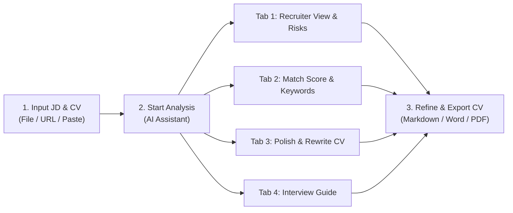
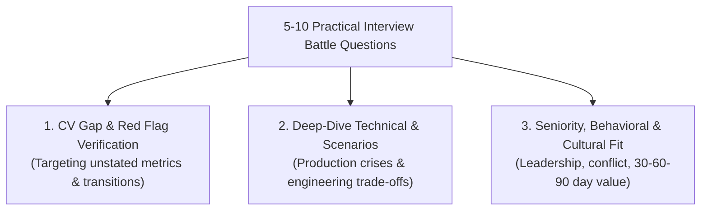

# RoleMatch User Guide for Candidates

> **Purpose:** Help you understand how recruiters and hiring managers evaluate your profile, identify capability gaps against a target Job Description (JD), master profile risk management, and thoroughly polish your CV and interview readiness based strictly on authentic experience.

---

## 1. What does RoleMatch help you do?

RoleMatch analyzes and contrasts your current CV against a specific **Job Description (JD)** through a deep multi-dimensional evaluation pipeline:

- **Recruiter 10-Second Scan & 4-Dimension Seniority Fit:** Understand initial screening impressions, interview recommendations (`YES` / `MAYBE` / `NO`), evaluate alignment across seniority level, project complexity, leadership autonomy, and domain fit, while pinpointing red flags and clear mitigation plans.
- **Transparent Score Rationale & Actionable Comparison Table:** Inspect exact reasons behind match scores, see your projected score after optimization (`projectedOverallScore`), separate essential Must-Haves from bonus Nice-to-Haves, and receive exact target placement suggestions and ready-to-use phrasing snippets.
- **Section-by-Section CV Audit & XYZ / STAR Bullet Rewriting:** Access 2 tailored executive summaries (50–200 words) positioned for the target company and role, review a structural audit across 4 core CV sections with grounded suggested snippets, and upgrade bullet points with embedded JD keywords and quantitative metric placeholders.
- **Practical Interview Battle Guide (5–10 Deep-Dive Questions):** Practice with 5 to 10 dynamically generated questions categorized across 3 battle-tested tracks, uncovering interviewer intent, STAR answer frameworks grounded in your actual CV, and dangerous pitfalls to avoid.
- **Generate a Full AI-Polished CV:** Leverage the AI Assistant to generate a cohesive updated CV tailored to the JD, preview diff comparisons against your original CV, and export cleanly to Markdown, DOCX, or PDF.

> [!IMPORTANT]
> RoleMatch helps you articulate your genuine competencies and strategic value; it does not replace or guarantee real hiring outcomes. Every detail in your CV must strictly reflect your actual skills, responsibilities, and achievements.

---

## 2. Quick workflow

1. Sign in and select the **Candidate** mode.
2. Paste text, upload files, or click **Import Link** (supports automatic scraping from LinkedIn, ITviec, TopCV, VietnamWorks, etc.).
3. Verify the extracted content in both the JD and CV text panes.
4. Click **Start CV Analysis Now**.
5. Open **1. Recruiter View & Risks** to review interview recommendations, the 10-second scan, 4-dimension seniority fit, and the risk mitigation matrix.
6. Open **2. Match Score & JD Keywords** to see score rationales, projected potential scores, and the Must-Have vs Nice-to-Have breakdown with 1-click snippets.
7. Open **3. Polish & Rewrite CV** to choose a tailored executive pitch (50–200 words), inspect the 4-section structural review with suggested snippets, and adopt rewritten STAR/XYZ bullets.
8. Open **4. Interview Battle Guide (5–10 Qs)** to rehearse targeted questions using the STAR framework.
9. Click **Update CV (AI)** to let the AI Assistant draft a unified CV version, then export to Word/PDF or copy directly.

---

## 3. Prepare the job description and your CV

### 3.1. What should the job description include?

Use the exact JD for the position you are targeting. An effective JD includes:

- Precise job title and seniority expectation (Junior, Mid, Senior, Lead, Manager, Director).
- Key responsibilities and scope of ownership.
- Core technical skills, required toolchains, and work methodologies.
- Distinction between **Must-Have** prerequisites and **Nice-to-Have** preferences.
- System scale, engineering architecture, or specialized industry domain.

Brief or fragmented JDs may reduce the nuance and differentiation of the analysis.

### 3.2. What should your CV include?

Prioritize verifiable, authentic professional details:

- Work history: Clear job titles, employer company names, and dates of tenure.
- Direct individual contributions (clearly distinguishing your responsibilities from overall team outputs).
- Tools, frameworks, languages, and methodologies personally utilized in production.
- Scope context: Active user base, data volumes, revenue impact, or team size led.
- Measurable outcomes and metrics (growth percentages, latency cuts, hours saved, bug reduction rates).

### 3.3. Upload a file, import from a link, or paste text

- **Direct Paste:** Ideal when you already have clean plain text.
- **File Upload:** Accepts **PDF**, **DOCX**, **DOC**, **TXT**, and **Markdown** (up to **15 MB per file**). Scanned or image-based PDFs automatically invoke intelligent OCR recognition.
- **Import Link (JD URL Extractor):** Paste live links from LinkedIn, ITviec, TopCV, VietnamWorks, CareerViet, Glints, and others. If the portal requires authentication (Auth Wall / Cloudflare), a secure popup opens for you to log in, accompanied by a **1-Click AI Clipboard Extractor** that extracts and cleans the JD instantly.

### 3.4. Format your CV before analysis

The **Format Standard CV** utility restructures unorganized text into a clean, modern layout, allowing seamless switching between raw markdown and a formatted preview.

---

## 4. Start the analysis

When you click **Start CV Analysis Now**, the AI Assistant runs an end-to-end verification pipeline (Draft → Auditor → Synthesizer) and presents results across **4 dedicated tabs**:

1. **Tab 1: Recruiter View & Risks (`RecruiterScanTab`)**
2. **Tab 2: Match Score & JD Keywords (`KeywordMatchTab`)**
3. **Tab 3: Polish & Rewrite CV (`BulletPointRewriteTab`)**
4. **Tab 4: Interview Battle Guide (`InterviewPrepTab`)**

Results are custom-generated for the current JD and CV combination. If you target a new job or substantially edit your CV, re-run the analysis to refresh all insights.

---

## 5. Recruiter View & Risks (Tab 1)

This tab simulates how an experienced Senior HR Recruiter or Hiring Manager screens your resume during an initial evaluation.

### 5.1. Interview recommendation & 10-second initial scan

| Recommendation | Interpretation | Your Recommended Action |
|:---:|---|---|
| **YES** | Profile shows strong, explicit alignment with core JD requirements. | Review Must-Have criteria and solidify evidence for upcoming interview rounds. |
| **MAYBE** | Profile has solid potential but reveals notable gaps or doubts to verify. | Review identified risks and add clarifying evidence before submitting. |
| **NO** | Profile does not yet demonstrate adequate alignment with JD expectations. | Review rejection drivers: expand on unstated authentic experience or reassess role fit. |

The decision is supported by 10-second first impressions, key strengths, the recruiter's biggest doubt, and the top 3 must-fix items.

### 5.2. 4-Dimension Seniority & Scope Fit Assessment

The system evaluates your CV against the JD across **4 fundamental axes**:

1. **Seniority & Experience Level:** Compares years of practice, industry standing, and organizational rank against role expectations.
2. **System Complexity & Project Scale:** Evaluates whether past project scale, user concurrency, system architecture, or operational budget match the company's scope.
3. **Scope of Autonomy & Leadership:** Determines whether you operate as an individual contributor, lead technical solutioning, or manage people and teams.
4. **Domain & Industry Fit:** Assesses familiarity with specific business domains (Fintech, E-commerce, EdTech, Logistics, B2B SaaS, etc.).

**Seniority Fit Conclusion:**
- `Strong Fit (Đúng tầm)`: Competency and operational scale match the role's expectations.
- `Junior / Gap (Chưa tới tầm)`: Emphasize rapid learning agility, adaptability, and high-impact stretch projects.
- `Overqualified (Vượt tầm)`: Explicitly communicate career rationale, motivators, and commitment to the role.

### 5.3. Risk Radar & Mitigation Matrix

Every potential red flag that recruiters flag during screening (frequent job changes, sudden domain pivots, missing quantitative metrics, leadership tier gaps, employment gaps) is mapped into a clear matrix:

- **Identified Risk:** Specific vulnerability detected in your CV.
- **Risk Level:** Categorized as `High`, `Medium`, or `Low`.
- **Recruiter's Concern:** Why hiring managers feel hesitant about this signal.
- **CV Mitigation Strategy:** Concrete resume phrasing and context adjustments to address the concern proactively.
- **Interview Talking Points:** Confident, transparent narratives to deploy when questioned during interviews.

---

## 6. Understand Match Scores & Score Rationales (Tab 2)

### 6.1. Four score dimensions & Multi-dimensional Score Rationales

Four visual scorebars are accompanied by **transparent, evidence-based rationales**:

| Score Dimension | Meaning | Accompanying Rationale |
|---|---|---|
| **Overall Role Fit** | Multi-dimensional synthesis reflecting end-to-end alignment with the role. | Explains primary scoring drivers and the main bottleneck limiting the score. |
| **Technical Keyword Match** | Precision of specialized domain terminology, tech stack, and tool adoption. | Identifies matched terms and unstated critical industry keywords. |
| **Skill Set Match** | Alignment across technical capabilities, methodologies, and management skills. | Distinguishes validated core competencies from unproven skills. |
| **Experience & Outcome Match** | Depth of tenure, project scale, and proven track record of tangible outcomes. | Reviews the credibility and depth of metrics and accomplishments in your CV. |

### 6.2. Projected Score After Optimization (`projectedOverallScore`)

Alongside your current score, the system displays your **Projected Score After Optimization** (`X% ➔ Y% (+Z%)`). This represents the achievable score ceiling if you:
- Provide authentic evidence for Must-Have requirements currently marked as "Needs Work".
- Adopt suggested phrases and insert them into recommended sections of your CV.

---

## 7. Deep-Dive JD vs CV Comparison Table (Tab 2)

The comparison table serves as your tactical roadmap for closing qualification gaps.

### 7.1. Must-Have vs. Nice-to-Have Criteria Separation

- **Must-Have Badge (Knock-out):** Non-negotiable criteria required to clear initial candidate screening.
- **Nice-to-Have Badge (Bonus):** Advantageous qualifications that boost candidate standing.
- **Progress Tracker:** Visual tracking of Must-Have fulfillment (e.g., `Matched 7/9 Must-Have requirements`).
- **Smart Filter:** Quick filtering by `All`, `Must-Have Only`, `Matched`, `Needs Work`, or `Missing`.

### 7.2. Alignment Statuses

- **Matched (Green):** Verifiable evidence clearly found in the CV.
- **Needs Work (Yellow):** Relevant experience is mentioned, but descriptions remain vague or lack metrics/context.
- **Missing (Red/Orange):** No reliable evidence found in the current CV text.

### 7.3. Target Section Placement & 1-Click Suggested Phrasings

For each requirement marked as `Needs Work` or `Missing`, the system provides:
- **Target Section (`targetSection`):** Specific guidance on where to place the content (e.g., *Professional Summary*, *Experience at Company A*, or *Core Skills section*).
- **Suggested Phrasing (`suggestedPhrasing`):** Professional, natural phrasing integrating the required keyword, with a **1-Click Copy** button for immediate adoption.

---

## 8. Polish & Rewrite CV (Tab 3)

Tab 3 serves as your resume enhancement workspace, built upon 3 practical pillars:

### 8.1. Tailored Professional Summary / Pitch

The system automatically generates **2 tailored executive summaries (50–200 words, max 250 words for Senior/Manager profiles)** customized to `[Company Name] - [Target Role]`:

- **Version 1: Technical & Domain Excellence:** Emphasizes technical depth, architecture design, specialized toolchains, and hands-on execution.
- **Version 2: Management & Business Impact:** Emphasizes team leadership, process optimization, budget/timeline stewardship, and business impact.

**Dynamic 4-Tier Word Count Badge:**
- `< 50 words`: Amber badge `X words • Short (<50 words)`.
- `50 – 180 words`: Emerald badge `X words • Ideal length (50–180 words)`.
- `181 – 250 words`: Teal badge `X words • Senior / Management Fit (181–250 words)`.
- `> 250 words`: Orange badge `X words • Long (>250 words)`.

Each version features a 1-click **Copy** button for immediate insertion at the top of your resume.

### 8.2. Section-by-Section Structural Review

Diagnoses and scores completion (0–100%) across 4 critical resume pillars:

1. **Professional Summary / Executive Pitch**
2. **Work Experience & Project Achievements**
3. **Core Skills & Technical Competencies**
4. **Education, Certifications & ATS Readiness**

Each section provides:
- **Visual Status:** `Good (Standard)`, `Needs Improvement`, or `Critical Gap`.
- **Current Observation:** Specific assessment of what is working and what is missing in your current CV.
- **Actionable Recommendation:** Professional advice aligned with corporate hiring practices.
- **Suggested Snippets:** 1–2 ready-to-use sample phrases grounded strictly in your CV's actual experience, equipped with independent copy buttons and guarded against AI hallucination.

### 8.3. XYZ / STAR Formula Bullet Rewriting

Rewrites 5–8 high-priority bullet points from your work history using Google's proven achievement formula:

> **Accomplished [X], as measured by [Y], by doing [Z]**

- **Embedded JD Keywords (`embeddedKeywords`):** Highlights which target JD keywords have been naturally integrated.
- **Metric Placeholders (`metricPlaceholders`):** Pinpoints placeholders for you to fill with authentic numbers (e.g., `[X%]`, `[$Y]`, `[Z engineers]`).
- Supports copying individual bullets or all rewritten items at once.

### 8.4. Clarifying Questions for Deeper Analysis

If your CV lacks sufficient context around specific projects or tools, the AI Assistant presents a few targeted questions. Provide brief authentic answers and click **Re-analyze with New Answers** to regenerate a refined evaluation.

---

## 9. Practical Interview Battle Guide (Tab 4)

Tab 4 is an independent interview preparation environment delivering **5 to 10 dynamically generated deep-dive interview questions** calibrated to the JD's complexity and your CV's authentic gaps.

### 9.1. Three Core Question Tracks

1. **CV Gap Verification:** Zeroes in on missing Must-Have requirements, unquantified achievements, short tenures, or industry pivots.
2. **Deep-Dive Technical & Scenario Questions:** Real-world incident management, architectural trade-offs, performance optimization, and problem-solving under constraints.
3. **Seniority & Behavioral Leadership:** Conflict resolution, cross-functional collaboration, cultural alignment, and 30–60–90 day value delivery.

### 9.2. Three-Part Deconstruction for Every Question

Each question is broken down into 3 actionable components:

- **Interviewer Intent (`interviewerIntent`):** Reveals what recruiters or hiring managers are truly probing for beneath the surface.
- **STAR Answer Guide (`starAnswerGuide`):**
  - **Situation & Task:** Grounded context and challenges based on actual projects in your CV.
  - **Action:** Specific engineering, managerial, or problem-solving actions you personally took.
  - **Result:** Quantified metrics, business value, or lessons learned.
- **Pitfalls to Avoid (`pitfallToAvoid`):** Common missteps, overly defensive replies, or exaggerations that lead to candidate disqualification.

Filter questions by track, copy individual questions with their STAR framework, or copy the complete interview battle guide for offline practice.

---

## 10. Generate an AI-Updated CV

When you are ready to assemble all suggestions into a unified resume, click the **Update CV (AI)** button on the top toolbar.

1. **Review Adjustments:** The modal presents a summary of key enhancements, full Markdown text of the updated CV, and a side-by-side comparison with your original CV.
2. **Custom Prompt Instructions:** Request custom refinements using natural language (e.g., *"Condense skills section to 2 lines"*, *"Emphasize Agile project management"*).
3. **Apply to Input:** Click **Apply to Input CV** to load the updated content into your active workflow for future iterations.
4. **Export:** Download directly as Markdown (`.md`), Microsoft Word (`.docx`), or generate a print-ready PDF (`.pdf`).

---

## 11. Quick Re-evaluate & Before vs. After Comparison

Once you review recommendations and refine your resume, verify tangible score improvement immediately with **Quick Re-evaluate**:

1. Click **Re-evaluate** (with the `TrendingUp` growth icon) on the main results toolbar.
2. Inside the interactive modal, you can:
   - Edit your CV text directly in the built-in monospace editor.
   - Click **Load AI Suggested CV** to load the rewritten draft generated in step 10.
   - Click **Reset** to return to your original input if needed.
3. Click **Quick Re-evaluate**: The AI Assistant scores the updated CV against the exact same target JD.
4. **Before vs. After Comparison Dashboard:**
   - **Overall Growth Highlight:** Shows clear score leaps (e.g., `65% ➔ 82% (+17% improvement)`).
   - **4-Dimension Score Grid:** Displays before, after, and delta across Overall, JD Keywords, Skills, and Experience.
   - **Resolved Red Flags (`Resolved Red Flags`):** Detailed checklist of previously flagged gaps, missing must-haves, or unquantified bullets that have been resolved.
   - **New Strengths Recognized (`New Strengths`):** Highlights newly evidenced competencies aligning with JD expectations.
5. Click **Apply New CV & Update Analysis** to replace the active results and automatically sync to your history.

---

## 12. Multi-Format Export Center & ATS-Optimized Drafts

The **Export Report & CV** button on the results toolbar provides a comprehensive document export modal:

1. **Comprehensive Analysis Report (Senior HR Audit):**
   - **Word (`.docx`):** Fully formatted corporate report spanning all 4 tabs: HR perspective & risk matrix, JD keyword matching with insertion recommendations, Tailored pitches & structural review, and the 5–10 question STAR interview guide.
   - **PDF (`.pdf`):** Polished print-ready format with page-break optimizations and color accents.
   - **Markdown (`.md`):** Portable format for Notion, Obsidian, and personal notes.
2. **ATS-Optimized CV Draft:**
   - **Word (`.docx`):** ATS-compliant 1-column layout with clean hierarchical headings and no complex table elements that confuse screening parsers.
   - **PDF (`.pdf`):** Clean print layout ready for job applications.
   - **Plain Text (`.txt`):** Convenient for copy-pasting directly into online application portals (Workday, Taleo, Greenhouse).

---

## 13. Candidate Cloud History & Sync

- **Automatic Cloud Synchronization:** Logged-in candidates have their analysis history safely persisted to Cloud Storage (Firestore). Access your saved reports from any browser or device seamlessly.
- **Cloud Status Badge:** Every successfully synced card displays a `Cloud` badge with a **Sync Now** button in the sidebar header.
- **Multi-Tier Score Filtering:** Filter reports instantly by `All`, `High Score (≥80%)`, `Potential (60–79%)`, or `Needs Work (<60%)`.
- **Company Grouping:** Automatically groups and filters your saved reports by hiring company.
- **Re-evaluated Indicator:** Reports created through the Quick Re-evaluate workflow are tagged with a `Re-evaluated` badge.
- **Inline Rename (`✏️ Rename`):** Directly customize report titles to add context (target salary, interview rounds, work location).

---

## 14. Understanding AI Analysis Quotas

- To maintain service reliability and balance shared resources, standard accounts operate under a daily analysis quota (default: **5 runs per day**).
- Quotas are shared between Candidate and Recruiter modes, resetting daily at midnight in the `Asia/Ho_Chi_Minh` timezone.
- Re-analyzing after answering clarifying questions engages the AI pipeline and consumes 1 quota unit.

---

## 13. Troubleshooting Common Issues

| Scenario | Possible Cause | Solution |
|---|---|---|
| Cannot click Analyze | Missing JD or CV text. | Verify that text is present in both input boxes. |
| File upload error | File exceeds 15 MB or is an unsupported format. | Reduce file size, convert to standard PDF/DOCX, or paste text directly. |
| Fallback simulation warning | AI service is temporarily experiencing high load or rate limits. | A smart simulation fallback displays temporary results; click **Retry AI** after 1–2 minutes. |
| Score lower than expected | CV omits specific JD keywords or describes outcomes vaguely. | Review the Score Rationale and Comparison Table to incorporate concrete, authentic evidence. |
| History missing on new device | History is preserved locally in browser storage (`localStorage`). | History is device-specific; export critical reports as Markdown or PDF for permanent archiving. |

---

## 14. AI Safety, Integrity, and Authenticity

RoleMatch is strictly engineered around **Grounded Anti-Hallucination**:

1. **Zero Fabrication:** Never add skills, credentials, tools, or metrics to your CV that you have not personally earned or executed.
2. **Individual Ownership:** When using STAR answers or rewritten bullets, claim credit only for responsibilities you personally managed.
3. **Confidentiality Awareness:** When incorporating scope and metrics, ensure compliance with Non-Disclosure Agreements (NDAs) from previous employers.
4. **Own Your CV in Interviews:** You are solely accountable for the contents of your resume; ensure you can confidently substantiate and defend every statement during live interviews.
