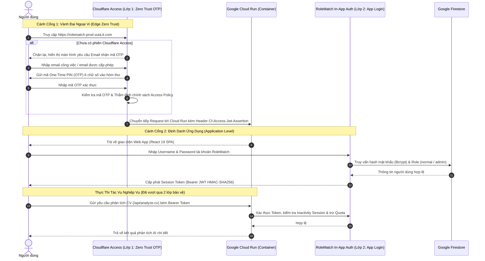
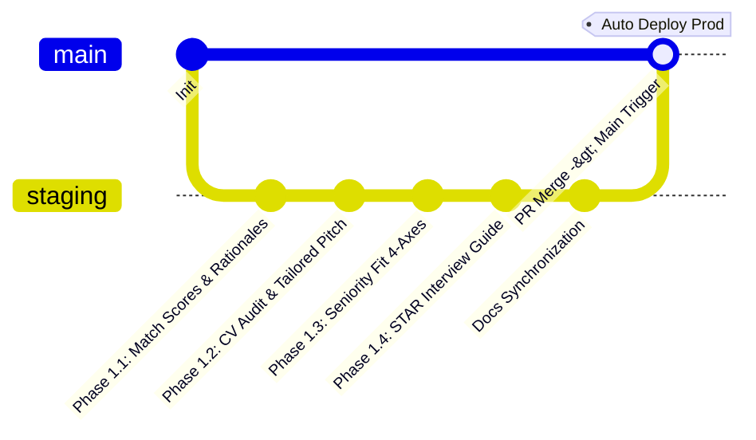
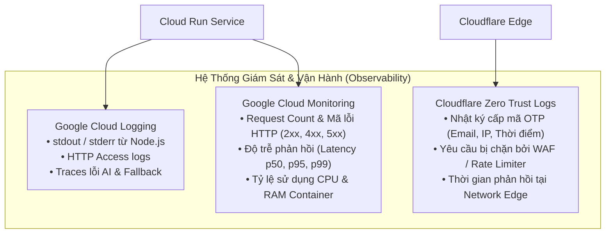

# Kiến Trúc CI/CD & Mô Hình Triển Khai Hệ Thống (CI/CD & Deployment Architecture)

> **Dự án:** RoleMatch 2  
> **Tên miền Production:** `https://rolematch-prod.vuta.it.com`  
> **Nhánh mã nguồn Production:** `main` (kết nối tự động với Cloud Build)  
> **Nhánh phát triển & kiểm thử:** `staging`  
> **Hạ tầng chính:** Google Cloud Run + Google Cloud Build (Buildpack) + Cloudflare Zero Trust  
> **Phiên bản tài liệu:** 1.0 (Production Architecture)  
> **Ngày cập nhật:** 30/10/2026  

---

## 1. Tổng Quan Kiến Trúc Triển Khai (Deployment Topology)

Hệ thống **RoleMatch 2** trên môi trường Production được vận hành theo kiến trúc **Serverless Containerized Micro-Monolith**, tối ưu hóa chi phí vận hành, tự động co giãn theo lưu lượng (auto-scaling) và áp dụng mô hình bảo mật đa tầng **Zero Trust Defense-in-Depth**.

### 1.1. Sơ Đồ Luồng Truy Cập & Hạ Tầng End-to-End

```mermaid
flowchart TD
    subgraph ClientLayer["1. Phân Vùng Người Dùng (Client Layer)"]
        U["Người Dùng (Ứng viên / Nhà tuyển dụng / Admin)"]
    end

    subgraph SecurityPerimeter["2. Vành Đai Ngoại Vi (Cloudflare Edge & Zero Trust)"]
        CF_DNS["Cloudflare DNS (CNAME: rolematch-prod.vuta.it.com)"]
        CF_WAF["Cloudflare Edge WAF & DDoS Mitigation (Layer 3/4/7)"]
        CFA["Cloudflare Access (Zero Trust Gateway)<br/>• Xác thực One-Time PIN (OTP) qua Email<br/>• Kiểm tra danh sách Email được ủy quyền<br/>• Inject Header: Cf-Access-Jwt-Assertion & User-Email"]
    end

    subgraph ComputePlatform["3. Nền Tảng Tính Toán (Google Cloud Platform)"]
        CR["Google Cloud Run (Serverless Container)<br/>• URL Gốc: rolematch-*.run.app<br/>• Tự động co giãn: 0 -> N instances (Scale-to-zero)<br/>• Cổng nội bộ: PORT=8080 (0.0.0.0)"]
        
        subgraph ContainerRuntime["Container Runtime (Node.js & Express)"]
            VITE_STATIC["Frontend Static Assets (Vite Dist)<br/>• React 19 SPA, Tailwind CSS 4, Icons<br/>• Nhúng tài liệu docs/ (?raw)"]
            EXPRESS_API["Express API Backend (dist/server.cjs)<br/>• Lớp 2: Xác thực Login In-App (Bcrypt, JWT Session)<br/>• AI Pipeline Orchestrator (Draft -> Audit -> Synth)<br/>• File Extraction & OCR Engine"]
        end
    end

    subgraph ExternalServices["4. Cơ Sở Dữ Liệu & Dịch Vụ AI Phía Sau"]
        FS[(Google Cloud Firestore)<br/>Users, Usage Quota, Analysis Records, Batches]
        GEMINI["Google Gemini API<br/>Drafting, Vision OCR, Synthesis, Interview Prep"]
        OR["OpenRouter API<br/>Auditor Step Verification (Multi-Model Audit)"]
    end

    subgraph CICDPipeline["5. Đường Ống CI/CD Tự Động (GitHub & Cloud Build)"]
        GH["GitHub Repository (Nhánh main)"]
        GCB["Google Cloud Build<br/>• Trigger tự động khi có push / PR merge vào main<br/>• Cơ chế: Google Cloud Native Buildpack (pack)<br/>• Tự động thực thi: npm install & npm run build"]
        AR["Google Artifact Registry / Container Registry<br/>• Lưu trữ Container Image gắn tag Git Commit SHA & latest"]
    end

    %% Access flow
    U -->|Truy cập: https://rolematch-prod.vuta.it.com| CF_DNS
    CF_DNS --> CF_WAF
    CF_WAF --> CFA
    CFA -->|Reverse Proxy kèm Header Cf-Access-*| CR
    CR --> VITE_STATIC
    CR --> EXPRESS_API
    EXPRESS_API --> FS
    EXPRESS_API --> GEMINI
    EXPRESS_API --> OR

    %% CI/CD flow
    GH -->|Webhook Trigger| GCB
    GCB -->|Build Image & Pack| AR
    AR -->|Deploy Revision Mới (Zero-Downtime)| CR
```

---

## 2. Kiến Trúc Bảo Mật 2 Lớp Xác Thực (Two-Layer Authentication)

Để bảo vệ tối đa dữ liệu tuyển dụng và thông tin CV của ứng viên, RoleMatch thiết lập **hai cánh cổng xác thực độc lập**:



### 2.1. Lớp 1: Vành Đai Ngoại Vi — Cloudflare Access (Zero Trust)
- **Tên miền quản lý:** `rolematch-prod.vuta.it.com` (bản ghi CNAME trỏ tới địa chỉ Cloud Run gốc, bật proxy đám mây cam Cloudflare).
- **Phương thức xác thực:** **One-Time PIN (OTP) gửi qua Email**.
- **Chính sách kiểm soát (Access Policy):**
  - Chỉ những địa chỉ email được định nghĩa trong danh sách cho phép (Allowed List / Domain Rule) mới nhận được mã PIN và được quyền truy cập.
  - Sau khi người dùng xác thực thành công mã PIN, Cloudflare Access cấp một phiên làm việc (Session Cookie) có thời hạn quy định.
- **Header truyền tải vào máy chủ:**
  - `Cf-Access-Jwt-Assertion`: Chứa JSON Web Token (JWT) được ký mật mã bởi Cloudflare, xác minh request đã đi qua xác thực Zero Trust hợp lệ.
  - `Cf-Access-Authenticated-User-Email`: Email của người dùng đã vượt qua bước xác thực OTP.
- **Bảo vệ bổ sung:** Toàn bộ lưu lượng truy cập được bảo vệ bởi Cloudflare WAF, chống quét cổng, tự động loại bỏ các cuộc tấn công DDoS ở tầng L3/L4/L7 trước khi chạm tới Google Cloud.

### 2.2. Lớp 2: Tầng Ứng Dụng — RoleMatch In-App Authentication
- **Vị trí xử lý:** Module xác thực nội bộ bên trong `server.ts` kết nối với cơ sở dữ liệu Google Cloud Firestore (`collection: users`).
- **Mục đích:**
  - Định danh chính xác cá nhân người dùng để phân quyền chức năng (RBAC) và theo dõi hạn mức phân tích AI hàng ngày (Quota Management).
  - Cách ly dữ liệu: Đảm bảo người dùng chỉ xem lịch sử và các đợt phân tích do chính mình thực hiện.
- **Quản lý mật khẩu & Phiên đăng nhập:**
  - Mật khẩu lưu trữ được băm (hash) bằng thuật toán **Bcrypt** với salt round an toàn.
  - Cấp phát Bearer Token ký bằng **HMAC-SHA256 (`JWT_SECRET`)** thời hạn tối đa 24 giờ.
  - Kiểm soát thời gian không hoạt động (Inactivity Timeout): Backend tự động hủy session sau **15 phút** không tương tác; Frontend hiển thị cảnh báo đăng xuất sau **30 phút**.
- **Phân quyền người dùng (Role-Based Access Control):**
  - **Role `normal`:** Sử dụng các tính năng Ứng viên (Candidate) và Nhà tuyển dụng (Recruiter), bị kiểm soát theo hạn mức ngày (mặc định 5 lượt/ngày).
  - **Role `admin`:** Toàn quyền truy cập Admin Dashboard, quản lý tài khoản người dùng, xem thống kê hệ thống, kiểm soát file upload, tra cứu lịch sử phân tích, xem audit/error logs, reset quota và bypass giới hạn quota.

---

## 3. Quy Trình & Đường Ống CI/CD (CI/CD Pipeline Details)

### 3.1. Chiến Lược Nhánh (Branching Strategy)

Dự án duy trì quy trình kiểm thử và phát hành chuẩn mực:



1. **Nhánh `staging` (Working & Pre-release Branch):**
   - Nơi tập trung phát triển tính năng mới, vá lỗi và đồng bộ tài liệu.
   - Bắt buộc phải vượt qua chuỗi kiểm thử tiêu chuẩn trước khi tạo Pull Request vào `main`:
     * `npm run lint` (`tsc --noEmit`): **0 errors**.
     * `npm test` (`vitest run`): **84/84 tests passed (100%)**.
     * `npm run build` (`vite build && esbuild`): **Exit code 0**.
     * Security Audit Gate: **PASS 100%**.
2. **Nhánh `main` (Production Release Branch):**
   - Nhánh được bảo vệ, chỉ nhận code thông qua Pull Request từ `staging`.
   - Mỗi khi một Pull Request được merge vào `main`, sự kiện Webhook sẽ tự động kích hoạt **Google Cloud Build Trigger**.

---

### 3.2. Google Cloud Build — Quy Trình Đóng Gói Tự Động (Buildpack)

Hệ thống sử dụng cơ chế **Google Cloud Native Buildpack (`pack`)** tích hợp sẵn từ giao diện Cloud Run (Continuous Deployment):

```mermaid
flowchart LR
    A["1. GitHub Push Event<br/>Nhánh main được cập nhật"] --> B["2. Cloud Build Runner<br/>Fetch mã nguồn commit mới"]
    B --> C["3. Google Cloud Buildpack<br/>Nhận diện Node.js & package.json"]
    C --> D["4. Cài đặt Dependencies<br/>npm install (kèm esbuild)"]
    D --> E["5. Thực thi Build Script<br/>npm run build"]
    E --> F["6. Đóng gói Container<br/>Tạo OCI Docker Image"]
    F --> G["7. Push Image<br/>Google Artifact Registry"]
    G --> H["8. Cập nhật Service<br/>Deploy Revision mới lên Cloud Run"]
```



1. **Nhận diện tự động:** Cloud Build sử dụng builder Node.js của Google (`gcr.io/k8s-skaffold/pack` / `google-22/builder`), tự động đọc cấu hình trong `package.json` mà không yêu cầu duy trì file `Dockerfile` hay `cloudbuild.yaml` phức tạp trong repo.
2. **Cài đặt thư viện:**
   - Cài đặt dependencies cần thiết cho môi trường chạy.
   - Gói `esbuild` được đặt trong mục `dependencies` (thay vì `devDependencies`) để đảm bảo quá trình buildpack trong môi trường production luôn có sẵn công cụ biên dịch backend.
3. **Biên dịch kép (Dual-Build Process):**
   - Lệnh `npm run build` thực hiện 2 nhiệm vụ song song:
     - **Frontend:** `vite build` nén và biên dịch toàn bộ React 19 SPA, Tailwind CSS 4 và nhúng tài liệu Markdown (`?raw`) thành các asset tĩnh tối ưu trong thư mục `dist/`.
     - **Backend:** `esbuild server.ts --bundle --platform=node --format=cjs --packages=external --sourcemap --outfile=dist/server.cjs` gom toàn bộ server Express thành một tệp bundle thực thi duy nhất `dist/server.cjs`.
4. **Lưu trữ Image:**
   - Image sau khi đóng gói được gắn tag định danh theo Git Commit SHA và tag `latest`.
   - Lưu trữ tại **Google Cloud Artifact Registry / Container Registry**.

---

### 3.3. Google Cloud Run — Triển Khai Không Gián Đoạn (Continuous Deployment)

Ngay sau khi image được đẩy lên Registry, Cloud Run tự động thực hiện quy trình phát hành:

1. **Khởi tạo Revision Mới (Zero-Downtime Blue-Green Deployment):**
   - Cloud Run tạo một Revision độc lập, nạp Container Image mới và inject các biến môi trường cấu hình.
   - Container khởi động bằng lệnh: `npm start` ➔ `node dist/server.cjs`.
   - Server tự động lắng nghe cổng do Cloud Run chỉ định qua biến môi trường `PORT` (mặc định: `8080`) trên địa chỉ `0.0.0.0`.
2. **Kiểm Tra Tình Trạng Hoạt Động (Health Check Probe):**
   - Cloud Run gửi request thăm dò tới endpoint: `GET /api/health`.
   - Khi server phản hồi HTTP `200 OK` (`{"status":"ok",...}`), Cloud Run xác nhận revision đã sẵn sàng tiếp nhận traffic.
3. **Chuyển Đổi Lưu Lượng:**
   - `100%` lưu lượng người dùng từ tên miền `https://rolematch-prod.vuta.it.com` được chuyển tức thì sang Revision mới.
   - Nếu Revision mới gặp lỗi khởi động, Cloud Run sẽ hủy bỏ quá trình chuyển đổi và giữ nguyên Revision cũ, đảm bảo người dùng không bao giờ gặp tình trạng sập web.
4. **Khả Năng Tự Động Co Giãn (Auto-scaling):**
   - **Scale-to-zero:** Khi không có người dùng truy cập, số lượng container tự động giảm về `0` để tiết kiệm chi phí.
   - **Scale Up tức thời:** Khi có request đi qua Cloudflare, Cloud Run khởi động container chỉ trong khoảng 1–2 giây (Cold Start được tối ưu nhờ backend đã được bundle gọn gàng bằng `esbuild`).

---

## 4. Quản Lý Cấu Hình & Biến Môi Trường (Environment & Secrets)

### 4.1. Danh Mục Biến Môi Trường Trên Production

| Tên Biến (Env Var) | Nguồn Cung Cấp | Mục Đích & Phạm Vi Sử Dụng | Mức Độ Nhạy Cảm |
| :--- | :--- | :--- | :---: |
| `NODE_ENV` | Cloud Run Config | Thiết lập môi trường chạy (`production`). Bật chế độ phục vụ asset tĩnh từ `dist/`. | Thấp |
| `PORT` | Cloud Run Runtime | Cổng mạng do Cloud Run tự động inject (`8080`). Server lắng nghe tại `0.0.0.0:${PORT}`. | Thấp |
| `APP_URL` | Cloud Run Config | URL gốc của ứng dụng: `https://rolematch-prod.vuta.it.com`. | Thấp |
| `JWT_SECRET` | Secret Manager | Khóa bí mật dùng để ký và xác thực token JWT phiên đăng nhập của người dùng. | **Tối Mật (P0)** |
| `GEMINI_API_KEY` | Secret Manager | Khóa API Google Gemini phục vụ phân tích CV, OCR ảnh scan, và Cẩm nang phỏng vấn. | **Tối Mật (P0)** |
| `OPENROUTER_API_KEY` | Secret Manager | Khóa API OpenRouter phục vụ bước Auditor đối chiếu độc lập (multi-model verification). | **Tối Mật (P0)** |
| `OPENAI_API_KEY` | Secret Manager | Khóa API dự phòng cho bước audit hoặc các mô hình dự phòng nâng cao. | **Cao** |
| `ENABLE_TEST_USER_SEED`| Cloud Run Config | Cờ kiểm soát nạp tài khoản mẫu. Bắt buộc đặt `false` trên production. | Trung bình |

> [!CAUTION]
> **Khuyến nghị Vận hành (Security Best Practice):**
> Tuyệt đối không lưu các khóa `JWT_SECRET`, `GEMINI_API_KEY`, `OPENROUTER_API_KEY` dưới dạng plain-text trong giao diện cấu hình Cloud Run. Hãy tạo Secret tương ứng trong **Google Cloud Secret Manager** và cấu hình Cloud Run tham chiếu dưới dạng `Reference a secret`.

---

## 5. Giám Sát, Nhật Ký & Khắc Phục Sự Cố (Monitoring & Rollback)



### 5.1. Nhật Ký Hoạt Động (Logging)
- Toàn bộ log từ `console.log` và `console.error` trong `server.ts` được Google Cloud Logging tự động thu thập dưới dạng structured logs.
- Quản trị viên có thể theo dõi chi tiết các sự kiện phân tích CV, thời gian phản hồi của từng bước AI (Drafting, Auditor, Synthesizer) và mã lỗi nếu xảy ra sự cố.

### 5.2. Quy Trình Rollback Khẩn Cấp (Disaster Recovery)
Khi phát hiện lỗi nghiêm trọng trên production sau khi merge code vào `main`:
1. **Rollback 1-Click Tức Thời Trên Cloud Run (Dưới 30 giây):**
   - Mở Google Cloud Console ➔ Cloud Run ➔ Service `rolematch`.
   - Chọn tab **Revisions**, tìm phiên bản ổn định gần nhất trước đó.
   - Bấm **Manage Traffic** ➔ Chuyển `100%` lưu lượng về Revision cũ. Hệ thống trở lại bình thường ngay lập tức mà không cần build lại mã nguồn.
2. **Rollback Trên Git:**
   - Tạo lệnh Revert trên nhánh `main`: `git revert <COMMIT_HASH>` và push lên repo.
   - Cloud Build sẽ tự động build lại commit ổn định và đồng bộ trạng thái kho mã nguồn.

---

## 6. Khuyến Nghị Tối Ưu Hóa & Hardening Tiếp Theo (Next-Step Recommendations)

Nhằm tiếp tục nâng cao tính vững chắc và bảo mật cho tên miền `https://rolematch-prod.vuta.it.com`:

1. **Khóa Ingress Cloud Run Chỉ Cho Phép Cloudflare (Origin Cloaking):**
   - Hiện tại, nếu người dùng biết URL gốc `*.run.app` của Cloud Run, họ có thể cố gắng truy cập bỏ qua lớp Cloudflare Access OTP.
   - *Khuyến nghị:* Cấu hình Ingress của Cloud Run ở chế độ **Internal and Cloud Load Balancing** kết hợp Cloud Armor, hoặc sử dụng **Cloudflare Authenticated Origin Pulls** để Cloud Run chỉ chấp nhận request xuất phát từ dải IP chính thức của Cloudflare.
2. **Thẩm Định Chữ Ký Cloudflare Access JWT Trong Backend (`server.ts`):**
   - Bổ sung middleware kiểm tra và xác thực chữ ký của header `Cf-Access-Jwt-Assertion` bằng public certs từ Cloudflare.
   - Đảm bảo ngay cả khi có request nội bộ giả mạo chạm tới server, backend vẫn sẽ từ chối nếu thiếu chữ ký hợp lệ từ Cloudflare Zero Trust.
3. **Bổ Sung GitHub Actions CI Check Trước Khi Cho Phép Merge PR:**
   - Thiết lập GitHub Actions workflow chạy tự động `npm run lint`, `npm test`, và `npm run build` trên mọi Pull Request vào nhánh `main`.
   - Bật tính năng **Branch Protection** trên GitHub cho nhánh `main`, yêu cầu bài test CI phải báo xanh (Green Check) trước khi nút "Merge PR" được mở.
