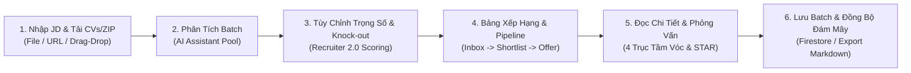
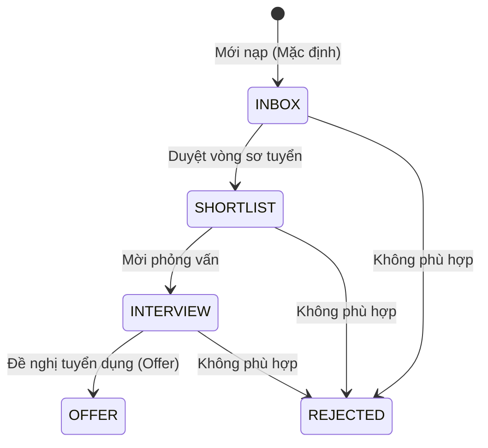

# Hướng dẫn sử dụng RoleMatch dành cho Nhà tuyển dụng

> **Mục tiêu:** Giúp Nhà tuyển dụng và Hiring Manager làm chủ các công cụ sàng lọc nâng cao của **Recruiter Module 2.0 (Phase 3)**: tùy chỉnh trọng số chấm điểm đa chiều, thiết lập tiêu chí loại trực tiếp (Knock-out), quản lý pipeline tuyển dụng, đánh giá tầm vóc 4 trục và ứng dụng bộ câu hỏi phỏng vấn thực chiến theo mô hình STAR để ra quyết định tuyển dụng chuẩn xác, có kiểm chứng.

---

## 1. RoleMatch hỗ trợ việc gì?

RoleMatch hỗ trợ nhà tuyển dụng và bộ phận thu hút nhân tài (Talent Acquisition):

- **Phân tích hàng loạt CV theo cùng một JD:** Tải lên tối đa 15 CV hoặc tệp nén ZIP để đối chiếu công bằng, nhất quán theo cùng tiêu chuẩn tuyển dụng.
- **Tùy biến Trọng số Chấm điểm & Xếp hạng Động (Custom Scoring Weights):** Tự do phân bổ tỷ trọng phần trăm giữa Từ khóa, Kỹ năng và Kinh nghiệm (hoặc dùng các preset mẫu) để tính điểm có trọng số (`weightedScore`) và tái sắp xếp bảng xếp hạng.
- **Bộ lọc Loại trực tiếp (Knock-out Criteria):** Thiết lập ngưỡng điểm sàn tối thiểu và tự động loại các hồ sơ thiếu kỹ năng bắt buộc cốt lõi (`Must-Have`), kèm lý do vi phạm minh bạch.
- **Quản lý Pipeline Tuyển dụng & Đánh giá Nội bộ:** Phân loại ứng viên theo 5 giai đoạn (`Mới nạp`, `Sơ tuyển`, `Phỏng vấn`, `Offer`, `Từ chối`), chấm điểm sao (1–5 sao), ghi chú nội bộ và gắn nhãn (tags).
- **Đánh giá tầm vóc 4 trục (Seniority Fit) & Ma trận rủi ro hồ sơ:** Đánh giá cấp bậc, độ phức tạp dự án, mức độ tự chủ/lãnh đạo, độ khớp ngành nghề và các điểm nghi ngại (Red Flags) của từng ứng viên.
- **Cẩm nang phỏng vấn thực chiến (5–10 câu hỏi STAR):** Trang bị sẵn bộ câu hỏi đào sâu bám sát khoảng trống thực tế của từng hồ sơ, giải mã ý đồ phỏng vấn và cạm bẫy ứng viên để chuẩn bị vòng phỏng vấn chuyên nghiệp.
- **Lưu trữ và mở lại báo cáo ngoại tuyến:** Lưu đợt tuyển dụng vào hệ thống để mở lại và xem chi tiết bất kỳ lúc nào mà không cần tốn thêm lượt phân tích AI.

> [!IMPORTANT]
> Trợ lý AI đóng vai trò công cụ trợ lực sàng lọc sơ bộ và chuẩn bị phỏng vấn có cấu trúc; hệ thống không thay thế quyết định tuyển dụng cuối cùng của con người.

---

## 2. Quy trình sử dụng nhanh

1. Chuyển sang chế độ **Nhà tuyển dụng / Recruiter**.
2. Cung cấp Mô tả công việc (JD) rõ ràng: dán văn bản trực tiếp, kéo thả tệp tải lên, hoặc bấm **Dán Link JD / Import Link** để trích xuất tự động từ tin tuyển dụng online (LinkedIn, ITviec, TopCV...).
3. Tải lên danh sách CV cần phân tích (tối đa 15 tệp riêng lẻ hoặc 1 tệp `.zip`).
4. Bấm **Bắt Đầu Phân Tích / Start Analysis**.
5. **Cấu hình Trọng số & Tiêu chí Knock-out:** Chọn preset phân bổ điểm phù hợp với vị trí tuyển dụng hoặc điều chỉnh tỷ trọng và ngưỡng điểm sàn.
6. **Điều phối Pipeline Tuyển dụng:** Cập nhật trạng thái vòng tuyển dụng, xếp hạng sao, thêm ghi chú phỏng vấn và gắn nhãn cho ứng viên sáng giá.
7. Mở chi tiết từng ứng viên để kiểm tra bằng chứng, khoảng trống Must-Have, đánh giá tầm vóc 4 trục và ma trận rủi ro hồ sơ.
8. Mở **Cẩm nang phỏng vấn thực chiến (5–10 câu STAR)** để chuẩn bị kịch bản phỏng vấn chuyên sâu.
9. Bấm **Lưu đợt này** để lưu toàn bộ dữ liệu (bao gồm cả trọng số, knock-out và pipeline) lên hệ thống.

---

## 3. Tùy Chỉnh Trọng Số Chấm Điểm & Tiêu Chí Knock-out (Phase 3)

Hệ thống cung cấp cơ chế **Recruiter Scoring 2.0** giúp nhà tuyển dụng linh hoạt điều chỉnh cách đánh giá phù hợp với từng vị trí công việc:

### 3.1. Các Preset Trọng Số Mẫu

| Preset | Tỷ trọng (Từ khóa / Kỹ năng / Kinh nghiệm) | Phù hợp cho vị trí |
|---|:---:|---|
| **Cân bằng chuẩn (Balanced Standard)** | **33% / 34% / 33%** | Đa số các vị trí chuyên môn tổng quát. |
| **Ưu tiên Kinh nghiệm & Tác động** | **20% / 30% / 50%** | Senior, Tech Lead, Engineering Manager, Giám đốc khối. |
| **Ưu tiên Năng lực Kỹ thuật** | **20% / 50% / 30%** | Chuyên gia R&D, System Architect, Specialist công nghệ mới. |
| **Tùy chỉnh linh hoạt (Custom)** | Tự do cấu hình (tổng = 100%) | Các bài toán tuyển dụng đặc thù của doanh nghiệp. |

Điểm có trọng số (`weightedScore`) được tính toán tức thì và tự động tái xếp hạng thứ bậc ứng viên trên bảng xếp hạng mà không cần phân tích lại AI.

### 3.2. Tiêu Chí Loại Trực Tiếp (Knock-out Criteria)

Khi bật các điều kiện loại trực tiếp, ứng viên không đáp ứng sẽ được tự động gắn nhãn **Bị loại (Knocked Out)** kèm lý do cụ thể và được đưa xuống cuối bảng xếp hạng:
- **Ngưỡng điểm tổng thể tối thiểu:** Ví dụ điểm dưới `60` sẽ bị đánh dấu không đạt chuẩn sơ tuyển.
- **Ngưỡng điểm kỹ năng hoặc kinh nghiệm tối thiểu:** Đảm bảo ứng viên phải đạt mức sàn năng lực nhất định.
- **Bắt buộc đáp ứng tiêu chí cốt lõi (Require Must-Have Skills):** Tự động phát hiện nếu ứng viên còn thiếu bất kỳ kỹ năng nào được đánh dấu là `Must-Have / Knock-out` trong JD.

---

## 4. Quản Lý Pipeline Tuyển Dụng & Ghi Chú Đánh Giá (Phase 3)

RoleMatch tích hợp quy trình theo dõi ứng viên (Candidate Pipeline Management) trực tiếp trong mỗi đợt tuyển dụng:

### 4.1. 5 Giai Đoạn Tuyển Dụng Chuẩn Hóa

- **Mới nạp (`INBOX`):** Hồ sơ vừa phân tích xong, đang chờ HR đọc lướt.
- **Duyệt vòng sơ tuyển (`SHORTLIST`):** Hồ sơ đạt chuẩn, chuyển cho Hiring Manager xem xét.
- **Mời phỏng vấn (`INTERVIEW`):** Ứng viên được chọn để tiến hành phỏng vấn trực tiếp.
- **Đề nghị tuyển dụng (`OFFER`):** Ứng viên vượt qua các vòng phỏng vấn, chuẩn bị nhận offer.
- **Không phù hợp (`REJECTED`):** Hồ sơ bị từ chối hoặc không đạt yêu cầu.

### 4.2. Công Cụ Đánh Giá Nội Bộ Của Tuyển Dụng

- **Đánh giá sao (Rating 1–5):** Đánh giá nhanh chất lượng hồ sơ theo cảm nhận của người sàng lọc.
- **Ghi chú nội bộ (Internal Notes):** Lưu lại thông tin lương kỳ vọng, thời gian có thể nhận việc hoặc ấn tượng khi gọi điện sơ tuyển.
- **Gắn nhãn (Candidate Tags):** Gắn các nhãn nhanh như `Top Candidate`, `Tech Lead`, `Culture Fit`, `Urgent Hire`, `High Salary Expectation`.
- **Giao diện Kanban Trực Quan (5 Cột Tuyển Dụng):** Hỗ trợ chuyển đổi 1-click giữa Bảng Xếp Hạng truyền thống và Bảng Kanban 5 cột tuyển dụng, giúp quản lý tiến độ ứng viên trực quan và thuận tiện.

Mọi thay đổi về Pipeline, Trọng số, Ghi chú và Đánh giá đều được cập nhật và lưu trữ qua endpoint `PUT /api/recruiter/batches/:id`.

---

## 5. Hiểu Đúng Điểm Số và Mức Độ Phù Hợp

### 5.1. Bốn nhóm điểm đánh giá

| Chỉ số | Ý nghĩa | Lưu ý cho Nhà tuyển dụng |
|---|---|---|
| **Overall Score** | Điểm phù hợp tổng thể đa chiều từ 0–100 do AI đánh giá độc lập từ toàn bộ CV và JD. | Không phải xác suất ứng viên sẽ nhận việc; phản ánh độ khớp ban đầu của hồ sơ. |
| **Weighted Score** | Điểm tổng hợp sau khi áp dụng trọng số chấm điểm tùy chỉnh (`weights`). | Dùng để xếp hạng thực tế theo ưu tiên tuyển dụng của tổ chức. |
| **Keyword Alignment** | Mức độ tương đồng về thuật ngữ, công nghệ, công cụ chuyên ngành. | Điểm thấp có thể do ứng viên dùng từ đồng nghĩa; cần kiểm tra kỹ năng chuyển đổi. |
| **Experience Fit** | Mức độ phù hợp về số năm công tác, quy mô dự án và thành tựu kết quả đã chứng minh. | Đánh giá mức độ vững vàng thực chiến và trách nhiệm trực tiếp của ứng viên. |
| **Skills Fit** | Mức độ đáp ứng của hệ thống kỹ năng cứng và kỹ năng mềm theo yêu cầu vai trò. | Cho biết ứng viên đã có đủ bộ công cụ cần thiết để hoàn thành công việc hay chưa. |

### 5.2. Thang phân loại mức độ phù hợp

| Điểm số | Mức hiển thị | Khuyến nghị hành động cho HR |
|:---:|---|---|
| 85–100 | **Phù hợp rất cao / Very High** | Chuyển ngay sang `SHORTLIST` hoặc `INTERVIEW`; chuẩn bị câu hỏi chuyên môn sâu. |
| 70–84 | **Phù hợp cao / High** | Hồ sơ sáng giá; cần kiểm tra các khoảng trống cụ thể và kế hoạch thích ứng nghiệp vụ. |
| 50–69 | **Phù hợp trung bình / Medium** | Cần đánh giá kỹ khả năng chuyển đổi kỹ năng hoặc năng lực học hỏi; dùng screening call để thẩm định. |
| Dưới 50 | **Phù hợp thấp / Low** | Khoảng cách năng lực lớn; chỉ cân nhắc nếu thị trường nhân sự quá khan hiếm. |
| Không có điểm | **Chưa có dữ liệu / Not available** | File bị lỗi nhận dạng hoặc xử lý; cần kiểm tra thủ công hoặc phân tích lại. |

---

## 6. Đọc Chi Tiết Từng Ứng Viên & Đánh Giá Tầm Vóc 4 Trục

Khi chọn một ứng viên từ danh sách bảng xếp hạng, bạn có thể xem báo cáo tóm tắt hoặc mở chế độ **Toàn màn hình / Xem chi tiết ứng viên (Candidate Deep-Dive)**:

### A. Đánh giá Tầm vóc 4 trục (Seniority & Scope Fit Assessment)

Giúp nhà tuyển dụng thẩm định nhanh xem ứng viên có thực sự "đúng tầm" với vị trí hay không:
1. **Cấp bậc & Thâm niên:** Đối chiếu xem ứng viên đang ở cấp độ nào (Junior, Mid, Senior, Lead, Manager) so với mong đợi của JD.
2. **Quy mô & Độ phức tạp dự án:** Đánh giá quy mô hệ thống, số lượng người dùng hoặc ngân sách dự án ứng viên từng phụ trách.
3. **Phạm vi Tự chủ / Lãnh đạo:** Xác định ứng viên phù hợp làm việc độc lập (IC) hay có năng lực dẫn dắt, quản lý đội nhóm.
4. **Độ khớp Ngành nghề (Domain):** Mức độ am hiểu nghiệp vụ chuyên sâu đối với bài toán của doanh nghiệp.

### B. Ma trận Rủi ro & Cách Hóa giải (Risk Mitigation Matrix)

Phát hiện các điểm nghi ngờ (Red Flags) thường gặp và cung cấp góc nhìn đa chiều:
- **Rủi ro nhận diện:** Nhảy việc, chuyển ngành, hụt cấp bậc, thiếu số liệu đo lường, khoảng trống thời gian.
- **Góc nhìn e ngại của HR:** Lý do vì sao đây là điểm rủi ro đối với tổ chức.
- **Chiến lược hóa giải trên CV:** Cách ứng viên trình bày để giải tỏa lo lắng.
- **Lập luận khi phỏng vấn:** Điểm mấu chốt cần lắng nghe khi ứng viên đối đáp trong buổi phỏng vấn.

### C. Bảng đối chiếu tiêu chí Bắt buộc (Must-Have) vs Điểm cộng (Nice-to-Have)

- Đánh dấu rõ ràng các tiêu chí tiên quyết (`Must-Have`) để bạn không bỏ sót ứng viên đạt chuẩn hoặc chọn nhầm ứng viên thiếu kỹ năng sống còn.
- Xem bằng chứng thực tế tìm thấy trong CV và khoảng trống cần bổ sung.

---

## 7. Sử Dụng Cẩm Nang Phỏng Vấn Thực Chiến (STAR)

RoleMatch trang bị cho Nhà tuyển dụng một công cụ đắc lực: **Bộ 5–10 câu hỏi phỏng vấn xoáy sâu** được tạo riêng cho từng ứng viên theo mô hình STAR:

### 7.1. Ba nhóm câu hỏi phỏng vấn chuẩn hóa

1. **Kiểm chứng khoảng trống CV (CV Gap Verification):** Câu hỏi xoáy thẳng vào các tiêu chí Must-Have mà ứng viên chưa nêu rõ bằng chứng, các khoảng trống thời gian hoặc dự án thiếu số liệu đo lường.
2. **Chuyên môn sâu & Tình huống thực tế (Deep-Dive Technical & Scenarios):** Đặt ứng viên vào các tình huống thực tế của doanh nghiệp (xử lý sự cố, tối ưu hệ thống, giải quyết xung đột kỹ thuật).
3. **Tầm vóc, Văn hóa & Phong cách làm việc (Seniority & Cultural Fit):** Đánh giá phong cách lãnh đạo, làm việc nhóm và lộ trình hòa nhập 30–60–90 ngày đầu tiên.

### 7.2. Khung thẩm định phỏng vấn chuyên nghiệp

Mỗi câu hỏi cung cấp:
- **Ý đồ sâu xa của Nhà tuyển dụng:** Giúp người phỏng vấn nắm rõ mục tiêu cần đánh giá.
- **Khung câu trả lời STAR kỳ vọng:** Bối cảnh (Situation), Nhiệm vụ (Task), Hành động (Action) và Kết quả (Result) mà một ứng viên đạt chuẩn cần thể hiện được dựa trên kinh nghiệm thật.
- **Cạm bẫy cần cảnh giác (Pitfalls):** Dấu hiệu ứng viên trả lời né tránh, phóng đại thành tích hoặc đổ lỗi cho tập thể.

---

## 8. Ma Trận So Sánh Đa Chiều & Bộ Kit Phỏng Vấn HR (Deep-Dive Comparison Matrix)

- **So sánh tối đa 5 ứng viên cùng lúc:** Đặt lên bàn cân trực diện từ 2 đến 5 hồ sơ xuất sắc nhất (hỗ trợ nút nhanh *So sánh Top 3* và *So sánh Top 5*).
- **Ma trận đối chiếu chuyên sâu:**
  - Điểm tổng thể gốc vs Điểm theo trọng số tùy chỉnh (`weightedScore`).
  - Kiểm tra điều kiện loại trực tiếp (`Knock-out Check`) và cảnh báo lý do vi phạm.
  - Đánh giá Tầm vóc & Cấp bậc (Seniority & Scope Fit).
  - Đối đầu Lợi thế vượt trội (Key Edge) vs Mối e ngại / Rủi ro lớn nhất (Critical Concern).
  - Đối chiếu danh sách các tiêu chí JD chưa có bằng chứng trong CV.
- **Bộ Kịch Bản Phỏng Vấn Thẩm Định Dành Riêng Cho HR (HR Interview Kit):**
  - Tự động tập hợp các câu hỏi phỏng vấn đào sâu vào khoảng trống thực tế của từng ứng viên được chọn so sánh.
  - Đi kèm checklist *"Điều HR cần lắng nghe trong câu trả lời (What to listen for)"* và *"Cờ đỏ Red Flags cần cảnh giác"* khi ứng viên trả lời.
- **Xuất Báo Cáo So Sánh:** Cho phép tải xuống file Markdown (`.md`) hoàn chỉnh hoặc sao chép nhanh vào clipboard để gửi cho ban giám đốc hoặc hội đồng tuyển dụng.

---

## 9. Lưu, Mở Lại và Xuất Báo Cáo

- **Lưu đợt tuyển dụng (Save Batch):** Lưu lại toàn bộ dữ liệu batch (gồm JD, danh sách ứng viên, điểm số, trọng số chấm điểm, tiêu chí knock-out, trạng thái pipeline và toàn bộ báo cáo chi tiết) vào cơ sở dữ liệu.
- **Mở lại từ Saved Batches:** Xem lại kết quả bất cứ lúc nào với tốc độ tức thì, không tốn quota AI.
- **Cập nhật đợt tuyển dụng:** Bất kỳ thay đổi nào về Pipeline, Ghi chú, Rating hoặc Trọng số đều được tự động đồng bộ vào bản lưu.
- **Xuất Báo Cáo Markdown:** Tải xuống file Markdown chứa toàn bộ bảng xếp hạng và báo cáo phân tích chi tiết để đính kèm vào hệ thống ATS nội bộ hoặc gửi cho Hiring Manager.

---

## 10. Checklist Tuyển Dụng Dành Cho HR & Hiring Manager

- [ ] JD đã phân tách rõ tiêu chí Bắt buộc (Must-Have) và Điểm cộng (Nice-to-Have).
- [ ] Đã lựa chọn preset Trọng số chấm điểm phù hợp với cấp bậc và tính chất công việc.
- [ ] Đã rà soát danh sách ứng viên bị loại bởi tiêu chí Knock-out để tránh bỏ sót nhân tài đặc biệt.
- [ ] Đã phân loại ứng viên vào các giai đoạn Pipeline (`SHORTLIST`, `INTERVIEW`).
- [ ] Đã đọc kỹ Đánh giá tầm vóc 4 trục và Ma trận rủi ro của Top ứng viên sáng giá.
- [ ] Đã chọn lọc 3–5 câu hỏi phỏng vấn trọng tâm từ Cẩm nang Phỏng vấn STAR để đưa vào kịch bản phỏng vấn.
- [ ] Đã ghi nhận nhận xét đánh giá, rating và lý do lựa chọn cuối cùng vào phần Ghi chú nội bộ.
