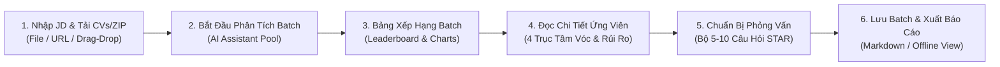

# Hướng dẫn sử dụng RoleMatch dành cho Nhà tuyển dụng

> **Mục tiêu:** Giúp Nhà tuyển dụng và Hiring Manager đọc đúng báo cáo phân tích AI, làm chủ ma trận tầm vóc 4 trục, nhận diện rủi ro hồ sơ và ứng dụng bộ câu hỏi phỏng vấn thực chiến theo mô hình STAR để đưa ra quyết định tuyển dụng chuẩn xác, có kiểm chứng.

---

## 1. RoleMatch hỗ trợ việc gì?

RoleMatch hỗ trợ nhà tuyển dụng và bộ phận thu hút nhân tài (Talent Acquisition):

- **Phân tích hàng loạt CV theo cùng một JD:** Tải lên tối đa 15 CV hoặc tệp nén ZIP để đối chiếu công bằng, nhất quán theo cùng tiêu chuẩn tuyển dụng.
- **Bảng xếp hạng (Leaderboard) & Thống kê trực quan:** Tự động xếp hạng ứng viên dựa trên mức độ phù hợp tổng thể, tỷ lệ đề xuất phỏng vấn (`YES` / `MAYBE` / `NO`) và phân bố năng lực toàn batch.
- **Đánh giá tầm vóc 4 trục (Seniority Fit) & Ma trận rủi ro hồ sơ:** Đánh giá cấp bậc, độ phức tạp dự án, mức độ tự chủ/lãnh đạo, độ khớp ngành nghề và các điểm nghi ngại (Red Flags) của từng ứng viên.
- **Cẩm nang phỏng vấn thực chiến (5–10 câu hỏi STAR):** Trang bị sẵn bộ câu hỏi đào sâu bám sát khoảng trống thực tế của từng hồ sơ, giải mã ý đồ phỏng vấn và cạm bẫy ứng viên để chuẩn bị vòng phỏng vấn chuyên nghiệp.
- **Lưu trữ và mở lại báo cáo ngoại tuyến:** Lưu đợt tuyển dụng vào hệ thống để mở lại và xem chi tiết bất kỳ lúc nào mà không cần tốn thêm lượt phân tích AI.

> [!IMPORTANT]
> Trợ lý AI đóng vai trò công cụ trợ lực sàng lọc sơ bộ và chuẩn bị phỏng vấn có cấu trúc; hệ thống không thay thế quyết định tuyển dụng cuối cùng của con người.

---

## 2. Quy trình sử dụng nhanh

1. Chuyển sang chế độ **Nhà tuyển dụng / Recruiter**.
2. Cung cấp Mô tả công việc (JD) rõ ràng: dán văn bản trực tiếp, kéo thả tệp tải lên, hoặc bấm **Dán Link JD / Import Link** để trích xuất tự động từ tin tuyển dụng online (LinkedIn, ITviec, TopCV...). Nếu trang yêu cầu đăng nhập, hệ thống sẽ mở cửa sổ an toàn để bạn đăng nhập và hỗ trợ nút 1-chạm đọc từ Clipboard.
3. Tải lên danh sách CV cần phân tích (tối đa 15 tệp riêng lẻ hoặc 1 tệp `.zip`).
4. Bấm **Bắt Đầu Phân Tích / Start Analysis**.
5. Đọc tổng quan đợt phân tích: tỷ lệ phỏng vấn (`YES` / `MAYBE` / `NO`), phân bố điểm số và danh sách Top 10 ứng viên.
6. Mở chi tiết từng ứng viên để kiểm tra bằng chứng, khoảng trống Must-Have, đánh giá tầm vóc 4 trục và ma trận rủi ro hồ sơ.
7. Mở **Cẩm nang phỏng vấn thực chiến (5–10 câu)** của ứng viên để chuẩn bị kịch bản phỏng vấn chuyên sâu theo mô hình STAR.
8. Ghi nhận quyết định tuyển dụng; sau đó bấm **Lưu đợt này** hoặc **Xuất Báo Cáo (Markdown)**.

---

## 3. Chuẩn bị dữ liệu trước khi phân tích

### 3.1. Chuẩn bị JD

JD càng rõ thì kết quả càng hữu ích. Trước khi phân tích, bạn nên kiểm tra:

- Chức danh và phạm vi công việc có nhất quán hay không.
- Các yêu cầu bắt buộc (**Must-Have**) có được phân biệt rõ với tiêu chí điểm cộng (**Nice-to-Have**) hay không.
- Kinh nghiệm được mô tả bằng trách nhiệm, phạm vi và kết quả mong đợi, không chỉ bằng số năm thâm niên thuần túy.
- Kỹ năng công nghệ, công cụ, ngành nghề đặc thù có thực sự cần thiết hay không.

### 3.2. Chuẩn bị CV

- Đảm bảo các tệp CV không bị khóa mật khẩu hoặc hỏng cấu trúc. Hỗ trợ định dạng `.pdf`, `.docx`, `.doc`, `.txt`, `.rtf`, `.md`.
- Với CV dạng ảnh hoặc PDF scan, hệ thống tự động kích hoạt Gemini Vision OCR để nhận diện nội dung.
- Các hồ sơ lỗi định dạng hoặc không đọc được chữ sẽ được đánh dấu rõ ràng trên giao diện và không bị trừ vào lượt quota của bạn.

---

## 4. Hiểu đúng điểm số và mức độ phù hợp

### 4.1. Bốn nhóm điểm đánh giá

| Chỉ số | Ý nghĩa | Lưu ý cho Nhà tuyển dụng |
|---|---|---|
| **Overall Score** | Điểm phù hợp tổng thể đa chiều từ 0–100 do AI đánh giá độc lập từ toàn bộ CV và JD. | Không phải xác suất ứng viên sẽ nhận việc; không phải trung bình cộng đơn thuần của 3 điểm thành phần. |
| **Keyword Alignment** | Mức độ tương đồng về thuật ngữ, công nghệ, công cụ chuyên ngành. | Điểm thấp có thể do ứng viên dùng từ đồng nghĩa; cần kiểm tra kỹ năng chuyển đổi. |
| **Experience Fit** | Mức độ phù hợp về số năm công tác, quy mô dự án và thành tựu kết quả đã chứng minh. | Đánh giá mức độ vững vàng thực chiến và trách nhiệm trực tiếp của ứng viên. |
| **Skills Fit** | Mức độ đáp ứng của hệ thống kỹ năng cứng và kỹ năng mềm theo yêu cầu vai trò. | Cho biết ứng viên đã có đủ bộ công cụ cần thiết để hoàn thành công việc hay chưa. |

### 4.2. Thang phân loại mức độ phù hợp

| Overall Score | Mức hiển thị | Khuyến nghị hành động cho HR |
|:---:|---|---|
| 85–100 | **Phù hợp rất cao / Very High** | Ưu tiên mời phỏng vấn sớm; đối chiếu các tiêu chí Must-Have và chuẩn bị câu hỏi chuyên môn sâu. |
| 70–84 | **Phù hợp cao / High** | Hồ sơ sáng giá; cần kiểm tra các khoảng trống cụ thể và kế hoạch thích ứng nghiệp vụ. |
| 50–69 | **Phù hợp trung bình / Medium** | Cần đánh giá kỹ khả năng chuyển đổi kỹ năng hoặc năng lực học hỏi; dùng screening call để thẩm định. |
| Dưới 50 | **Phù hợp thấp / Low** | Khoảng cách năng lực lớn; chỉ cân nhắc nếu thị trường nhân sự quá khan hiếm hoặc ứng viên có tố chất đặc biệt. |
| Không có điểm | **Chưa có dữ liệu / Not available** | File bị lỗi nhận dạng hoặc xử lý; cần kiểm tra thủ công hoặc phân tích lại. |

---

## 5. Đọc trang tổng quan của batch

### 5.1. Các số liệu tổng quan

- Tổng số hồ sơ đã xử lý thành công vs thất bại.
- Phân bổ đề xuất: số lượng hồ sơ `YES`, `MAYBE`, `NO`.
- Điểm trung bình và điểm cao nhất của cả đợt tuyển dụng.

### 5.2. Biểu đồ phân bố đề xuất & Mức độ phù hợp

- **YES — Đề xuất phỏng vấn:** Đủ tín hiệu mạnh để ưu tiên xếp lịch phỏng vấn.
- **MAYBE — Cần xem xét thêm:** Có tiềm năng tốt nhưng tồn tại một vài điểm nghi vấn cần phỏng vấn làm rõ.
- **NO — Không ưu tiên:** Mức độ phù hợp thấp hoặc thiếu các điều kiện tiên quyết (Must-Have).

---

## 6. Đọc chi tiết từng ứng viên

Khi chọn một ứng viên từ danh sách bảng xếp hạng, bạn có thể xem báo cáo tóm tắt hoặc mở chế độ **Toàn màn hình / Xem chi tiết ứng viên (Candidate Deep-Dive)** với đầy đủ 4 tab phân tích:

### A. Đánh giá Tầm vóc 4 trục (Seniority & Scope Fit Assessment)

Giúp nhà tuyển dụng thẩm định nhanh xem ứng viên có thực sự "đúng tầm" với vị trí hay không:

1. **Cấp bậc & Thâm niên:** Đối chiếu xem ứng viên đang ở cấp độ nào (Junior, Mid, Senior, Lead, Manager) so với mong đợi của JD.
2. **Quy mô & Độ phức tạp dự án:** Đánh giá quy mô hệ thống, số lượng người dùng hoặc ngân sách dự án ứng viên từng phụ trách.
3. **Phạm vi Tự chủ / Lãnh đạo:** Xác định ứng viên phù hợp làm việc độc lập (IC) hay có năng lực dẫn dắt, quản lý đội nhóm.
4. **Độ khớp Ngành nghề (Domain):** Mức độ am hiểu nghiệp vụ chuyên sâu đối với bài toán của doanh nghiệp.

### B. Ma trận Rủi ro & Cách Hóa giải (Risk Mitigation Matrix)

Phát hiện các điểm nghi ngờ (Red Flags) thường gặp và cung cấp góc nhìn đa chiều:

- **Rủi ro nhận diện:** Nhảy việc, chuyển ngành, hụt cấp bậc, thiếu số liệu đo lường, khoảng trống thời gian.
- **Góc nhìn e ngại của HR:** Lý do vì sao đây là điểm rủi ro đối với tổ chức.
- **Chiến lược hóa giải trên CV:** Cách ứng viên trình bày để giải tỏa lo lắng.
- **Lập luận khi phỏng vấn:** Điểm mấu chốt cần lắng nghe khi ứng viên đối đáp trong buổi phỏng vấn.

### C. Bảng đối chiếu tiêu chí Bắt buộc (Must-Have) vs Điểm cộng (Nice-to-Have)

- Đánh dấu rõ ràng các tiêu chí tiên quyết (`Must-Have`) để bạn không bỏ sót ứng viên đạt chuẩn hoặc chọn nhầm ứng viên thiếu kỹ năng sống còn.
- Xem bằng chứng thực tế tìm thấy trong CV và khoảng trống cần bổ sung.

---

## 7. Sử dụng Cẩm nang Phỏng vấn Thực chiến (STAR)

RoleMatch trang bị cho Nhà tuyển dụng một công cụ đắc lực: **Bộ 5–10 câu hỏi phỏng vấn xoáy sâu** được tạo riêng cho từng ứng viên theo mô hình STAR:

### 7.1. Ba nhóm câu hỏi phỏng vấn chuẩn hóa

1. **Kiểm chứng khoảng trống CV (CV Gap Verification):** Câu hỏi xoáy thẳng vào các tiêu chí Must-Have mà ứng viên chưa nêu rõ bằng chứng, các khoảng trống thời gian hoặc dự án thiếu số liệu đo lường.
2. **Chuyên môn sâu & Tình huống thực tế (Deep-Dive Technical & Scenarios):** Đặt ứng viên vào các tình huống thực tế của doanh nghiệp (xử lý sự cố, tối ưu hệ thống, giải quyết xung đột kỹ thuật).
3. **Tầm vóc, Văn hóa & Phong cách làm việc (Seniority & Cultural Fit):** Đánh giá phong cách lãnh đạo, làm việc nhóm và lộ trình hòa nhập 30–60–90 ngày đầu tiên.

### 7.2. Khung thẩm định phỏng vấn chuyên nghiệp

Mỗi câu hỏi cung cấp:
- **Ý đồ sâu xa của Nhà tuyển dụng:** Giúp người phỏng vấn nắm rõ mục tiêu cần đánh giá.
- **Khung câu trả lời STAR kỳ vọng:** Bối cảnh (Situation), Nhiệm vụ (Task), Hành động (Action) và Kết quả (Result) mà một ứng viên đạt chuẩn cần thể hiện được dựa trên kinh nghiệm thật.
- **Cạm bẫy cần cảnh giác (Pitfalls):** Dấu hiệu ứng viên trả lời né tránh, phóng đại thành tích hoặc đổ lỗi cho tập thể.

---

## 8. So sánh đa ứng viên

- Hỗ trợ chọn tối đa **3 ứng viên** để đặt lên bàn cân đối chiếu trực diện.
- So sánh song song điểm số thành phần, đề xuất AI, điểm mạnh nổi bật, rủi ro chính và mức độ đáp ứng các yêu cầu bắt buộc của từng người.
- Giúp hội đồng tuyển dụng đưa ra quyết định dựa trên bằng chứng minh bạch, loại bỏ định kiến cá nhân.

---

## 9. Lưu, mở lại và xuất báo cáo

- **Lưu đợt tuyển dụng (Save Batch):** Lưu lại toàn bộ dữ liệu batch (gồm JD, danh sách ứng viên, điểm số, thứ hạng và toàn bộ báo cáo chi tiết) vào cơ sở dữ liệu.
- **Mở lại từ Saved Batches:** Xem lại kết quả bất cứ lúc nào với tốc độ tức thì, không tốn quota AI.
- **Xuất Báo Cáo Markdown:** Tải xuống file Markdown chứa toàn bộ bảng xếp hạng và báo cáo phân tích chi tiết để đính kèm vào hệ thống ATS nội bộ hoặc gửi cho Hiring Manager.

---

## 10. Checklist phỏng vấn và ra quyết định dành cho HR

- [ ] JD đã phân tách rõ tiêu chí Bắt buộc (Must-Have) và Điểm cộng (Nice-to-Have).
- [ ] Đã kiểm tra trạng thái của các ứng viên trong đợt tuyển dụng (không bỏ sót hồ sơ No Score do lỗi file).
- [ ] Đã đọc kỹ Đánh giá tầm vóc 4 trục và Ma trận rủi ro của Top ứng viên sáng giá.
- [ ] Đã chọn lọc 3–5 câu hỏi phỏng vấn trọng tâm từ Cẩm nang Phỏng vấn STAR để đưa vào kịch bản phỏng vấn.
- [ ] Đã ghi nhận nhận xét đánh giá của hội đồng phỏng vấn và lý do lựa chọn cuối cùng.
