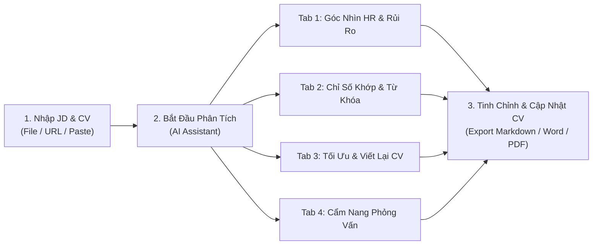
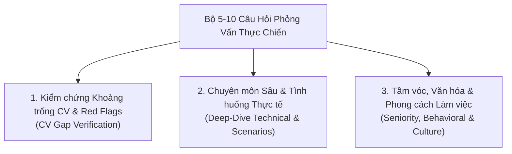

# Hướng dẫn sử dụng RoleMatch dành cho Ứng viên

> **Mục tiêu:** Giúp bạn thấu hiểu góc nhìn sàng lọc thực tế của Nhà tuyển dụng (HR/Hiring Manager), nhận diện khoảng trống năng lực so với mô tả công việc (JD), làm chủ ma trận rủi ro hồ sơ và nâng cấp toàn diện CV cùng kỹ năng phỏng vấn dựa trên kinh nghiệm thật.

---

## 1. RoleMatch hỗ trợ bạn những gì?

RoleMatch đối chiếu CV hiện tại của bạn với một Mô tả công việc cụ thể (**JD - Job Description**) thông qua mô hình phân tích đa chiều chuyên sâu, giúp bạn:

- **Khám phá góc nhìn đọc lướt 10 giây của HR & Đánh giá tầm vóc (Seniority Fit):** Thấu hiểu ấn tượng đầu tiên, khuyến nghị phỏng vấn (`YES` / `MAYBE` / `NO`), đối chiếu cấp bậc – quy mô dự án – mức độ tự chủ – độ khớp ngành nghề và nhận diện các rủi ro hồ sơ (Red Flags) kèm giải pháp hóa giải.
- **Giải trình chỉ số khớp & Bảng đối chiếu thực chiến:** Nắm rõ căn cứ chấm điểm, điểm tiềm năng sau tối ưu (`projectedOverallScore`), phân tách rõ tiêu chí Bắt buộc (`Must-Have`) và Điểm cộng (`Nice-to-Have`), nhận gợi ý vị trí chèn và câu văn mẫu tham khảo.
- **Tối ưu cấu trúc hồ sơ & Viết lại bullet point chuẩn STAR / XYZ:** Cung cấp 2 bản tóm tắt mở đầu định vị theo vị trí (50–200 từ), đánh giá độ hoàn thiện 4 phần trọng yếu của CV kèm mẫu câu tham khảo trực tiếp, và nâng cấp bullet points lồng ghép từ khóa JD cùng gợi ý số liệu định lượng.
- **Cẩm nang phỏng vấn thực chiến (5–10 câu hỏi xoáy sâu):** Chuẩn bị bộ câu hỏi phỏng vấn linh hoạt theo 3 nhóm trọng điểm, giải mã ý đồ sâu xa của Nhà tuyển dụng, khung trả lời theo mô hình STAR bám sát dữ liệu thật trong CV và các cạm bẫy cần tránh.
- **Tạo bản CV cập nhật chuẩn mực:** Hỗ trợ Trợ lý AI tạo bản CV mới bám sát JD, so sánh trực quan với bản gốc và xuất ra định dạng Markdown, DOCX hoặc PDF.

> [!IMPORTANT]
> RoleMatch là công cụ hỗ trợ nâng tầm cách trình bày năng lực và tư duy chiến lược; hệ thống không thay thế hoặc bảo đảm kết quả tuyển dụng thực tế. Mọi thông tin đưa vào CV phải tuyệt đối trung thực, dựa trên kinh nghiệm, kỹ năng và thành tích có thật của bạn.

---

## 2. Quy trình sử dụng nhanh

1. Đăng nhập và chọn chế độ **Ứng viên / Candidate**.
2. Dán nội dung, tải tệp hoặc bấm **Dán Link JD** (hỗ trợ tự động trích xuất từ LinkedIn, ITviec, TopCV...).
3. Kiểm tra nội dung văn bản trích xuất trong hai khung nhập liệu JD và CV.
4. Bấm **Bắt Đầu Phân Tích / Start CV Analysis Now**.
5. Mở **1. Góc Nhìn HR & Rủi Ro** để nắm bắt khuyến nghị phỏng vấn, ấn tượng 10 giây, đánh giá tầm vóc 4 trục và ma trận hóa giải rủi ro.
6. Mở **2. Chỉ Số Khớp & Từ Khóa JD** để xem giải trình điểm số, điểm tiềm năng sau tối ưu và bảng đối chiếu tiêu chí Bắt buộc / Điểm cộng kèm câu mẫu gợi ý chèn ngay.
7. Mở **3. Tối ưu & Viết lại CV** để chọn bản tóm tắt mở đầu may đo (50–200 từ), xem chẩn đoán cấu trúc 4 phần CV kèm mẫu câu tham khảo, và áp dụng các bullet points viết lại chuẩn STAR/XYZ.
8. Mở **4. Cẩm Nang Phỏng Vấn (5–10 câu)** để luyện tập bộ câu hỏi xoáy sâu theo mô hình STAR.
9. Bấm **Cập Nhật CV (AI)** nếu bạn muốn Trợ lý AI tổng hợp thành một bản CV hoàn chỉnh, sau đó xuất ra Word/PDF hoặc sao chép.

---

## 3. Chuẩn bị JD và CV

### 3.1. Mô tả công việc (JD) nên đầy đủ đến mức nào?

Hãy sử dụng bản JD chính xác của vị trí bạn dự định ứng tuyển. Một JD lý tưởng cần thể hiện:

- Chức danh công việc và cấp bậc kỳ vọng (Junior, Mid, Senior, Lead, Manager, Director).
- Trách nhiệm chính và phạm vi vai trò (Scope of Ownership).
- Kỹ năng chuyên môn, công cụ kỹ thuật và phương pháp làm việc cốt lõi.
- Các tiêu chí **Bắt buộc (Must-Have)** vs tiêu chí **Điểm cộng (Nice-to-Have)**.
- Quy mô hệ thống, môi trường công nghệ hoặc lĩnh vực nghiệp vụ (Domain).

Nếu JD quá ngắn hoặc chắp vá, kết quả phân tích có thể giảm tính phân hóa.

### 3.2. CV cần thể hiện những gì?

Ưu tiên cung cấp CV chứa các thông tin có thể xác minh được:

- Quá trình công tác: Chức danh, tên công ty, thời gian làm việc cụ thể.
- Trách nhiệm và đóng góp cá nhân trực tiếp (phân biệt rõ phần mình làm và phần việc của tập thể).
- Công cụ, ngôn ngữ, framework hoặc phương pháp đã ứng dụng thực tế.
- Bối cảnh quy mô: Số người dùng, dung lượng dữ liệu, doanh thu, quy mô đội ngũ phụ trách.
- Kết quả và số liệu đo lường định lượng (tỷ lệ tăng trưởng, thời gian tiết kiệm, tỷ lệ lỗi giảm thiểu...).

### 3.3. Tải tệp, trích xuất từ Link tuyển dụng hoặc dán văn bản

- **Dán văn bản trực tiếp:** Phù hợp khi bạn đã có sẵn nội dung văn bản thuần.
- **Tải tệp:** Hỗ trợ **PDF**, **DOCX**, **DOC**, **TXT** và **Markdown** (dung lượng tối đa **15 MB/tệp**). Nếu file PDF là dạng tài liệu scan hoặc ảnh, hệ thống tự động kích hoạt nhận diện quang học OCR thông minh.
- **Dán Link JD (Import Link):** Nhập đường dẫn tin tuyển dụng từ LinkedIn, ITviec, TopCV, VietnamWorks, CareerViet, Glints... Hệ thống sẽ tự động bóc tách nội dung JD chuẩn Markdown. Trường hợp trang tuyển dụng yêu cầu đăng nhập (Auth Wall / Cloudflare), ứng dụng sẽ mở cửa sổ Popup an toàn để bạn đăng nhập và cung cấp nút **1-Click đọc từ Clipboard** để Trợ lý AI tự động lọc sạch thông tin rác.

### 3.4. Định dạng lại CV trước khi phân tích

Tính năng **Định dạng chuẩn CV (Format Standard CV)** giúp tái cấu trúc các đoạn văn bản lộn xộn thành bố cục CV khoa học, dễ đọc, hỗ trợ chuyển đổi linh hoạt giữa chế độ xem văn bản thô và bản trình bày giao diện trực quan.

---

## 4. Bắt đầu phân tích

Sau khi chọn **Bắt Đầu Phân Tích**, Trợ lý AI phân tích đối chiếu chuyên sâu toàn diện giữa CV và JD qua quy trình tuần tự khép kín (Draft → Auditor → Synthesizer) và trình bày kết quả thành **4 tab chức năng chuyên biệt**:

1. **Tab 1: Góc Nhìn HR & Rủi Ro (`RecruiterScanTab`)**
2. **Tab 2: Chỉ Số Khớp & Từ Khóa JD (`KeywordMatchTab`)**
3. **Tab 3: Tối ưu & Viết lại CV (`BulletPointRewriteTab`)**
4. **Tab 4: Cẩm Nang Phỏng Vấn (`InterviewPrepTab`)**

Kết quả được may đo riêng cho chính cặp JD và CV hiện tại. Khi đổi vị trí ứng tuyển hoặc chỉnh sửa CV, bạn nên bấm phân tích lại để cập nhật toàn bộ dữ liệu mới nhất.

---

## 5. Đọc Góc Nhìn HR & Rủi Ro (Tab 1)

Tab này mô phỏng chân thực quy trình đánh giá của một Senior Recruiter / Hiring Manager giàu kinh nghiệm khi tiếp cận hồ sơ của bạn.

### 5.1. Khuyến nghị phỏng vấn & Ấn tượng đọc nhanh 10 giây

| Khuyến nghị | Diễn giải | Hành động tương ứng của bạn |
|:---:|---|---|
| **YES** | Hồ sơ thể hiện sự phù hợp rõ ràng với các yêu cầu trọng yếu của JD. | Rà soát lại các tiêu chí Must-Have và củng cố dẫn chứng để sẵn sàng cho vòng phỏng vấn. |
| **MAYBE** | Hồ sơ có tiềm năng nhưng còn tồn tại nghi ngờ hoặc khoảng trống cần kiểm chứng. | Đọc kỹ mục rủi ro hồ sơ và bổ sung bằng chứng làm rõ trước khi nộp. |
| **NO** | Hồ sơ hiện tại chưa chứng minh đủ độ khớp với kỳ vọng của JD. | Rà soát lý do từ chối: bổ sung kinh nghiệm thật chưa viết rõ hoặc đánh giá lại mức độ phù hợp của vị trí. |

Khuyến nghị đi kèm nhận xét ấn tượng 10 giây đầu tiên, điểm mạnh nổi bật, nghi ngờ lớn nhất của nhà tuyển dụng và 3 nội dung cần ưu tiên xử lý gấp.

### 5.2. Đánh giá Tầm vóc & Cấp bậc (Seniority & Scope Fit Assessment)

Hệ thống đối chiếu hồ sơ của bạn với yêu cầu của JD trên **4 trục năng lực cốt lõi**:

1. **Cấp bậc & Thâm niên (Seniority & Experience Level):** So sánh số năm kinh nghiệm, vị thế chuyên môn và cấp bậc hiện tại so với kỳ vọng của JD.
2. **Quy mô & Độ phức tạp hệ thống/dự án (System Complexity & Project Scale):** Đánh giá xem quy mô dự án, khối lượng người dùng, kiến trúc công nghệ hoặc ngân sách bạn từng làm việc có tương xứng với bài toán của doanh nghiệp hay không.
3. **Phạm vi Tự chủ / Lãnh đạo (Scope of Autonomy & Leadership):** Xác định bạn làm việc độc lập, đóng vai trò chuyên gia dẫn dắt giải pháp hay quản lý đội nhóm.
4. **Độ khớp Ngành nghề / Miền chuyên môn (Domain & Industry Fit):** Đánh giá mức độ am hiểu nghiệp vụ đặc thù (Fintech, E-commerce, EdTech, Logistics, B2B SaaS...).

**Kết luận tầm vóc:**
- `Đúng tầm (Strong Fit)`: Năng lực và quy mô hoàn toàn tương xứng với kỳ vọng vai trò.
- `Chưa tới tầm (Junior / Gap)`: Cần nhấn mạnh tốc độ học hỏi, năng lực thích ứng và các dự án có tính thử thách cao.
- `Vượt tầm (Overqualified)`: Cần định vị rõ lý do bạn quan tâm đến vị trí và cam kết gắn bó lâu dài.

### 5.3. Ma trận Rủi ro & Chiến lược Hóa giải (Risk Radar & Mitigation Matrix)

Mọi điểm nghi ngại (Red Flags) mà HR thường chú ý khi sàng lọc (ví dụ: nhảy việc nhiều công ty trong thời gian ngắn, chuyển đổi ngành nghề đột ngột, thiếu số liệu định lượng, hụt cấp bậc quản lý, khoảng trống thời gian làm việc) đều được tổng hợp thành bảng ma trận minh bạch:

- **Rủi ro nhận diện:** Điểm yếu cụ thể được tìm thấy trong CV.
- **Mức độ rủi ro:** Phân tầng theo `Cao (High)`, `Trung bình (Medium)`, `Thấp (Low)`.
- **Góc nhìn e ngại của HR:** Lý do vì sao nhà tuyển dụng lo lắng khi thấy dấu hiệu này.
- **Chiến lược hóa giải trên CV:** Cách viết lại câu chữ, nhấn mạnh thành tựu liên tục hoặc bổ sung bối cảnh hợp lý vào CV để giải tỏa lo ngại.
- **Lập luận khi phỏng vấn trực tiếp:** Cách diễn đạt tự tin, chân thành và thuyết phục khi được người phỏng vấn đặt câu hỏi về điểm này.

---

## 6. Hiểu đúng các chỉ số phù hợp (Tab 2)

### 6.1. Bốn nhóm điểm & Giải trình điểm số đa chiều (Score Rationale)

Hệ thống cung cấp 4 thanh chỉ số trực quan kèm **lời giải trình minh bạch** dưới từng chỉ số:

| Chỉ số | Ý nghĩa | Lời giải trình đi kèm |
|---|---|---|
| **Mức độ phù hợp tổng thể** | Điểm số tổng hợp đa chiều phản ánh độ khớp của toàn bộ hồ sơ với JD. | Nêu rõ lý do đạt điểm và điểm nghẽn chính kéo điểm tổng xuống. |
| **Khớp từ khóa chuyên môn** | Mức độ sử dụng chính xác các thuật ngữ, công nghệ, công cụ chuyên ngành. | Phân tích thuật ngữ nào đã khớp và thuật ngữ quan trọng nào chưa xuất hiện. |
| **Khớp bộ kỹ năng** | Sự tương đồng giữa kỹ năng kỹ thuật, phương pháp luận và kỹ năng quản lý. | Chỉ rõ kỹ năng cốt lõi nào đã có bằng chứng và kỹ năng nào còn thiếu. |
| **Khớp kinh nghiệm & kết quả** | Độ sâu của thâm niên công tác, phạm vi dự án và kết quả thực tế tạo ra. | Nhận xét tính thuyết phục của các thành tích và số liệu đo lường trong CV. |

### 6.2. Điểm tiềm năng sau tối ưu (`projectedOverallScore`)

Bên cạnh điểm số hiện tại, hệ thống hiển thị **Thẻ Điểm Tiềm Năng Sau Tối Ưu** (`X% ➔ Y% (+Z%)`). Đây là mức điểm ước tính bạn hoàn toàn có thể chạm tới nếu:
- Bổ sung các dẫn chứng thực tế cho các tiêu chí Bắt buộc đang ở mức "Cần bổ sung".
- Áp dụng các câu văn mẫu gợi ý và đưa vào đúng vị trí trong CV theo hướng dẫn ở bảng đối chiếu.

---

## 7. Đọc bảng đối chiếu CV với JD (Tab 2)

Bảng đối chiếu là bản đồ hành động chi tiết nhất giúp bạn biết chính xác cần chỉnh sửa nội dung nào.

### 7.1. Phân tách Tiêu chí Bắt buộc (`Must-Have`) vs Điểm cộng (`Nice-to-Have`)

- **Huy hiệu Bắt buộc (Must-Have / Knock-out):** Các điều kiện tiên quyết mà ứng viên bắt buộc phải đáp ứng để qua vòng lọc hồ sơ.
- **Huy hiệu Điểm cộng (Nice-to-Have):** Các tiêu chí gia tăng lợi thế cạnh tranh.
- **Thanh thống kê tiến độ:** Theo dõi trực quan tỷ lệ đáp ứng các yêu cầu bắt buộc (ví dụ: `Đạt 7/9 tiêu chí bắt buộc`).
- **Bộ lọc thông minh:** Cho phép bạn lọc nhanh theo `Tất cả`, `Chỉ xem Must-Have`, `Khớp`, `Cần bổ sung`, `Thiếu`.

### 7.2. Các trạng thái đối chiếu

- **Khớp (Matched - Xanh lá):** Đã tìm thấy bằng chứng rõ ràng trong CV.
- **Cần bổ sung (Needs Work - Vàng):** Có dấu hiệu liên quan nhưng mô tả còn chung chung hoặc thiếu số liệu/bối cảnh.
- **Thiếu (Missing - Đỏ/Cam):** Chưa tìm thấy căn cứ trong văn bản CV hiện tại.

### 7.3. Gợi ý Vị trí chèn & Câu mẫu tham khảo 1-Click

Với mỗi tiêu chí ở trạng thái `Cần bổ sung` hoặc `Thiếu`, hệ thống cung cấp:
- **Vị trí chèn đề xuất (`targetSection`):** Chỉ dẫn rõ ràng nên đưa nội dung này vào đâu trong CV (ví dụ: *Tóm tắt mở đầu*, *Kinh nghiệm làm việc tại Công ty A*, hoặc *Mục Kỹ năng cốt lõi*).
- **Câu văn mẫu gợi ý (`suggestedPhrasing`):** Câu văn mẫu chuẩn mực nghiệp vụ, lồng ghép từ khóa tự nhiên, đi kèm nút **Sao chép 1-Click** để bạn nhanh chóng chèn vào bản thảo CV.

---

## 8. Tối ưu & Viết lại CV (Tab 3)

Tab 3 là xưởng nâng cấp chất lượng nội dung hồ sơ, gồm 3 trụ cột thực chiến:

### 8.1. Tóm Tắt Hồ Sơ Định Vị Theo Vị Trí (Tailored Professional Summary / Pitch)

Hệ thống tự động tạo **2 bản tóm tắt mở đầu may đo (50–200 từ, tối đa 250 từ cho Senior/Quản lý)** khớp chính xác với `[Company Name] - [Vị trí ứng tuyển]`:

- **Bản 1: Năng Lực Chuyên Môn & Kỹ Thuật Sâu (Technical & Domain Excellence):** Nhấn mạnh chiều sâu công nghệ, kiến trúc giải pháp, công cụ chuyên sâu và kỹ năng thực thi giải quyết bài toán cốt lõi.
- **Bản 2: Tác Động Quản Trị & Giá Trị Kinh Doanh (Management & Business Impact):** Nhấn mạnh năng lực dẫn dắt đội ngũ, tối ưu hóa quy trình, quản lý ngân sách/tiến độ và giá trị kinh doanh đo lường được.

**Huy hiệu đếm từ động 4 phân tầng:**
- `< 50 từ`: Báo vàng `X từ • Hơi ngắn (<50 từ)`.
- `50 – 180 từ`: Báo xanh lá `X từ • Độ dài lý tưởng (50–180 từ)`.
- `181 – 250 từ`: Báo xanh ngọc `X từ • Phù hợp Quản lý / Senior (181–250 từ)`.
- `> 250 từ`: Báo cam `X từ • Hơi dài (>250 từ)`.

Mỗi bản đều có nút **Sao chép nội dung** một chạm để dán ngay lên đầu CV.

### 8.2. Đánh Giá Cấu Trúc Từng Phần CV (Section-by-Section Structural Review)

Chẩn đoán và chấm điểm độ hoàn thiện (0–100%) cho 4 phần rường cột của hồ sơ:

1. **Tóm tắt mở đầu (Professional Summary / Executive Pitch)**
2. **Kinh nghiệm làm việc (Work Experience & Project Achievements)**
3. **Cấu trúc Kỹ năng (Core Skills & Technical Competencies)**
4. **Học vấn, Chứng chỉ & Định dạng chuẩn ATS (Education, Certifications & ATS Readiness)**

Mỗi phần bao gồm:
- **Trạng thái trực quan:** `Tốt (Đạt chuẩn)`, `Cần cải thiện`, hoặc `Cần bổ sung gấp`.
- **Nhận xét thực trạng:** Chỉ rõ điểm làm được và điểm còn thiếu sót của CV hiện tại.
- **Đề xuất điều chỉnh:** Lời khuyên nâng cấp chuẩn văn phòng tuyển dụng.
- **Mẫu câu tham khảo trực tiếp (Suggested Snippets):** Cung cấp 1–2 mẫu câu viết sẵn bám sát dữ liệu thật trong CV kèm nút sao chép độc lập, tuân thủ nguyên tắc chống bịa đặt (Anti-Hallucination).

### 8.3. Viết lại Bullet Point Chuẩn XYZ / STAR Formula

Nâng cấp 5–8 gạch đầu dòng quan trọng nhất từ kinh nghiệm của bạn theo công thức thành tựu của Google:

> **Đạt được [X], được đo lường bởi [Y], thông qua việc thực hiện [Z]**

- **Hiển thị nhãn Từ khóa JD đã lồng ghép (`embeddedKeywords`):** Giúp bạn thấy rõ câu mới đã khéo léo kết hợp từ khóa tuyển dụng nào.
- **Gợi ý chỗ điền số liệu định lượng (`metricPlaceholders`):** Đánh dấu các vùng bạn cần tự điền số liệu thật (ví dụ: `[X%]`, `[Y triệu VNĐ]`, `[Z kỹ sư]`).
- Hỗ trợ sao chép từng câu hoặc sao chép toàn bộ các bullet points.

### 8.4. Trả lời câu hỏi làm rõ để phân tích sâu hơn

Nếu CV còn một số điểm chưa đủ bối cảnh, Trợ lý AI sẽ đặt một số câu hỏi ngắn về công cụ, quy mô hoặc vai trò của bạn. Bạn chỉ cần nhập câu trả lời ngắn và bấm **Phân Tích Lại Với Thông Tin Mới / Re-analyze with New Answers** để nhận kết quả tối ưu hơn.

---

## 9. Cẩm nang Phỏng vấn Thực chiến (Tab 4)

Tab 4 được tách thành một không gian luyện tập phỏng vấn độc lập, cung cấp **bộ 5–10 câu hỏi phỏng vấn xoáy sâu linh hoạt** tùy theo độ phức tạp của JD và các khoảng trống thực tế trong CV của bạn.

### 9.1. Ba nhóm câu hỏi phỏng vấn trọng điểm

1. **Kiểm chứng khoảng trống CV & Điểm nghi ngờ:** Nhắm thẳng vào các yêu cầu Must-Have mà CV chưa có số liệu, kinh nghiệm ngắn hạn hoặc điểm chuyển đổi ngành nghề.
2. **Chuyên môn sâu & Tình huống thực tế:** Các câu hỏi xử lý khủng hoảng sản xuất, đánh đổi kiến trúc công nghệ, tối ưu hiệu năng hoặc giải quyết bài toán hóc búa.
3. **Tầm vóc, Văn hóa & Phong cách làm việc:** Đánh giá khả năng lãnh đạo, giải quyết xung đột quan điểm, phối hợp liên phòng ban và lộ trình tạo giá trị trong 30–60–90 ngày đầu tiên.

### 9.2. Cấu trúc giải mã 3 phần cho từng câu hỏi

Mỗi câu hỏi được bóc tách khoa học:

- **Ý đồ sâu xa của Nhà tuyển dụng (`interviewerIntent`):** Giúp bạn hiểu người phỏng vấn thực sự muốn kiểm chứng phẩm chất hay kỹ năng gì đằng sau câu hỏi.
- **Khung trả lời gợi ý theo mô hình STAR (`starAnswerGuide`):**
  - **Situation & Task (Bối cảnh & Thách thức):** Tóm tắt dự án và bài toán thực tế dựa trên kinh nghiệm có sẵn trong CV.
  - **Action (Hành động cụ thể):** Các bước giải pháp, kỹ thuật hoặc phương pháp do chính bạn trực tiếp thực thi.
  - **Result (Kết quả đo lường):** Con số định lượng, giá trị kinh doanh hoặc bài học kinh nghiệm rút ra.
- **Cạm bẫy cần tránh (`pitfallToAvoid`):** Chỉ ra những câu trả lời sai lầm phổ biến khiến ứng viên bị mất điểm hoặc bị đánh giá thiếu trung thực.

Bạn có thể lọc câu hỏi theo danh mục, sao chép từng câu hỏi kèm khung STAR, hoặc sao chép toàn bộ cẩm nang phỏng vấn để ôn tập trước ngày phỏng vấn.

---

## 10. Tạo bản CV cập nhật bằng Trợ lý AI

Khi muốn tích hợp nhanh toàn bộ các đề xuất tối ưu vào một bản CV hoàn chỉnh, bạn bấm nút **Cập Nhật CV (AI)** ở thanh công cụ phía trên.

1. **Xem xét các thay đổi:** Cửa sổ Modal hiển thị bản tóm tắt danh sách các cải tiến chính, nội dung CV mới đã chuẩn hóa Markdown và chế độ đối chiếu so sánh trực tiếp với CV gốc.
2. **Yêu cầu điều chỉnh bổ sung:** Bạn có thể nhập thêm chỉ dẫn bằng ngôn ngữ tự nhiên (ví dụ: *"Rút gọn phần kỹ năng còn 2 dòng"*, *"Nhấn mạnh kinh nghiệm quản lý dự án Agile"*).
3. **Áp dụng vào ô nhập:** Bấm **Áp dụng bản này vào ô nhập CV** để sử dụng nội dung mới cho các lần phân tích tiếp theo.
4. **Xuất file:** Tải xuống file định dạng Markdown (`.md`), Microsoft Word (`.docx`), hoặc in/xuất bản PDF (`.pdf`).

---

## 11. Chấm điểm lại nhanh & So sánh Trước vs. Sau tối ưu (Before vs. After)

Sau khi nghiên cứu các khuyến nghị và chỉnh sửa CV, bạn có thể kiểm chứng ngay hiệu quả tối ưu bằng tính năng **Chấm Điểm Lại Nhanh**:

1. Bấm nút **Chấm Điểm Lại** (biểu tượng biểu đồ tăng trưởng `TrendingUp`) trên thanh công cụ kết quả.
2. Tại modal hiển thị, bạn có thể:
   - Sửa trực tiếp văn bản CV trong khung soạn thảo.
   - Bấm **Nạp CV gợi ý từ AI** để áp dụng nhanh bản CV tối ưu đã sinh trước đó.
   - Bấm **Khôi phục gốc** để quay lại văn bản ban đầu nếu cần làm lại.
3. Bấm **Chấm điểm lại nhanh**: Trợ lý AI sẽ đối chiếu phiên bản CV mới với cùng một JD mục tiêu.
4. **Bảng so sánh Trước vs. Sau (Before vs. After Comparison):**
   - **Huy hiệu Tăng trưởng Tổng thể:** Hiển thị trực quan bước nhảy điểm số (Ví dụ: `65% ➔ 82% (+17% tăng trưởng)`).
   - **So sánh 4 trục điểm thành phần:** Điểm Tổng thể, Từ khóa JD, Kỹ năng và Kinh nghiệm.
   - **Điểm nghi ngại / Rủi ro đã hóa giải (`Resolved Red Flags`):** Thống kê danh sách cụ thể các Red Flags, từ khóa thiếu hoặc thiếu sót định lượng đã được khắc phục hoàn toàn trên bản mới.
   - **Điểm mạnh mới bổ sung (`New Strengths`):** Ghi nhận các tiêu chí JD trước đây thiếu mà nay đã được chứng minh đầy đủ.
5. Bấm **Áp dụng bản CV mới & Cập nhật kết quả** để lưu đè bản phân tích tối ưu vào màn hình chính và tự động đồng bộ vào lịch sử phân tích.

---

## 12. Xuất báo cáo phân tích toàn diện & Bản nháp CV chuẩn ATS

Hệ thống cung cấp trung tâm xuất tài liệu đa định dạng thông qua nút **Xuất Báo Cáo** trên thanh công cụ:

1. **Báo Cáo Phân Tích Toàn Diện (Senior HR Audit Report):**
   - **File Word (`.docx`):** Báo cáo văn bản hoàn chỉnh chuẩn mực doanh nghiệp, bao gồm đầy đủ cả 4 tabs: Góc nhìn HR & Ma trận rủi ro, Bảng đối chiếu chỉ số & từ khóa JD (kèm vị trí chèn và câu mẫu), Tóm tắt mở đầu may đo & Đánh giá cấu trúc từng phần CV, và Cẩm nang phỏng vấn 5–10 câu STAR.
   - **File PDF (`.pdf`):** Định dạng in ấn tài liệu thẩm mỹ, tối ưu ngắt trang và phân màu trực quan.
   - **File Markdown (`.md`):** Dành cho lưu trữ ghi chú cá nhân (Obsidian, Notion, GitHub).
2. **Bản Nháp CV Tối Ưu Chuẩn ATS (ATS-Optimized CV Draft):**
   - **File Word (`.docx`):** Định dạng 1 cột chuẩn ATS, phân cấp Heading rõ ràng, không sử dụng các bảng biểu phức tạp gây nhiễu phần mềm ATS của doanh nghiệp.
   - **File PDF (`.pdf`):** Bản in PDF chuẩn form sẵn sàng nộp hồ sơ.
   - **File Văn bản thuần (`.txt`):** Dùng để copy-paste nhanh vào các cổng ứng tuyển trực tuyến (Workday, Taleo, Greenhouse).

---

## 13. Quản lý lịch sử phân tích & Đồng bộ đám mây (Cloud Sync)

- **Đồng bộ Đám mây Tự động (Cloud Sync):** Khi bạn đăng nhập tài khoản, toàn bộ lịch sử phân tích CV sẽ tự động được đồng bộ an toàn lên Cloud Database (Firestore). Bạn có thể truy cập lại lịch sử này từ bất kỳ thiết bị nào.
- **Huy hiệu Cloud Sync:** Mỗi thẻ lịch sử đã lưu thành công lên đám mây sẽ hiển thị nhãn `Cloud` kèm nút **Đồng bộ ngay** ở đầu thanh bên.
- **Bộ lọc nâng cao theo Phân tầng Điểm số:** Lọc nhanh theo các mức: `Tất cả`, `Điểm cao (≥80%)`, `Tiềm năng (60–79%)`, `Cần cải thiện (<60%)`.
- **Lọc theo Công ty Tuyển dụng:** Tự động gom nhóm và lọc theo danh sách các công ty mục tiêu bạn đã từng ứng tuyển.
- **Nhận diện bản ghi Chấm điểm lại (`Re-evaluated`):** Các bản ghi được tạo ra từ luồng Chấm điểm lại nhanh sẽ được gắn cờ đánh dấu rõ ràng.
- **Đổi tên nhanh (`✏️ Sửa tên`):** Nút chỉnh sửa tên cố định ngay trên mỗi thẻ lịch sử cho phép bạn tự do đổi tên gợi nhớ (thêm mức lương, địa điểm làm việc, vòng phỏng vấn).

---

## 14. Hiểu về hạn mức phân tích AI (Quota)

- Nhằm đảm bảo tài nguyên hệ thống và sự ổn định dịch vụ, tài khoản người dùng thông thường được áp dụng hạn mức phân tích theo ngày (mặc định **5 lượt/ngày**).
- Lượt phân tích được tính chung giữa chế độ Ứng viên và Nhà tuyển dụng, tự động làm mới vào đầu mỗi ngày theo múi giờ `Asia/Ho_Chi_Minh`.
- Việc phân tích lại khi trả lời câu hỏi làm rõ cũng sử dụng tài nguyên AI và tiêu thụ 1 lượt phân tích.

---

## 13. Xử lý các tình huống thường gặp

| Tình huống | Nguyên nhân có thể | Cách xử lý |
|---|---|---|
| Không bấm được nút phân tích | Chưa nhập đủ cả hai ô JD và CV. | Kiểm tra xem nội dung văn bản ở cả hai khung đã có hay chưa. |
| File tải lên báo lỗi | File vượt quá 15 MB hoặc định dạng không hỗ trợ. | Nén nhỏ file, chuyển sang định dạng PDF/DOCX chuẩn hoặc dán văn bản trực tiếp. |
| Xuất hiện cảnh báo kết quả mô phỏng (Fallback) | Hệ thống AI quá tải hoặc đạt ngưỡng rate-limit tạm thời. | Hệ thống sử dụng bộ mô phỏng thông minh để hiển thị kết quả dự phòng; bạn có thể bấm **Thử lại AI** sau 1–2 phút. |
| Điểm số phù hợp thấp hơn kỳ vọng | CV chưa dùng đúng thuật ngữ JD hoặc mô tả thành tích còn chung chung. | Xem kỹ phần Giải trình điểm số và Bảng đối chiếu để bổ sung bằng chứng thực tế vào CV. |
| Không thấy lịch sử cũ khi đổi thiết bị | Lịch sử được lưu trữ trong bộ nhớ trình duyệt (localStorage). | Lịch sử gắn liền với trình duyệt hiện tại; hãy xuất file Markdown/PDF của các báo cáo quan trọng để lưu trữ lâu dài. |

---

## 14. Nguyên tắc sử dụng AI an toàn và trung thực

RoleMatch được thiết kế xoay quanh nguyên tắc **Grounded Anti-Hallucination (Chống bịa đặt dữ liệu)**:

1. **Tuyệt đối không bịa đặt:** Không thêm công nghệ, chứng chỉ, kinh nghiệm hoặc số liệu mà bạn chưa từng thực hiện vào CV.
2. **Trung thực với vai trò cá nhân:** Khi dùng khung trả lời STAR hoặc bullet points viết lại, chỉ khẳng định những đóng góp do chính bạn chịu trách nhiệm.
3. **Bảo mật thông tin nội bộ:** Khi đưa bối cảnh và số liệu vào CV, hãy đảm bảo bạn không vi phạm thỏa thuận bảo mật thông tin (NDA) của các công ty cũ.
4. **Kiểm tra kỹ lưỡng trước khi nộp hồ sơ:** Bạn là người đại diện cho CV của mình trong buổi phỏng vấn; hãy đảm bảo bạn hiểu sâu sắc và bảo vệ được từng câu chữ trong hồ sơ.
