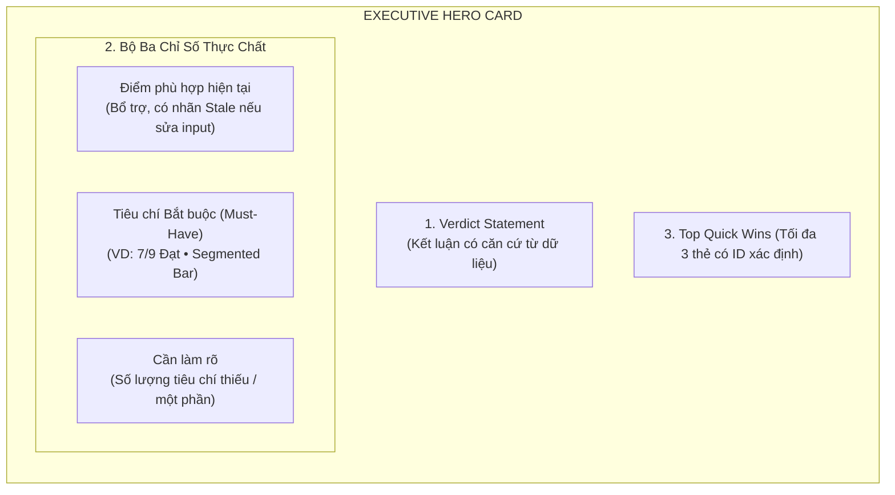
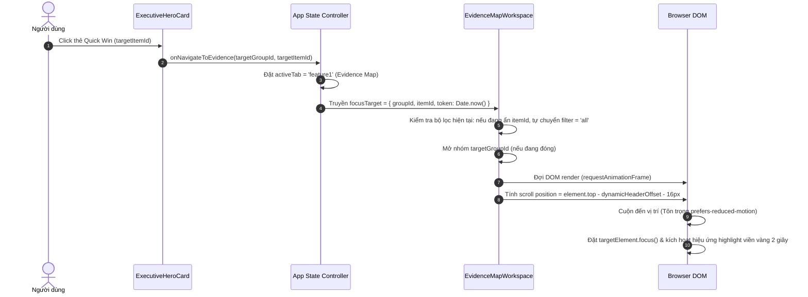
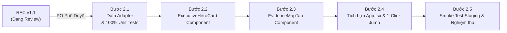

# RFC: Phase 2 Architecture & UX Blueprint — Executive Hero Card & Evidence Map Workspace

> **Tài liệu tham chiếu:** `docs/PHASE_2_PROPOSAL_RFC.md`  
> **Phiên bản:** 1.1 (Cập nhật Tháng 11/2026 sau phản biện kiến trúc của PO & ChatGPT)  
> **Trạng thái:** DRAFT / UNDER ARCHITECTURE REVIEW — Chưa phê duyệt triển khai hoặc deploy  
> **Nhánh áp dụng dự kiến:** `staging`  
> **Liên kết kế hoạch tổng thể:** [`docs/UI_UX_IMPLEMENTATION_PLAN.md`](file:///c:/Users/User/Downloads/VU%20TA/GITHUB%20REPO/rolematch2/docs/UI_UX_IMPLEMENTATION_PLAN.md)

---

## 1. Bối Cảnh, Mục Tiêu & Ranh Giới Phạm Vi Phase 2

### 1.1. Hiện trạng sau Phase 1
- **Phase 1 đã hoàn tất và kiểm chứng (Commit `50371fd`):**
  - Header nền sáng chuẩn Google Workspace, tích hợp Pill Switch Ứng viên / Nhà tuyển dụng.
  - `CompactContextBar` tự động ghim động theo chiều cao Header (`ResizeObserver`), tương thích mọi mức zoom 100%–200%.
  - Cơ chế nhận diện dữ liệu sửa đổi (`isInputDirty`), phân biệt rõ `Điểm hồ sơ` (xanh) với `Điểm lần phân tích trước` (hổ phách), tự xóa cảnh báo khi hoàn tác (Undo).
  - Giữ nguyên văn bản, tệp đính kèm và tab con trong DOM (`hidden` toggle). Chặn sửa đầu vào khi AI đang phân tích (`disabled={isLoading}`).

### 1.2. Mục tiêu cốt lõi của Phase 2 (P2)
Giải quyết triệt để tình trạng **"Bức tường chữ" (Cognitive Overload)** ở khu vực kết quả:
1. **Executive Hero Card:** Nắm bắt kết luận đánh giá và tình trạng yêu cầu bắt buộc (Must-Have) trong **3–5 giây đầu tiên**.
2. **Evidence Map Workspace:** Phân nhóm năng lực cốt lõi theo Progressive Disclosure 3 tầng; đối chiếu trực tiếp giữa yêu cầu JD và bằng chứng thực tế trong CV.
3. **Quick Wins có đích xác định:** Điều hướng thẳng đến tiêu chí cần bổ sung chỉ với 1 cú click.

### 1.3. Ranh giới phạm vi (Scope Boundaries) — Tách biệt rõ ràng P2 và P3
- **Thuộc phạm vi P2:**
  - Executive Hero Card (Verdict khách quan, Metric Cards thực chất, Quick Wins có đích đến).
  - Evidence Map Workspace (Bộ lọc nhanh, 5 nhóm năng lực, bảng chi tiết drill-down).
  - Data Adapter phía client (`evidenceMapAdapter.ts`) chuyển đổi từ dữ liệu backend hiện có.
  - Luồng điều hướng 1-Click Jump (chuyển tab, mở nhóm, cuộn và đặt focus có accessibility).
  - Hướng dẫn bổ sung bằng chứng khách quan (Advisory notes).
- **Tuyệt đối KHÔNG thuộc phạm vi P2 (Dành cho Phase 3):**
  - Không có tính năng tự áp dụng câu vào bản nháp CV.
  - Không có CV Diff Studio, trình biên tập trực tiếp hoặc luồng Undo/Redo chỉnh sửa tài liệu.
  - Không sửa đổi backend prompt hoặc gọi thêm lượt AI quota.

---

## 2. Thống Nhất 4 Lựa Chọn UX Cốt Lõi

| Hạng mục | Quyết định chốt | Chi tiết kỹ thuật & Lý do |
| :--- | :--- | :--- |
| **1. Verdict Statement** | **Phương án B: Adapter thuần Client** | Sử dụng dữ liệu hiện có từ `CompleteCVAnalysisResponse`. Không sửa prompt backend, không gọi thêm lượt AI, đảm bảo 0 latency và 0 quota. |
| **2. Tương tác Quick Win** | **Lựa chọn 1: 1-Click Jump to Evidence** | Chuyển sang Tab Evidence Map, tự mở nhóm năng lực tương ứng, cuộn và đặt focus vào đúng dòng tiêu chí. **Không tự sửa CV** (dành cho P3). |
| **3. Mở rộng nhóm mặc định** | **Phương án B: Mở nhóm Must-Have cần làm rõ nhất** | Chỉ tự động mở khi hiển thị kết quả lần đầu. Sau đó ghi nhớ lựa chọn của người dùng (User intent persistence). **Cho phép mở nhiều nhóm cùng lúc (Multi-expandable)**, không ép kiểu Accordion đóng mở cưỡng bức. |
| **4. Bố cục Mobile (<640px)** | **Xếp dọc — Không dùng Carousel** | Xếp chồng thẻ dọc để loại trừ swipe friction. Bảng chi tiết chuyển thành thẻ dọc. Giữ nhãn trạng thái bằng chữ (VD: `[Đủ bằng chứng]`, `[Một phần]`, `[Chưa thấy]`), **không chỉ dùng màu** (tuân thủ WCAG cho người mù màu). |

---

## 3. Cấu Trúc Thành Phần & Tiêu Chuẩn Hiển Thị

### 3.1. Executive Hero Card (Nằm trên thanh Tabs)



#### A. Loại bỏ hoàn toàn các chỉ số suy diễn không căn cứ
- **Nghiêm cấm:** Không hiển thị “ATS Pass Rate” hay “Top 15% hồ sơ ứng tuyển” suy diễn từ điểm tổng. Schema hiện tại không có dữ liệu đối chuẩn thị trường.
- `inviteDecision` là nhận định mô phỏng nội bộ, không phải xác suất trúng tuyển. Nếu nhận định mâu thuẫn với bảng bằng chứng, adapter hiển thị đúng số liệu thực tế, không tạo kết luận chủ quan mạnh hơn.

#### B. Mẫu câu Verdict Statement chuẩn hóa:
- **Cấu trúc:**  
  *`"CV đã thể hiện rõ {passed}/{total} yêu cầu được xác định là bắt buộc; {partial} yêu cầu có bằng chứng một phần và {gap} yêu cầu chưa thấy bằng chứng."`*
- **Nguyên tắc tôn trọng ứng viên:** Dùng cụm từ *"Chưa thấy bằng chứng trong CV"* thay vì quy chụp *"Ứng viên không có năng lực"*.

#### C. Bộ ba thẻ chỉ số (Real Metrics):
1. **Thẻ 1: Tiêu chí Bắt buộc (Must-Have):**
   - Tỷ lệ: `{passed} / {total} Đạt`.
   - Segmented Progress Bar: Xanh lá (Đủ bằng chứng) / Vàng (Một phần) / Đỏ (Chưa thấy).
   - Nếu `total === 0`: Hiển thị *"Chưa xác định yêu cầu bắt buộc"*, **không hiển thị 100%**.
2. **Thẻ 2: Cần làm rõ (Clarification Needed):**
   - Tính trực tiếp: `{gap + partial} tiêu chí` cần bổ sung thông tin hoặc minh chứng dự án.
3. **Thẻ 3: Điểm phù hợp (Match Score):**
   - Đóng vai trò bổ trợ.
   - Khi input bị sửa: Đổi nhãn thành `Điểm lần phân tích trước` màu hổ phách đồng bộ với P1.

#### D. Top Quick Wins có đích đến xác định:
- **Nguyên tắc tạo thẻ:**
  - Lấy trực tiếp từ các `EvidenceItem` có khoảng trống thực tế.
  - **Thứ tự ưu tiên:**  
    1. Must-Have chưa thấy bằng chứng (`isMustHave && matchStatus === 'thieu'`).  
    2. Must-Have một phần (`isMustHave && matchStatus === 'can_bo_sung'`).  
    3. Các tiêu chí khác cần làm rõ.
  - **Không ép đủ 3 thẻ:** Nếu chỉ có 1 hoặc 2 mục thiếu, chỉ hiển thị đúng 1 hoặc 2 thẻ. Nếu không có mục thiếu, hiển thị trạng thái hồ sơ đã bao phủ tốt các yêu cầu chính.
  - **Ánh xạ chuỗi tự do (`top3MustFix`):** Chỉ gắn nút điều hướng khi xác định được `targetItemId` chắc chắn; trường hợp không map được thì hiển thị dưới dạng **Hướng dẫn chung (General Advisory)** không có nút Jump.

---

### 3.2. Evidence Map Workspace (Thay thế `KeywordMatchTab`)

#### A. Tầng 1: Bộ Lọc Nhanh (Fast Filter Chips)
- Đặt phía trên bảng nhóm năng lực:
  - `Tất cả ({total})` — Mặc định.
  - `Bắt buộc ({mustHaveCount})` — Lọc nhanh các điều kiện tiên quyết.
  - `Chưa thấy bằng chứng ({gapCount})` — Lọc các khoảng trống cần bổ sung khẩn cấp.
  - `Cần làm rõ ({partialCount})` — Lọc các mục có bằng chứng một phần.
- **Quy tắc bộ lọc:** Khi người dùng click Quick Win mà bộ lọc hiện tại đang ẩn đích đến, hệ thống sẽ **tự động chuyển bộ lọc về `Tất cả`** để làm lộ tiêu chí đích trước khi cuộn.

#### B. Tầng 2: 5 Nhóm Năng Lực Cốt Lõi (Competency Groups)
1. **Kỹ năng Chuyên môn (Core Technical Skills)**
2. **Công cụ & Phương pháp (Tools & Methodologies)**
3. **Kinh nghiệm Thực tế (Hands-on Domain Experience)**
4. **Kết quả & Đầu ra đo lường được (Outcomes & Deliverables)**
5. **Văn hóa & Làm việc nhóm (Soft Skills & Culture)**
- Nếu có tiêu chí không thể phân loại: Đưa vào nhóm **"Khác / Chưa phân loại" (Uncategorized)**, **tuyệt đối không bỏ sót dòng**.
- **Quy tắc thanh tiến độ:** Nhóm có 0 tiêu chí sẽ hiển thị thanh rỗng màu xám, **không được vẽ thanh 100%**.

#### C. Tầng 3: Bảng Đối Chiếu Chi Tiết Mở Rộng
Khi mở rộng nhóm, hiển thị danh sách tiêu chí với 4 cột:
1. **Yêu cầu JD & Mức độ quan trọng:** Tên tiêu chí, huy hiệu `Bắt buộc` hoặc `Điểm cộng`.
2. **Bằng chứng trong CV:** Trích dẫn câu thực tế từ CV (kèm số dòng/vị trí nếu có) hoặc nhãn `Chưa thấy bằng chứng`.
3. **Khoảng trống / Cần làm rõ:** Ghi nhận điểm chưa rõ ràng từ góc nhìn nhà tuyển dụng.
4. **Hướng dẫn bổ sung bằng chứng (Advisory):**  
   - **Chống bịa đặt (Anti-Hallucination):** Không dùng `inferSuggestedPhrasing` cũ để tự viết câu khẳng định ứng viên đã có kinh nghiệm khi CV chưa từng nhắc đến.  
   - **Mẫu hướng dẫn chuẩn:**  
     *`"Nếu bạn đã từng sử dụng công nghệ này, hãy bổ sung dự án thực tế, quy mô và vai trò của bạn theo định dạng: [Hành động] + [Công nghệ] + [Kết quả đạt được]."`*

---

## 4. Hợp Đồng Dữ Liệu Của Adapter (`src/utils/evidenceMapAdapter.ts`)

### 4.1. TypeScript Interface Chuẩn Hóa

```typescript
export type MatchStatus = 'khop' | 'can_bo_sung' | 'thieu' | 'chua_doi_chieu';
export type MustHaveSource = 'explicit' | 'keyword_match' | 'inferred_importance' | 'unspecified';

export interface EvidenceItem {
  /** Deterministic ID: evi_${categorySlug}_${termSlug} */
  id: string;
  term: string;
  normalizedTerm: string;
  category: string;
  categoryTitle: string;
  importance: string;
  isMustHave: boolean;
  mustHaveSource: MustHaveSource;
  cvEvidence: string;
  gapOrClarification: string;
  matchStatus: MatchStatus;
  suggestedGuidance: string;
  targetSectionHint?: string;
  isUnverified?: boolean;
}

export interface CompetencyGroup {
  id: string;
  categoryKey: string;
  title: string;
  total: number;
  matchedCount: number;
  partialCount: number;
  gapCount: number;
  uncomparedCount: number;
  mustHaveCount: number;
  items: EvidenceItem[];
}

export interface QuickWinAction {
  id: string;
  targetGroupId: string;
  targetItemId?: string;
  title: string;
  description: string;
  hasDirectNavigation: boolean;
  isMustHave: boolean;
}

export interface ExecutiveHeroViewModel {
  verdictTitle: string;
  verdictStatement: string;
  overallScore: number;
  isScoreStale: boolean;
  mustHaveTotal: number;
  mustHavePassed: number;
  mustHavePartial: number;
  mustHaveGap: number;
  hasUnspecifiedMustHave: boolean;
  clarificationCount: number;
  quickWins: QuickWinAction[];
}

export interface EvidenceMapViewModel {
  hero: ExecutiveHeroViewModel;
  groups: CompetencyGroup[];
  totalCriteriaCount: number;
  uncategorizedGroup?: CompetencyGroup;
}
```

### 4.2. Quy Tắc Xử Lý Dữ Liệu & Ranh Giới An Toàn (Edge Cases)

1. **Nguồn chân lý duy nhất (Single Source of Truth):**
   `hero` và `groups` được sinh ra trong cùng một chu trình adapter từ `buildEvidenceMapViewModel(analysis, isInputDirty)`. Mọi con số đếm (Total, Passed, Partial, Gap) đảm bảo khớp nhau 100%.
2. **Quy tắc xác định `isMustHave` theo thứ bậc:**
   - *Bậc 1 (Explicit):* Nếu `ComparisonRow.isMustHave !== undefined`, dùng trực tiếp (`source: 'explicit'`).
   - *Bậc 2 (Keyword Match):* Ghép chuẩn hóa (lowercase, strip diacritics, trim) với `jdKeywords`. Nếu tìm thấy keyword trùng khớp, lấy `keyword.isMustHave` (`source: 'keyword_match'`).
   - *Bậc 3 (Suy luận importance):* Nếu `importance` là `'Rất quan trọng'` hoặc `'Bắt buộc'`, coi là Must-Have (`source: 'inferred_importance'`).
   - *Bậc 4 (Không xác định):* Gán `isMustHave = false` (`source: 'unspecified'`). Nếu cả hồ sơ không có tiêu chí nào ở Bậc 1–3, gắn cờ `hasUnspecifiedMustHave = true`.
3. **Keyword trong JD chưa có dòng đối chiếu trong `comparisonTable`:**
   - Được đưa vào Evidence Map với trạng thái `matchStatus: 'chua_doi_chieu'`.
   - **Tuyệt đối không tự suy diễn** là đạt hay thiếu bằng chứng.
4. **Dòng trùng lặp (Duplicate Terms):**
   - Nếu xuất hiện 2 dòng cùng `normalizedTerm` trong cùng nhóm: Hợp nhất bằng chứng CV (`cvEvidence = ev1 + "\n" + ev2`), giữ trạng thái bảo thủ hơn (ưu tiên `thieu` > `can_bo_sung` > `khop`).
5. **Ghép nhiều nghĩa (Ambiguity):**
   - Ưu tiên Exact match > Substring match dài nhất. Nếu vẫn trùng nhiều category, gán vào category đầu tiên và ghi nhận log cảnh báo nội bộ.
6. **Dữ liệu thiếu hoặc trạng thái không hợp lệ:**
   - Không tự động chuyển thành `thieu`. Gán cờ `isUnverified: true` để giao diện hiển thị badge `[Chưa xác minh]`.
7. **Tính ổn định của ID (Deterministic ID):**
   - ID sinh theo công thức: `evi_${slugify(category)}_${slugify(term)}`. Đảm bảo ID không thay đổi khi sắp xếp hay lọc danh sách.

---

## 5. Quy Trình Điều Hướng 1-Click Jump Chuẩn Mực



- **Hỗ trợ Accessibility & Bàn phím:**
  - Dòng tiêu chí được gán `tabIndex={-1}` để nhận programmatic focus.
  - Nếu người dùng bật `prefers-reduced-motion`, chuyển `behavior: 'auto'` (cuộn tức thì) thay vì `behavior: 'smooth'`.
- **Sử dụng Offset động của P1:** Vị trí cuộn trừ đúng chiều cao thực tế `headerHeight + contextBarHeight` để dòng tiêu chí không bị ghim đè bên dưới thanh Context Bar.

---

## 6. Quản Lý Trạng Thái & Chống Hồi Quy

1. **Bảo lưu lựa chọn (Tab Persistence):** Khi người dùng chuyển qua lại giữa Tab Evidence Map và các Tab khác (Recruiter Scan, Interview Prep), bộ lọc hiện tại và danh sách các nhóm đang mở được giữ nguyên vẹn.
2. **Reset khi đổi hồ sơ:** Khi người dùng phân tích cặp CV/JD mới hoặc chọn bản ghi từ Lịch sử:
   - Reset bộ lọc về `Tất cả`.
   - Reset trạng thái mở nhóm về mặc định (chỉ mở nhóm Must-Have cần làm rõ nhất).
3. **Phân tích lại bị lỗi hoặc Stale Input:**
   - Nếu sửa input: Giữ nguyên điểm và dữ liệu Evidence Map, chỉ bật cảnh báo Stale và đổi nhãn thành `Điểm lần phân tích trước`.
   - Nếu phân tích lại thất bại: Báo cáo cũ còn nguyên, mở lại form nhập liệu để người dùng sửa đổi.
4. **Bảo toàn 100% P1:** Toàn bộ Header, Context Bar, ResizeObserver và cơ chế bảo vệ file upload tiếp tục hoạt động độc lập và ổn định.

---

## 7. Kế Hoạch Kiểm Thử & Tiêu Chí Nghiệm Thu Hai Cấp Độ

### 7.1. Cấp độ 1: Kiểm thử Tự động (Unit & Integration Tests)
File kiểm thử chuyên biệt: `src/utils/evidenceMapAdapter.test.ts` & `src/phase2_verification.test.ts`.

| Bộ kiểm thử | Kịch bản kiểm chứng chi tiết |
| :--- | :--- |
| **Adapter Edge Cases** | - Dữ liệu cũ thiếu `isMustHave` và `category`.<br/>- Hồ sơ 0 Must-Have (`hasUnspecifiedMustHave === true`, không hiện 100%).<br/>- Keywords chưa có trong bảng đối chiếu (`chua_doi_chieu`).<br/>- Trùng lặp term, category không xác định.<br/>- Trạng thái match không hợp lệ (`isUnverified`). |
| **Single Source of Truth** | Kiểm tra tổng số lượng tiêu chí và tỷ lệ đếm giữa Hero và các Group luôn khớp 100%. |
| **Quick Win Generation** | - Tạo tối đa 3 thẻ, đúng thứ tự ưu tiên Must-Have.<br/>- Xử lý mượt mà khi chỉ có 0, 1 hoặc 2 lỗi.<br/>- Chuỗi tự do không có ID thì không sinh nút Jump. |
| **Navigation & Filter Override** | Khi filter đang chọn `Chưa có bằng chứng` nhưng target lại là mục `Một phần`, kiểm tra hàm điều hướng tự động chuyển filter về `Tất cả`. |
| **P1 Regression** | Kiểm tra toàn bộ 142/142 tests hiện tại tiếp tục PASS 100%. |

### 7.2. Cấp độ 2: Kiểm thử Thực tế trên Trình duyệt (Usability & Browser Verification)
- **Kiểm thử bố cục đa màn hình:**
  - Desktop 100% (1440px / 1920px).
  - Zoom 125%, 150%, 200% — quan sát không chồng đè giữa Header, Context Bar, Hero Card và Tabs.
  - Mobile (375px–414px) — xác nhận thẻ dọc, không carousel, nút bấm >=44px, nhãn trạng thái bằng chữ rõ ràng.
- **Đánh giá Usability (Mục tiêu 3–5 giây):**
  - Người dùng mở kết quả lần đầu có thể đọc ngay câu Verdict và biết ngay số tiêu chí Must-Have đạt/thiếu mà không cần cuộn trang.
  - Bấm 1 Quick Win chuyển đúng đến dòng tiêu chí cần sửa và nhận biết được bằng viền highlight.

---

## 8. Lộ Trình Triển Khai Sau Khi PO Chốt RFC v1.1



> ⚠️ **Cam kết nguyên tắc:**  
> Giữ nguyên trạng thái tài liệu là **DRAFT / UNDER REVIEW**.  
> **Tuyệt đối chưa sửa mã nguồn ứng dụng, chưa tạo component P2 và chưa deploy lên Staging trước khi PO chính thức phê duyệt phương án kiến trúc v1.1 này.**
