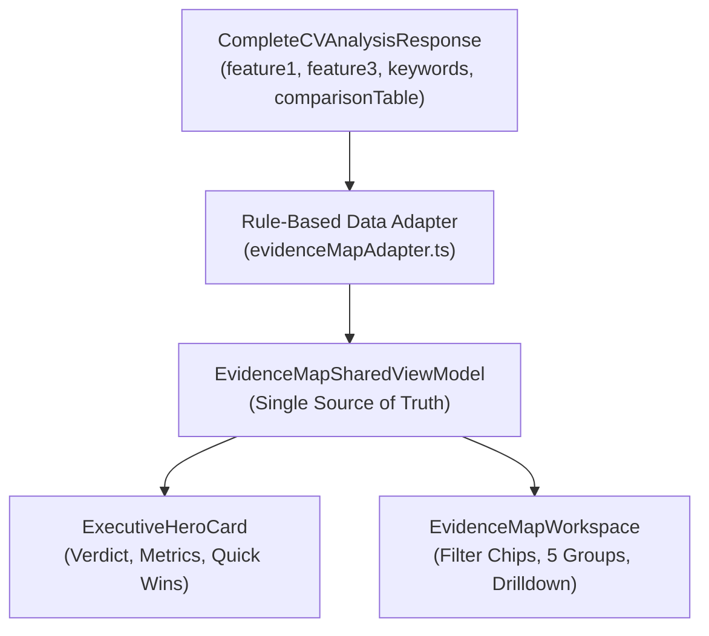
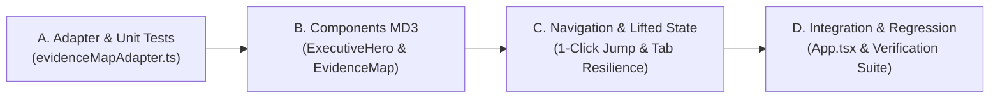

# RFC v1.1: Phase 2 Architecture & Data Blueprint — Executive Hero Card & Evidence Map Workspace

> **Tài liệu tham chiếu:** `docs/PHASE_2_PROPOSAL_RFC.md`  
> **Phiên bản:** 1.1 (Tháng 11/2026 — Đã tích hợp đầy đủ hợp đồng dữ liệu, ranh giới Phase 2 & chỉ đạo từ PO)  
> **Trạng thái:** APPROVED SPECIFICATION — Sẵn sàng cho triển khai kỹ thuật  
> **Nhánh áp dụng:** `staging`  
> **Liên kết kế hoạch tổng thể:** [`docs/UI_UX_IMPLEMENTATION_PLAN.md`](file:///c:/Users/User/Downloads/VU%20TA/GITHUB%20REPO/rolematch2/docs/UI_UX_IMPLEMENTATION_PLAN.md)

---

## 1. Bối Cảnh, Mục Tiêu & Ranh Giới Phạm Vi Phase 2 (P2 Scope)

### 1.1. Mục tiêu cốt lõi của Phase 2
- Giải quyết triệt để "Bức tường chữ" (Cognitive Overload) từ kết quả phân tích.
- Tái cấu trúc trải nghiệm theo 2 thành phần chính:
  1. **`ExecutiveHeroCard` (Nằm trên thanh Tabs):** Cung cấp kết luận định lượng, rõ ràng có căn cứ trong 3–5 giây đầu tiên.
  2. **`EvidenceMapWorkspace` (Tab 1 thay thế `KeywordMatchTab` cũ):** Trình bày bằng chứng theo 5 nhóm năng lực, thanh phân đoạn trực quan và bộ lọc 1-click.
- Hỗ trợ **Quick Win Navigation** chuyển tab, tự gỡ bộ lọc che đích, mở nhóm và cuộn đặt focus tiếp cận vào đúng tiêu chí.

### 1.2. Ranh giới nghiêm ngặt của Phase 2 (Out of Scope for P2)
- **Giữ nguyên 100% backend:** Không thay đổi server prompt, không gọi thêm lượt AI phụ, không làm phát sinh thêm quota trong Phase 2.
- **Không có luồng biên tập hoặc áp dụng câu viết lại trong P2:** Chưa triển khai chức năng chỉnh sửa CV, áp dụng câu viết lại vào bản nháp (`cvDraft`), Undo/Redo hay can thiệp văn bản của Phase 3. P2 tập trung hoàn toàn vào **Thấu hiểu, Đọc bằng chứng, Lọc và Điều hướng**.
- **Không tự ý deploy sản phẩm:** Chỉ triển khai code và kiểm thử trên môi trường phát triển; chỉ merge/deploy khi PO duyệt toàn bộ bằng chứng nghiệm thu thực tế.

---

## 2. Hợp Đồng Dữ Liệu Chi Tiết (Data Contract & Adapter Layer)

Để đảm bảo tính nhất quán giữa Hero Card và Evidence Map, toàn bộ dữ liệu hiển thị phải đi qua một Adapter duy nhất (`evidenceMapAdapter.ts`) với các nguyên tắc nghiêm ngặt sau:

### 2.1. Đơn vị nguồn sự thật duy nhất (Single Source of Truth)
- `ExecutiveHeroCard` và `EvidenceMapWorkspace` **phải dùng chung một ViewModel** và **áp dụng cùng một quy tắc đếm**. Tuyệt đối không để xảy ra trường hợp Hero Card hiển thị 7/9 Must-Have mà vào Evidence Map lại đếm ra số lượng khác.

### 2.2. Quy tắc phân loại Tiêu chí Bắt buộc (Must-Have vs. Nice-to-Have)
1. **Ưu tiên giá trị tường minh (`isMustHave` explicit):**
   - Nếu tiêu chí trong `comparisonTable` hoặc `jdKeywords` đã có trường boolean `isMustHave !== undefined`, adapter sử dụng trực tiếp giá trị này (`source: 'explicit'`).
2. **Quy tắc suy luận fallback và ghi nhận nguồn gốc:**
   - Nếu `isMustHave` không có sẵn, tiêu chí chỉ được suy luận là Bắt buộc nếu `importance === 'Rất quan trọng'`.
   - Adapter phải đánh dấu rõ nguồn gốc suy luận: `mustHaveSource: 'inferred_importance'`. Giao diện có tooltip/ghi chú nhỏ giải thích tiêu chí được xác định dựa trên mức độ quan trọng cao nhất của JD.
3. **Quy tắc xử lý trường hợp không có Must-Have:**
   - Nếu hồ sơ/JD không xác định được tiêu chí bắt buộc nào (`mustHaveTotal === 0`):
     - Hệ thống hiển thị: *"Chưa xác định yêu cầu bắt buộc trong JD"* (hoặc nhãn trung tính tương đương).
     - **Tuyệt đối không mặc định coi là đạt 100%** hoặc hiển thị tỷ lệ giả định $0/0 = 100\%$.

### 2.3. Quy tắc phân loại Trạng thái Bằng chứng (Evidence Match Status)
Phân định rạch ròi 3 trạng thái có căn cứ:
1. `khop` (Đủ bằng chứng - Xanh lá): CV có câu văn/dự án chứng minh rõ ràng.
2. `can_bo_sung` (Một phần - Vàng hổ phách): CV có nhắc đến nhưng thiếu bối cảnh, thiếu số liệu hoặc còn chung chung.
3. `thieu` (Chưa thấy bằng chứng - Đỏ/Hồng): Không tìm thấy bằng chứng phù hợp trong nội dung CV hiện tại.

> [!IMPORTANT]
> **Quy tắc Keyword chưa có dòng đối chiếu:**  
> Nếu một từ khóa nằm trong danh sách `jdKeywords` nhưng chưa xuất hiện trong `comparisonTable`, adapter phải phân loại vào nhóm **"Chưa được đối chiếu"**, tuyệt đối **không tự ý coi là thiếu bằng chứng (thieu)**.

### 2.4. Phân nhóm Năng lực (5 Nhóm chuẩn & Nhóm dự phòng)
Ánh xạ chuẩn hóa từ `KeywordCategory`:
1. `Kỹ năng chuyên môn` $\rightarrow$ `tech` (Kỹ Năng Chuyên Môn)
2. `Công cụ, phần mềm hoặc phương pháp` $\rightarrow$ `tools` (Công Cụ & Phương Pháp)
3. `Kinh nghiệm mong muốn` $\rightarrow$ `experience` (Kinh Nghiệm Thực Tế)
4. `Kết quả đầu ra hoặc kỳ vọng công việc` $\rightarrow$ `outcomes` (Kết Quả & Đầu Ra)
5. `Phẩm chất hoặc cách làm việc` $\rightarrow$ `culture` (Văn Hóa & Làm Việc Nhóm)
- **Nhóm Chưa Phân Loại (`unclassified`):** Mọi tiêu chí có category không khớp 5 nhóm trên hoặc bị trống/lỗi dữ liệu phải được gom vào nhóm **"Chưa phân loại"**, không được bỏ sót hay vứt bỏ dữ liệu của ứng viên.

### 2.5. Xử lý Trùng lặp, Xung đột & Dữ liệu không hợp lệ
- **Trùng lặp (Deduplication):** Nếu có nhiều dòng đối chiếu trùng cùng một thuật ngữ `jdTerm` (không phân biệt hoa thường), adapter giữ dòng có thông tin chi tiết nhất (hoặc gộp bằng chứng), không hiển thị lặp dòng.
- **Xung đột trạng thái:** Nếu `jdKeywords` gắn nhãn `isMustHave = false` nhưng `comparisonTable` gắn `isMustHave = true`, ưu tiên cờ tường minh từ `comparisonTable`.
- **Chống bịa đặt dữ liệu (Anti-Hallucination):** Tuyệt đối không tự sinh câu khẳng định kinh nghiệm, công nghệ hay số liệu định lượng nếu dữ liệu gốc không có căn cứ.

> [!NOTE]
> **Lưu ý về tính toán định lượng:**  
> Rule-based adapter đảm bảo thuật toán tính toán, quy tắc làm tròn và xử lý dữ liệu đầu ra mang tính nhất quán logic và kiểm thử tự động được $100\%$. Điều này không bảo đảm bản thân nội dung văn bản do AI sinh ra ở bước trước là hoàn hảo tuyệt đối; do đó giao diện luôn trình bày dưới dạng nhận định hỗ trợ tham khảo.

---

## 3. Bốn Quyết Định Kiến Trúc Đã Thống Nhất

### Quyết định 1: Phán Quyết Hệ Thống (Verdict Statement) bằng Rule-Based Adapter
- Sử dụng hoàn toàn dữ liệu có sẵn, không gọi thêm AI.
- Câu phán quyết phản ánh số liệu thực tế:
  > *"CV đã thể hiện rõ 7/9 yêu cầu được xác định là bắt buộc; 1 yêu cầu có bằng chứng một phần và 1 yêu cầu chưa thấy bằng chứng trong hồ sơ."*
- `feature3.inviteDecision` (YES/NO/MAYBE) và `decisionReason` chỉ là nhận định bổ trợ, không diễn giải YES thành cam kết chắc chắn trúng tuyển.
- Không sử dụng các khái niệm phỏng đoán thiếu dữ liệu đo như *"Top 15%"* hay *"ATS Pass: Rất cao"*.

### Quyết định 2: Tương Tác Top 3 Quick Wins Điều Hướng Đến Evidence Map
- **Điều hướng xác định (Deterministic Linking):** Chỉ hiển thị nút `[ Xem vị trí ]` khi Quick Win có `targetItemId` hợp lệ khớp với một tiêu chí trong bảng đối chiếu.
- Nếu `top3MustFix` hay `immediateActions` là văn bản tự do không ánh xạ được 1-1, hiển thị dạng checklist tư vấn thông thường, không đoán mò liên kết.
- Hiển thị tối đa 3 Quick Wins; nếu dữ liệu chỉ có 1 hoặc 2 thì chỉ hiển thị số lượng thực có.
- **Chuỗi thao tác 1-Click Jump:**
  1. Chuyển tab sang `feature1` (Evidence Map).
  2. Tự động chuyển bộ lọc về `all` nếu bộ lọc hiện tại đang vô tình ẩn tiêu chí đích.
  3. Mở accordion nhóm chứa tiêu chí đích nếu đang đóng.
  4. Cuộn trang có bù trừ khoảng trống động (Dynamic header offset đã hoàn thành ở P1).
  5. Đặt focus trợ năng bàn phím và kích hoạt viền highlight nhẹ 2 giây. Sau khi hết 2 giây, focus ring và nhãn ngữ cảnh vẫn được giữ nguyên.
- Không đánh dấu trạng thái là `applied` chỉ vì người dùng đã bấm xem hoặc sao chép.

### Quyết định 3: Trạng Thái Mở Nhóm Năng Lực & Bảo Toàn State
- **Thuật toán mở nhóm ưu tiên (Lần đầu nạp kết quả):**
  - Nhóm có nhiều Must-Have thiếu bằng chứng (`gap`) nhất.
  - Nếu bằng nhau: nhóm có nhiều Must-Have bằng chứng một phần (`partial`) nhất.
  - Nếu vẫn bằng nhau: nhóm đầu tiên theo thứ tự nghiệp vụ cố định (`tech` $\rightarrow$ `tools` $\rightarrow$ `experience` $\rightarrow$ `outcomes` $\rightarrow$ `culture`).
  - Nếu không có khoảng trống: mở nhóm đầu tiên có dữ liệu.
- **Bảo toàn trạng thái chống unmount (Tab Unmount Resilience):**
  - Do `App.tsx` có thể unmount component con khi chuyển `activeTab`, toàn bộ state:
    - Danh sách các nhóm đang mở (`expandedGroups: Set<string>`)
    - Bộ lọc nhanh hiện tại (`competencyFilter: 'all' | 'must_have' | 'gap'`)
    phải được **nâng lên (lift state) cấp App** hoặc lưu trong state store gắn chặt với `analysisId` (ID của kết quả phân tích hiện tại).
  - Trạng thái **không bị reset** khi chuyển đổi qua lại giữa các tab hoặc đổi ngôn ngữ (VI/EN).
  - Chỉ khởi tạo lại (re-initialize) khi người dùng phân tích bộ dữ liệu mới hoặc chọn Preset khác.
  - Cho phép người dùng mở nhiều nhóm đồng thời (Multi-expand).

### Quyết định 4: Bố Cục Mobile / Tablet Nhỏ — Xếp Dọc & Trực Quan
- Xếp dọc các thẻ chỉ số theo hàng ngắn, không dùng thao tác vuốt ẩn (swipeable carousel).
- Hero Card không sticky trên thiết bị nhỏ để giữ không gian cuộn đọc dữ liệu.
- Mọi thanh phân đoạn Segmented Bar phải hiển thị đồng thời cả **số đếm**, **nhãn chữ** và **màu sắc** (tuân thủ nguyên tắc tiếp cận cho người mù màu).
- Bảng đối chiếu trên mobile chuyển thành thẻ dọc:
  $$\text{Yêu cầu JD} \longrightarrow \text{Bằng chứng CV} \longrightarrow \text{Khoảng trống} \longrightarrow \text{Gợi ý mẫu}$$

---

## 4. Kế Hoạch Triển Khai Kỹ Thuật Theo Thứ Tự

| Giai đoạn | Nội dung công việc chi tiết | Files tác động |
| :--- | :--- | :--- |
| **Bước A** | Xây dựng Data Adapter với đầy đủ quy tắc tính Must-Have, phân loại 5 nhóm + 1 nhóm unclassified, xử lý trùng lặp và dữ liệu thiếu. Viết unit tests bao phủ 100% các ca biên. | `src/utils/evidenceMapAdapter.ts` `src/utils/evidenceMapAdapter.test.ts` |
| **Bước B** | Xây dựng component `ExecutiveHeroCard` và `EvidenceMapTab` theo Google MD3 tokens, hỗ trợ giao diện thẻ dọc trên mobile và đa mở nhóm. | `src/components/ExecutiveHeroCard.tsx` `src/components/EvidenceMapTab.tsx` |
| **Bước C** | Cài đặt luồng 1-Click Jump từ Quick Win sang Evidence Map (auto-unhide filter, auto-expand, dynamic offset, accessible focus) và nâng state lên App để chống mất state khi đổi tab. | `src/App.tsx` `src/components/ExecutiveHeroCard.tsx` `src/components/EvidenceMapTab.tsx` |
| **Bước D** | Tích hợp hoàn chỉnh, chạy typecheck (`tsc`), test suite hồi quy Phase 1 & Phase 2, build kiểm tra bundle (`npm run build`). | `src/phase1_verification.test.ts` `src/phase2_verification.test.ts` |

---

## 5. Tiêu Chí & Bằng Chứng Nghiệm Thu Cần Báo Cáo Trước Khi Deploy

Báo cáo nghiệm thu cuối cùng trình PO sẽ bao gồm đầy đủ các bằng chứng thực nghiệm:
1. **Commit SHA** và bảng thống kê chi tiết các tệp thay đổi.
2. **Kết quả kiểm thử tự động:** `npm test`, `npx tsc --noEmit`, và `npm run build` đạt $100\%$ pass không cảnh báo lỗi.
3. **Kiểm chứng tương tác thực tế:**
   - Hoạt động mượt mà trên cả Desktop ($\ge 1024$px) và Mobile / Tablet ($< 640$px).
   - Kiểm tra hiển thị chuẩn xác trên cả 2 ngôn ngữ `VI` và `EN`.
   - Điều hướng bàn phím (`Tab`, `Enter`, `Space`) và focus outline tiếp cận.
   - 1-Click Jump hoạt động chính xác ngay cả khi bộ lọc nhanh đang ở trạng thái che giấu mục tiêu.
   - Trạng thái các nhóm mở và bộ lọc được bảo toàn nguyên vẹn khi chuyển tab hoặc đổi ngôn ngữ, và được reset đúng khi nạp phân tích mới.
   - Điểm số và thẻ cảnh báo dữ liệu thay đổi (*Stale score / input modified*) từ Phase 1 tiếp tục hoạt động chính xác, bảo toàn toàn bộ chức năng hồi quy của Phase 1.
