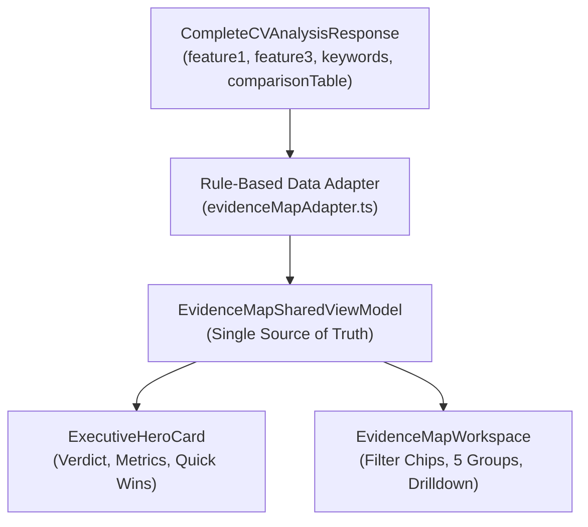

# RFC v1.2: Phase 2 Desktop-Focused Architecture & Data Blueprint — Executive Hero Card & Evidence Map Workspace

> **Tài liệu tham chiếu:** `docs/PHASE_2_PROPOSAL_RFC.md`  
> **Phiên bản:** 1.3 (Tháng 11/2026 — Hoàn tất nghiệm thu kỹ thuật Desktop tại commit `c5a2bfc`)  
> **Trạng thái Nghiệm thu Kỹ thuật:** ✅ **HOÀN TẤT NGHIỆM THU KỸ THUẬT (Desktop Scope — Commit `c5a2bfc`)**  
> **Trạng thái Deploy Staging:** ⏳ **CHƯA DEPLOY STAGING** *(Chờ lệnh triển khai từ PO; chỉ cập nhật sau khi có bằng chứng triển khai và smoke test thực tế)*  
> **Hồ sơ bằng chứng (CDP JSON, Logs, Ảnh chụp):** [`docs/evidence/phase2-c5a2bfc/`](file:///c:/Users/User/Downloads/VU%20TA/GITHUB%20REPO/rolematch2/docs/evidence/phase2-c5a2bfc/VERIFICATION_SUMMARY_AND_LOGS.md)  
> **Nhánh áp dụng:** `staging`  
> **Liên kết kế hoạch tổng thể:** [`docs/UI_UX_IMPLEMENTATION_PLAN.md`](file:///c:/Users/User/Downloads/VU%20TA/GITHUB%20REPO/rolematch2/docs/UI_UX_IMPLEMENTATION_PLAN.md)

---

## 1. Bối Cảnh, Mục Tiêu & Ranh Giới Phạm Vi Phase 2 (P2 Scope)

### 1.1. Phạm vi cốt lõi của Phase 2 (Desktop-First Focus)
- **Đối tượng người dùng mục tiêu:** Ứng viên và chuyên viên tuyển dụng sử dụng máy tính (Desktop / Laptop).
- **Ranh giới:** Bỏ các yêu cầu cải thiện UI/UX và kiểm thử mobile/tablet khỏi đợt P2 này. Giữ DOM hợp lệ, không gây xung đột ID và tập trung 100% vào tính đúng đắn của dữ liệu và trải nghiệm desktop.
- **Hai cấu phần trung tâm:**
  1. **`ExecutiveHeroCard` (Nằm trên thanh Tabs):** Cung cấp kết luận định lượng, rõ ràng có căn cứ trong 3–5 giây đầu tiên.
  2. **`EvidenceMapWorkspace` (Tab 1 thay thế `KeywordMatchTab` cũ):** Trình bày bằng chứng theo 5 nhóm năng lực, thanh phân đoạn trực quan và bộ lọc 1-click.
- Hỗ trợ **Desktop Quick Win Navigation** chuyển tab, chỉ gỡ bộ lọc khi thực sự che đích, mở nhóm và cuộn đặt focus tiếp cận vào đúng tiêu chí với khoảng bù trừ của cả top header và sticky tab bar.

### 1.2. Ranh giới nghiêm ngặt của Phase 2 (Out of Scope for P2)
- **Giữ nguyên 100% backend:** Không thay đổi server prompt, không gọi thêm lượt AI phụ, không làm phát sinh thêm quota trong Phase 2.
- **Không có luồng biên tập hoặc áp dụng câu viết lại trong P2:** Chưa triển khai chức năng chỉnh sửa CV, áp dụng câu viết lại vào bản nháp (`cvDraft`), Undo/Redo hay can thiệp văn bản của Phase 3. P2 tập trung hoàn toàn vào **Thấu hiểu, Đọc bằng chứng, Lọc và Điều hướng**.
- **Không yêu cầu tối ưu mobile/tablet:** Phạm vi mobile được tách khỏi P2.

---

## 2. Hợp Đồng Dữ Liệu & Quy Tắc Tính Toán Chuẩn Xác (Đã Hoàn Thiện)

### 2.1. Phân biệt rõ rệt Must-Have Đã đối chiếu, Chưa xác định (Unknown) & Chưa đối chiếu (Uncompared)
$$\text{mustHaveEvaluated} = \text{mustHavePassed} + \text{mustHavePartial} + \text{mustHaveGap} + \text{mustHaveUnknown}$$
$$\text{mustHaveTotal} = \text{mustHaveEvaluated} + \text{mustHaveUncompared}$$
- `mustHaveEvaluated`: Số lượng Must-Have đã có dòng trong `comparisonTable` (bao gồm cả trạng thái không hợp lệ được chuyển về `mustHaveUnknown`).
- `mustHaveUncompared`: Số lượng Must-Have có trong `jdKeywords` (sau khi khử trùng theo `normalizeTerm`) nhưng chưa xuất hiện trong `comparisonTable`.
- **Khử trùng Tri-state (`mergeIsMustHave`):** Bảo toàn chính xác 3 trạng thái `true | false | undefined` khi gộp từ khóa hoặc dòng đối chiếu trùng:
  - Có ít nhất 1 `true` $\rightarrow$ `true`
  - Không có `true`, có ít nhất 1 `false` $\rightarrow$ `false` (giữ quyền ưu tiên explicit `false` trước suy luận `importance`)
  - Cả hai đều `undefined` $\rightarrow$ `undefined` (cho phép suy luận từ `importance` khi không có cờ explicit trong toàn bộ dữ liệu).
- **Quy tắc phán quyết tuyệt đối:** **KHÔNG BAO GIỜ** kết luận *"đáp ứng đầy đủ tất cả các yêu cầu cốt lõi"* khi vẫn còn `mustHavePartial > 0`, `mustHaveGap > 0`, `mustHaveUnknown > 0`, hoặc `mustHaveUncompared > 0`.
- Hiển thị *"Chưa xác định"* và *"Chưa đối chiếu"* thành các pill trạng thái riêng biệt trên `ExecutiveHeroCard` và `EvidenceMapWorkspace`.

### 2.2. Khử va chạm chuỗi & Liên kết Quick Win xác định (Deterministic Linking)
- **Sử dụng Word Boundary Regex:** Khử lỗi chuỗi con (như `"Java"` bị ăn nhầm vào `"JavaScript"`, hay `"C"` vào `"C++"`).
- **Sắp xếp theo độ dài giảm dần:** Thuật ngữ dài hơn được đối chiếu trước.
- **Xử lý hành động nhắc nhiều tiêu chí:** Nếu hành động nhắc 2 tiêu chí trở lên (ví dụ: *"Bổ sung cả Docker và Kubernetes"*), adapter đánh dấu `targetItemId = undefined` (hướng dẫn chung) để không suy đoán bừa.
- **Ưu tiên tiêu chí Gap có ID thật:** Nếu không có câu fix nào khớp 1-1, adapter tự động tạo Quick Win trực tiếp từ các tiêu chí Must-Have Gap trong hồ sơ với ID chắc chắn $100\%$.

### 2.3. Định Danh Snapshot Tin Cậy (`computeAnalysisFingerprint`)
- Thay thế chuỗi ghép 4 trường dễ trùng lặp bằng hàm tạo fingerprint nội dung:
  - Kết hợp `requestId` (nếu có), hash danh sách tiêu chí `jdTerm:matchStatus:isMustHave`, hash từ khóa `jdKeywords` và điểm số.
  - Hoàn toàn độc lập với ngôn ngữ hiển thị (VI/EN).
  - Đảm bảo khi người dùng đổi sang phân tích mới (dù cùng công ty, chức danh, điểm và số dòng) thì state bộ lọc và nhóm mở vẫn được khởi tạo lại chính xác.

### 2.4. Không Biến Trạng Thái Lỗi Thành Partial
- Mọi trạng thái lạ ngoài `'khop' | 'can_bo_sung' | 'thieu'` được chuyển về `'unknown'`.
- Tuyệt đối không tự ý cộng vào `partialCount` hay `mustHavePartial`. Hiển thị nhãn trung tính *"Chưa xác định" / "Unknown"*.

### 2.5. Cột Khoảng Trống Trung Thực
- Nếu `gapOrClarification` rỗng nhưng tiêu chí có trạng thái là `thieu`: hiển thị *"Chưa tìm thấy bằng chứng trong hồ sơ"* / *"No evidence found in profile"*.
- **Chỉ hiển thị** *"Đã thể hiện tốt"* khi trạng thái thực sự là `khop`.

---

## 3. Hoàn Thiện Điều Hướng Desktop (Desktop Navigation Protocol)

1. **Bù trừ khoảng che của cả Top Header và Sticky Tabs Bar:**
   $$\text{totalStickyOffset} = \text{headerHeight} (64\text{px}) + \text{stickyTabHeight} (56\text{px}) + 20\text{px}$$
   Đảm bảo phần tử được cuộn tới nằm hoàn toàn trong tầm nhìn của người dùng, không bị thanh tab sticky che mất phần trên.
2. **Gỡ bộ lọc có điều kiện (Conditional Filter Unhide):**
   - Chỉ reset `competencyFilter` về `'all'` khi tiêu chí đích thực sự bị ẩn bởi bộ lọc hiện tại. Nếu tiêu chí đích là Gap và bộ lọc đang là `'gap'`, giữ nguyên bộ lọc.
3. **DOM Selector Độc Lập:**
   - Desktop row sử dụng `id="criterion-desktop-${id}"` và `data-criterion-id="${id}"`.
   - Hàm `findVisibleElement` chọn chính xác phần tử desktop đang hiển thị.
4. **Trợ năng & Trải nghiệm cuộn:**
   - Sử dụng `requestAnimationFrame` polling (tối đa 25 frames ~400ms) để chờ phần tử render sau khi chuyển tab và mở nhóm.
   - `el.focus({ preventScroll: true })` để không phá vỡ khoảng bù trừ cuộn.
   - Tôn trọng `prefers-reduced-motion`: chuyển `behavior: 'auto'` khi người dùng bật giảm chuyển động trên hệ điều hành.
   - Hủy bỏ (cancel) tác vụ điều hướng cũ khi người dùng bấm Quick Win khác hoặc khi phân tích thay đổi.

---

## 4. Bảng Bằng Chứng & Kết Quả Kiểm Thử Thực Tế

| Lỗi phản biện | Giải pháp kỹ thuật | Test case kiểm chứng |
| :--- | :--- | :--- |
| **1. Hero kết luận đầy đủ khi còn Must-Have chưa đối chiếu** | Phân tách `mustHaveTotal`, `mustHaveEvaluated`, `mustHaveUncompared`. Không kết luận đầy đủ khi uncompared > 0. | `src/utils/evidenceMapAdapter.test.ts` (Test 2: ca React + AWS) |
| **2. Quick Win va chạm từ khóa con (Java vs JavaScript)** | Áp dụng `isExactWordOrPhraseMatch` với word boundary và length-descending order. Xử lý đa tiêu chí thành general. | `src/utils/evidenceMapAdapter.test.ts` (Test 3: Java vs JavaScript, C vs C++, Docker + K8s) |
| **3. Snapshot key trùng khi cùng công ty/điểm** | Thay bằng `computeAnalysisFingerprint` băm toàn bộ nội dung tiêu chí. | `src/utils/evidenceMapAdapter.test.ts` (Test 4), `src/phase2_verification.test.ts` (Test 3) |
| **4. Trạng thái lỗi bị tính vào partial** | Bổ sung `MatchStatus = 'unknown'`. Không tăng `partialCount`. Hiển thị nhãn trung tính. | `src/utils/evidenceMapAdapter.test.ts` (Test 5), `src/phase2_verification.test.ts` (Test 5) |
| **5. Test mô phỏng thiếu kiểm tra component thật** | Dùng `renderToString` từ `react-dom/server` kiểm tra HTML render thật của component và DOM attributes. | `src/phase2_verification.test.ts` (5/5 tests PASS) |
| **6. Khoảng che sticky tab & filter unhide** | Tính tổng `topHeaderH + stickyTabH + 20px`, `shouldUnhideFilterForTarget` dùng chung, `preventScroll: true`. | `src/App.tsx`, `src/phase2_verification.test.ts` (Test 4) |
| **7. Song ngữ EN & cột khoảng trống trung thực** | Localize toàn bộ counter text, hiển thị mixed source, không bịa "Đã thể hiện tốt" khi thiếu bằng chứng. | `src/components/EvidenceMapTab.tsx`, `src/components/ExecutiveHeroCard.tsx` |
| **8. Unknown Must-Have & Tri-state Deduplication** | Cộng `mustHaveUnknown` vào `mustHaveEvaluated` & `mustHaveTotal`; dùng `mergeIsMustHave` giữ đúng `true / false / undefined`. | `src/utils/evidenceMapAdapter.test.ts` (`18/18 tests PASS`) |
| **9. Kiểm chứng trình duyệt thật (Strict CDP)** | `43/43 assertions PASS` với `node:assert/strict` tại viewport `1280x850` (CP1–CP5). | [`docs/evidence/phase2-c5a2bfc/`](file:///c:/Users/User/Downloads/VU%20TA/GITHUB%20REPO/rolematch2/docs/evidence/phase2-c5a2bfc/VERIFICATION_SUMMARY_AND_LOGS.md) |

---
*Tài liệu này ghi nhận Phase 2 (Desktop Scope) đã **hoàn tất nghiệm thu kỹ thuật tại commit `c5a2bfc`**. Trạng thái triển khai môi trường: **Chưa deploy staging** (chờ lệnh triển khai từ PO).*
