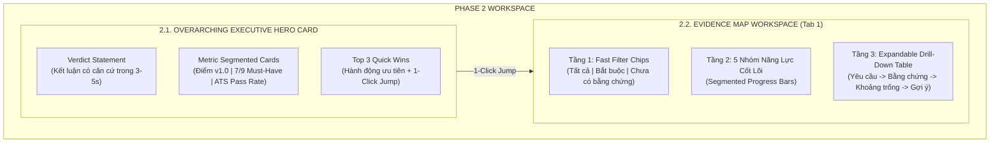

# RFC: Phase 2 Architecture & UX Blueprint — Executive Hero Card & Evidence Map Workspace

> **Tài liệu tham chiếu:** `docs/PHASE_2_PROPOSAL_RFC.md`  
> **Phiên bản:** 1.0 (Tháng 11/2026)  
> **Trạng thái:** DRAFT — Dành cho PO & ChatGPT cùng Antigravity Review & Brainstorm  
> **Nhánh áp dụng:** `staging`  
> **Liên kết kế hoạch tổng thể:** [`docs/UI_UX_IMPLEMENTATION_PLAN.md`](file:///c:/Users/User/Downloads/VU%20TA/GITHUB%20REPO/rolematch2/docs/UI_UX_IMPLEMENTATION_PLAN.md)

---

## 1. Bối Cảnh & Mục Tiêu Của Phase 2 (P2)

### 1.1. Hiện trạng sau khi hoàn thành Phase 1 (P1)
- **Phase 1 đã hoàn tất thành công (Commit `b11f55d`, `50371fd`):**
  - Hệ thống Header sáng sạch chuẩn Google Workspace với User Profile menu, role switch, full-screen.
  - Thanh `CompactContextBar` tự động thu gọn 48px khi đã có kết quả, giải phóng 100% không gian hiển thị kết quả phân tích.
  - Cảnh báo dữ liệu thay đổi (*Stale score badge*), dynamic header offset và cơ chế bảo vệ in-flight edits.
  - Toàn bộ suite kiểm thử `src/phase1_verification.test.ts` đạt 100% pass.

### 1.2. Vấn đề cốt lõi cần giải quyết trong Phase 2
Mặc dù Header và Input đã gọn gàng, khu vực kết quả bên dưới vẫn đang hiển thị dạng **"Bức tường chữ" (Cognitive Overload)**:
- Người dùng vừa vào đã phải đối mặt với hàng chục dòng bảng đối chiếu từ khóa và điểm số khô khan.
- Không có **Điểm neo thị giác (Visual Anchor)** để biết ngay:
  1. *Kết luận cuối cùng là gì? Tôi có cơ hội được gọi phỏng vấn không?*
  2. *Tôi đáp ứng được bao nhiêu tiêu chí bắt buộc (Must-Have)?*
  3. *3 việc quan trọng nhất cần làm ngay là gì?*
- Tìm kiếm lỗ hổng (gaps) hiện tại mất ít nhất 4 thao tác cuộn và lọc trang.

---

## 2. Kiến Trúc Chi Tiết Phase 2: Hai Cấu Phần Cốt Lõi



---

## 3. Đặc Tả Chi Tiết Từng Cấu Phần

### 3.1. Cấu phần 1: `ExecutiveHeroCard` (Nằm độc lập trên thanh Tabs)

#### Vị trí & Trực quan:
- Nằm ngay dưới `CompactContextBar`, phía trên thanh điều hướng Tabs (`tabsHeaderRef`).
- Nền trắng `bg-white`, bo góc `rounded-2xl`, viền mỏng `border-slate-200/90`, đổ bóng nhẹ `shadow-xs`.

#### Cấu trúc 3 phân vùng:
1. **Phân vùng 1: Câu Kết Luận Thực Tế (Verdict Statement)**
   - Huy hiệu `[ ✨ KẾT LUẬN ĐÁNH GIÁ ]` màu xanh Google Blue (`bg-blue-50 text-blue-700`).
   - Câu phán quyết ngắn gọn, khách quan, nhấn mạnh mức độ phù hợp và số lượng tiêu chí đạt/thiếu:
     > *"Hồ sơ **RẤT PHÙ HỢP** với vị trí Senior Frontend. Đã tìm thấy bằng chứng cho **7/9 yêu cầu bắt buộc**; còn 2 yêu cầu về Cloud Architecture chưa được thể hiện rõ trong CV."*
   - Tôn trọng nguyên tắc thiết kế: **"Chưa thấy bằng chứng trong CV"** chứ không quy chụp "Ứng viên không có năng lực".

2. **Phân vùng 2: Bộ 3 Chỉ Số Đo Lường Thực Chất (Segmented Metric Cards)**
   - **Thẻ 1: Điểm đánh giá CV gốc:** `78 / 100` kèm nhãn `(v1.0 cố định)`. Có nhãn cảnh báo nếu CV đang bị sửa đổi (Stale indicator).
   - **Thẻ 2: Tiêu chí Bắt buộc (Must-Have):** 
     - Tỷ lệ: `7 / 9 Đạt`.
     - Thanh phân đoạn ngang (Segmented Bar): `78% Đủ bằng chứng (Xanh lá)` | `22% Cần bổ sung (Đỏ)`.
     - Chú thích rõ ràng số lượng từng trạng thái.
   - **Thẻ 3: Độ vượt qua lọc tự động (ATS Pass Rate):**
     - Đánh giá: `Cao / Khá / Cần tối ưu`.
     - Định vị: `(Top 15% hồ sơ ứng tuyển)` hoặc lời khuyên tương ứng.

3. **Phân vùng 3: Top 3 Quick Wins (Hành động ưu tiên hàng đầu)**
   - Tiêu đề: `⚡ 3 HÀNH ĐỘNG ƯU TIÊN HÀNG ĐẦU (QUICK WINS) — Bấm để nhảy đến đúng vị trí`.
   - Grid 3 thẻ tương tác (`cursor-pointer`), có hover border và active ring:
     - Thẻ 1: Bổ sung từ khóa chuyên môn còn thiếu vào dự án gần nhất.
     - Thẻ 2: Định lượng số liệu theo công thức Google XYZ (đo lường kết quả).
     - Thẻ 3: Làm rõ phạm vi trách nhiệm / năng lực lãnh đạo.
   - **Tương tác 1-Click Jump:** Click vào thẻ Quick Win sẽ tự động chuyển sang Tab Evidence Map, mở đúng nhóm năng lực và highlight dòng tiêu chí tương ứng.

---

### 3.2. Cấu phần 2: `EvidenceMapWorkspace` (Bản Đồ Bằng Chứng — Thay thế `KeywordMatchTab`)

Thay vì danh sách từ khóa dày đặc gây quá tải thông tin, Evidence Map áp dụng **Progressive Disclosure 3 Tầng**:

#### Tầng 1: Bộ Lọc Nhanh 1-Click (Fast Filter Chips)
- Đặt ở góc phải trên cùng của Workspace:
  - `Tất cả (N)` — Mặc định.
  - `Bắt buộc (Must-Have: X)` — Lọc các tiêu chí sống còn (Knock-out).
  - `Chưa thấy bằng chứng (Y)` — Lọc ra ngay các khoảng trống cần bổ sung khẩn cấp (thay thế 4 thao tác cuộn/lọc trước đây).

#### Tầng 2: Bản Đồ 5 Nhóm Năng Lực Cốt Lõi (Segmented Evidence Bars)
Dựa trên 5 danh mục chuẩn hóa sẵn có trong dữ liệu backend:
1. **Kỹ năng Chuyên môn (Core Technical Skills):** Ngôn ngữ, framework, kiến trúc.
2. **Công cụ & Phương pháp (Tools & Methodologies):** Git, CI/CD, Agile, Docker, Cloud.
3. **Kinh nghiệm Thực tế (Hands-on Domain Experience):** Lĩnh vực nghiệp vụ, thâm niên dự án.
4. **Kết quả & Đầu ra đo lường được (Outcomes & Deliverables):** Tối ưu performance, số liệu doanh thu, quy mô người dùng.
5. **Văn hóa & Làm việc nhóm (Soft Skills & Culture):** Giao tiếp, dẫn dắt nhóm, giải quyết xung đột.

Mỗi nhóm năng lực được biểu diễn dưới dạng 1 hàng thẻ tương tác:
- Tên nhóm + Số lượng tiêu chí (vd: `6 tiêu chí`).
- **Thanh phân đoạn Segmented Bar:**
  $$\text{Tỷ lệ Xanh (Đủ bằng chứng)} + \text{Tỷ lệ Vàng (Một phần)} + \text{Tỷ lệ Đỏ (Chưa thấy)} = 100\%$$
- Nút chevron `Mở rộng / Thu gọn` chi tiết.

#### Tầng 3: Bảng Đối Chiếu Chi Tiết Mở Rộng (Expandable Drill-down View)
Khi mở rộng một nhóm năng lực:
- Hiển thị danh sách tiêu chí với 4 cột thông tin rõ ràng:
  1. **Yêu cầu JD & Tầm quan trọng:** Tên tiêu chí, nhãn `Bắt buộc` (Đỏ) hoặc `Điểm cộng` (Xanh nhạt).
  2. **Bằng chứng trong CV:** Trích dẫn câu thực tế từ CV của ứng viên (hoặc cảnh báo `Chưa có thông tin`).
  3. **Khoảng trống / Cần làm rõ:** Nhận định của HR về điểm còn mơ hồ.
  4. **Câu gợi ý mẫu (Ready-to-use):** Câu văn tham khảo theo công thức Google XYZ kèm vị trí khuyến nghị chèn vào CV (`targetSection`).

---

## 4. Tầng Chuyển Đổi Dữ Liệu (Data Adapter Layer: `evidenceMapAdapter.ts`)

Để đảm bảo Phase 2 chạy mượt mà trên dữ liệu thực tế từ backend mà **không phá vỡ tương thích ngược**:

```typescript
export interface EvidenceItem {
  id: string;
  term: string;
  category: KeywordCategory;
  importance: ImportanceLevel;
  isMustHave: boolean;
  cvEvidence: string;
  gapOrClarification: string;
  matchStatus: 'khop' | 'can_bo_sung' | 'thieu';
  suggestedPhrasing?: string;
  targetSection?: string;
}

export interface CompetencyGroup {
  id: string;
  category: KeywordCategory;
  title: string;
  total: number;
  matched: number;
  partial: number;
  gap: number;
  items: EvidenceItem[];
}

export interface ExecutiveHeroViewModel {
  verdictTitle: string;
  verdictStatement: string;
  overallScore: number;
  mustHaveTotal: number;
  mustHavePassed: number;
  atsPassLevel: 'Cao' | 'Khá' | 'Cần tối ưu';
  atsRankingText: string;
  quickWins: Array<{
    id: string;
    targetGroupId: string;
    targetItemId?: string;
    title: string;
    actionLabel: string;
    status: 'pending' | 'needs_review' | 'applied';
  }>;
}
```

### Quy tắc Mapping & Fallback:
1. **Từ `CompleteCVAnalysisResponse`:**
   - Lấy `feature1.comparisonTable` kết hợp `feature1.jdKeywords` để phân nhóm thành 5 `CompetencyGroup`.
   - Lấy `feature3.inviteDecision` và `feature3.decisionReason` làm nòng cốt để suy diễn câu **Verdict Statement**.
   - Lấy `feature3.top3MustFix` hoặc `feature1.summary.immediateActions` làm **Top 3 Quick Wins**.
2. **Fallback:** Nếu `comparisonTable` thiếu trường `isMustHave`, adapter tự động đối chiếu với danh sách `jdKeywords` hoặc căn cứ theo `importance === 'Rất quan trọng'`.

---

## 5. Điểm Cần PO & ChatGPT Thảo Luận & Brainstorm (Open Questions)

Kính mời ChatGPT và PO phản biện và thảo luận sâu về 4 câu hỏi thiết kế sau:

### ❓ Câu hỏi 1: Cơ chế tạo câu Phán quyết (Verdict Statement)
- **Phương án A:** Sinh hoàn toàn động từ phía AI trong prompt backend (cần update server prompt).
- **Phương án B (Khuyến nghị cho P2):** Dùng Adapter tổng hợp có kiểm soát từ `feature3.inviteDecision` + `feature3.decisionReason` + `Tỷ lệ Must-Have (7/9)` trên client.
  - *Ưu điểm của B:* Nhất quán, không phụ thuộc vào độ ổn định của prompt trả lời dài, phản ánh chính xác dữ liệu số học.
- **ChatGPT đánh giá thế nào về mẫu câu và ngữ điệu (tone of voice)?**

### ❓ Câu hỏi 2: Trải nghiệm 1-Click Jump của Top 3 Quick Wins
- Khi người dùng click vào 1 thẻ Quick Win trên Hero Card:
  - **Lựa chọn 1:** Tự động switch sang Tab 1 (Evidence Map), tự động expand nhóm năng lực tương ứng và highlight vàng viền thẻ tiêu chí trong 2 giây.
  - **Lựa chọn 2:** Mở một Modal popup cho phép sửa nhanh ngay tại chỗ.
  - **Lựa chọn 3:** Điều hướng thẳng sang Tab 2 (CV Diff Studio — khi P3 hoàn thiện).
- **Đâu là luồng mượt mà nhất cho người dùng ở giai đoạn Phase 2?**

### ❓ Câu hỏi 3: Trạng thái mở rộng mặc định của 5 Nhóm năng lực
- **Lựa chọn A:** Mặc định đóng cả 5 nhóm để giữ màn hình cực kỳ gọn gàng; người dùng click nhóm nào thì mở nhóm đó (Accordion).
- **Lựa chọn B:** Tự động mở sẵn nhóm năng lực có nhiều **Lỗ hổng nghiêm trọng nhất (Gap)** hoặc tiêu chí **Must-Have chưa đạt** để ứng viên thấy ngay việc cần sửa; 4 nhóm còn lại đóng.
- **Lựa chọn C:** Mở tất cả mặc định.

### ❓ Câu hỏi 4: Responsive trên Mobile / Tablet nhỏ
- Trên màn hình hẹp (<640px):
  - 3 thẻ Metric nên chuyển thành swipeable carousel hay xếp chồng 3 hàng dọc?
  - Thanh phân đoạn Segmented Bar nên thu gọn icon hay giữ nguyên tỷ lệ phần trăm?

---

## 6. Kế Hoạch Triển Khai Sau Khi Thống Nhất

| Bước | Nội dung công việc | File dự kiến |
| :--- | :--- | :--- |
| **Bước 2.1** | Xây dựng Data Adapter & Unit Test bộ chuyển đổi dữ liệu | `src/utils/evidenceMapAdapter.ts`, `src/utils/evidenceMapAdapter.test.ts` |
| **Bước 2.2** | Triển khai component `ExecutiveHeroCard` | `src/components/ExecutiveHeroCard.tsx` |
| **Bước 2.3** | Triển khai component `EvidenceMapWorkspace` (Tab 1) | `src/components/EvidenceMapTab.tsx` |
| **Bước 2.4** | Tích hợp vào `src/App.tsx`, kiểm thử E2E & nghiệm thu | `src/phase2_verification.test.ts` |

---
*Tài liệu này đã sẵn sàng trên nhánh `staging` để các bên tham khảo và phản biện.*
