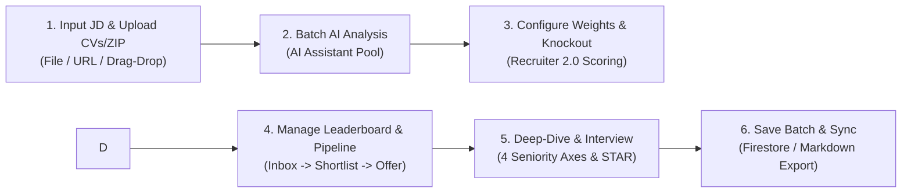
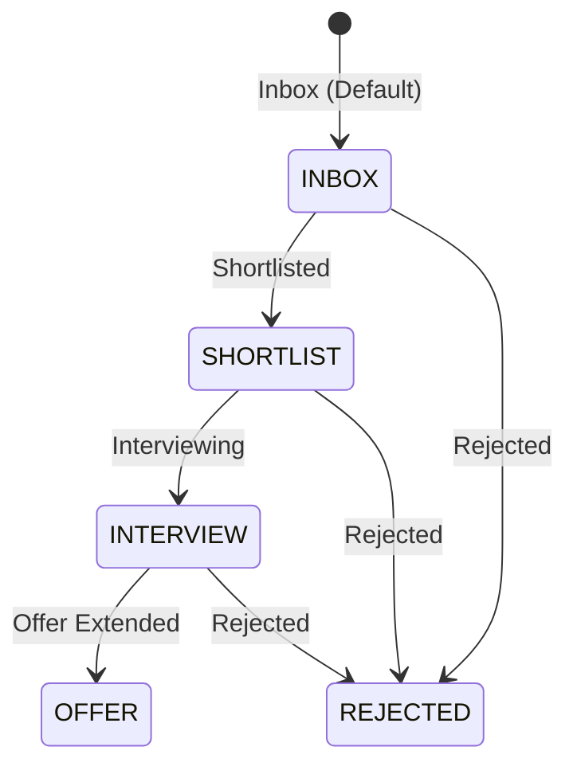

# RoleMatch User Guide for Recruiters

> **Purpose:** Help recruiters and hiring managers master the advanced candidate screening toolkits of **Recruiter Module 2.0 (Phase 3)**: customize multi-dimensional scoring weights, enforce hard knockout criteria, manage candidate pipeline stages, evaluate 4-dimension seniority fit, and leverage the practical STAR interview battle guide to make verifiable, high-confidence hiring decisions.

---

## 1. What does RoleMatch help recruiters do?

RoleMatch equips recruitment and talent acquisition teams with:

- **Batch Processing of Multiple Resumes against a Single JD:** Upload up to 15 CVs or a compressed ZIP archive for consistent, objective evaluation against unified criteria.
- **Customizable Scoring Weights & Dynamic Re-ranking (Phase 3):** Allocate percentage weights across Keywords, Skills, and Experience (or choose pre-configured presets) to calculate weighted scores (`weightedScore`) and dynamically reorder the leaderboard.
- **Hard Knockout Filtering (Phase 3):** Establish minimum score floors and disqualify candidates lacking critical Must-Have qualifications, complete with explicit, audit-ready disqualification rationales.
- **Candidate Pipeline Tracking & Internal Reviews (Phase 3):** Move candidates through 5 standardized hiring stages (`Inbox`, `Shortlist`, `Interview`, `Offer`, `Rejected`), record star ratings (1–5), internal evaluation notes, and customized tags.
- **4-Dimension Seniority Fit & Risk Mitigation Matrix:** Assess rank, project complexity, leadership autonomy, and domain fit, highlighting candidate red flags with clear interview talking points.
- **Practical Interview Battle Guide (5–10 STAR Questions):** Access candidate-specific deep-dive questions targeting genuine CV gaps, revealing interviewer intent, structured STAR response guides, and common candidate pitfalls.
- **Offline Batch Storage & Cloud Sync:** Persist batches securely in Firestore to review, update, or export candidate evaluations without consuming additional AI quota units.

> [!IMPORTANT]
> The AI Assistant functions as a powerful screening accelerator and structured interview tool; it does not replace human hiring committee decisions or recruitment accountability.

---

## 2. Quick workflow

1. Switch to **Recruiter** mode.
2. Provide a clear Job Description (JD): paste plain text, drag and drop files, or click **Import Link** to scrape postings from LinkedIn, ITviec, TopCV, and other portals.
3. Upload candidate CVs (up to 15 separate files or a single `.zip` archive).
4. Click **Start Analysis**.
5. **Configure Scoring Weights & Knockout Criteria:** Select a preset weight distribution tailored to the seniority tier or customize percentages and score thresholds.
6. **Manage Candidate Pipeline:** Update recruitment stages, assign star ratings, add internal interview notes, and apply tags to promising candidates.
7. Open individual candidate cards to examine match evidence, Must-Have requirements, 4-dimension seniority fit, and the risk mitigation matrix.
8. Open the candidate's **Interview Battle Guide (5–10 Qs)** to prepare structured interview questions using the STAR framework.
9. Click **Save Current Batch** to persist all evaluations, weights, knockout criteria, and pipeline states to the cloud database.

---

## 3. Customizable Scoring Weights & Knockout Criteria (Phase 3)

The **Recruiter Scoring 2.0** engine allows recruiters to calibrate candidate scoring according to role-specific requirements:

### 3.1. Standard Scoring Presets

| Preset Key | Weight Allocation (Keywords / Skills / Experience) | Best Suited For |
|---|:---:|---|
| **Balanced Standard** | **33% / 34% / 33%** | Generalist roles and mid-level positions. |
| **Experience & Impact Focused** | **20% / 30% / 50%** | Senior, Tech Lead, Engineering Manager, Director tiers. |
| **Deep Technical Skills Focused** | **20% / 50% / 30%** | R&D Specialists, System Architects, niche tech stacks. |
| **Custom Allocation** | Freely configurable (Sum = 100%) | Specialized organizational hiring requirements. |

Weighted scores (`weightedScore`) are computed in real time on the client and update leaderboard ranks instantaneously without re-running AI queries.

### 3.2. Hard Knockout Criteria

When knockout rules are active, non-compliant candidates are flagged as **Knocked Out** with explicit reasons and placed at the bottom of the leaderboard:
- **Minimum Overall Score Floor:** Disqualifies profiles scoring below a set baseline (e.g., `< 60`).
- **Minimum Skill or Experience Floors:** Enforces foundational execution competency.
- **Require Must-Have Skills:** Automatically flags candidates missing any criteria marked as `Must-Have / Knock-out` in the JD.

---

## 4. Candidate Pipeline Management & Internal Reviews (Phase 3)

RoleMatch provides an integrated candidate tracking pipeline directly within each recruitment batch:

### 4.1. Five Standardized Pipeline Stages

- **Inbox (`INBOX`):** Freshly analyzed candidate profiles awaiting review.
- **Shortlisted (`SHORTLIST`):** Qualified profiles advanced for hiring manager screening.
- **Interviewing (`INTERVIEW`):** Selected candidates scheduled for structured interviews.
- **Offer Extended (`OFFER`):** Finalists undergoing offer negotiations.
- **Rejected (`REJECTED`):** Profiles that do not meet core requirements.

### 4.2. Internal Review & Tagging Toolkits

- **Star Ratings (1–5 Stars):** Quick quality indicator assigned by screening teams.
- **Internal Review Notes:** Record compensation expectations, notice periods, or initial phone screening impressions.
- **Candidate Tags:** Apply quick tags such as `Top Candidate`, `Tech Lead`, `Culture Fit`, `Urgent Hire`, `High Salary Expectation`.
- **Interactive Kanban Pipeline View:** Seamless 1-click toggle between standard Leaderboard and visual 5-column Kanban board, tracking applicant progression with drag-and-drop ease.

All updates to pipeline stages, notes, ratings, and weights are persisted via the `PUT /api/recruiter/batches/:id` API endpoint.

---

## 5. Understanding Scores & Suitability Levels

### 5.1. Scoring Dimensions

| Dimension | Meaning | Guidance for Recruiters |
|---|---|---|
| **Overall Score** | Initial AI assessment of overall role alignment (0–100). | Baseline profile match before custom weighting. |
| **Weighted Score** | Composite score after applying custom role weights (`weights`). | The authoritative metric for candidate ranking. |
| **Keyword Alignment** | Alignment across specialized industry terminology and tooling. | Low scores may indicate synonym usage; verify transferable skills. |
| **Experience Fit** | Alignment across tenure depth, project complexity, and verifiable achievements. | Evaluates hands-on operational ownership and execution rigor. |
| **Skills Fit** | Breadth and depth of core hard skills and essential soft skills. | Validates whether the candidate possesses the requisite toolkits for immediate contribution. |

### 5.2. Role Suitability Tiers

| Score Range | Display Level | Recommended Action for Recruiters |
|:---:|---|---|
| 85–100 | **Very High** | Advance directly to `SHORTLIST` or `INTERVIEW`; prepare deep-dive technical briefs. |
| 70–84 | **High** | Strong candidate; review specific qualification gaps and plan domain onboarding. |
| 50–69 | **Medium** | Evaluate transferable capabilities; use an initial screening call to assess adaptability. |
| Below 50 | **Low** | Significant capability gap; consider only in talent-scarce markets. |
| No Valid Score | **Not Available** | Extraction or processing error; inspect manually or re-run analysis. |

---

## 6. Review Candidate Details & 4-Dimension Seniority Fit

When selecting a candidate from the leaderboard, enter **Candidate Deep-Dive** mode to review all 4 analysis tabs:

### A. 4-Dimension Seniority & Scope Fit Assessment

Helps recruiters quickly ascertain whether a candidate operates at the intended organizational tier:
1. **Seniority & Experience Level:** Compares professional tenure and rank against JD expectations.
2. **Project Complexity & Scale:** Assesses system scale, concurrency, or project budgets personally managed.
3. **Scope of Autonomy & Leadership:** Determines whether the candidate is an Individual Contributor or an experienced engineering manager.
4. **Domain & Industry Fit:** Evaluates depth of specialized business domain experience.

### B. Risk Radar & Mitigation Matrix

Pinpoints potential red flags with an objective, multi-perspective view:
- **Identified Risk:** Frequent transitions, career pivots, lack of metrics, rank drops, employment gaps.
- **Recruiter's Concern:** Why hiring managers feel cautious about this trait.
- **CV Mitigation Strategy:** How the candidate frames their experience to ease concerns.
- **Interview Talking Points:** Key indicators to listen for during live questioning.

### C. Must-Have vs. Nice-to-Have Comparison Table

- Explicitly highlights essential prerequisites (`Must-Have`) so you never disqualify strong candidates or advance those missing critical skills.
- Inspects real-world evidence found in the CV alongside identifiable gaps.

---

## 7. Leverage the STAR Interview Battle Guide

RoleMatch provides recruiters with **5 to 10 candidate-specific interview questions** structured around the STAR methodology:

### 7.1. Three Standardized Question Categories

1. **CV Gap Verification:** Directly probes unproven Must-Have criteria, employment gaps, or unquantified project claims.
2. **Deep-Dive Technical & Scenario Questions:** Tests real-world troubleshooting, architectural trade-offs, and critical problem-solving under constraints.
3. **Seniority & Cultural Fit:** Assesses leadership philosophy, team dynamics, and 30–60–90 day value delivery.

### 7.2. Professional Evaluation Framework

Each question delivers:
- **Interviewer Intent:** Clarifies the exact competency being evaluated.
- **Expected STAR Response Framework:** Outlines what a top candidate should demonstrate across Situation, Task, Action, and Result based on their genuine CV.
- **Pitfalls to Watch For:** Identifies evasive answers, exaggerated claims, or tendency to deflect responsibility.

---

## 8. Multi-Candidate Comparison

- Select up to **3 candidates** for direct side-by-side comparison.
- Contrast component scores, weighted scores, AI recommendations, major strengths, core risks, and fulfillment of Must-Have criteria simultaneously.
- Empowers hiring committees to make objective, data-backed decisions free from unconscious bias.

---

## 9. Save, Reopen, and Export Reports

- **Save Current Batch:** Persists the complete batch dataset (JD, candidate roster, scores, weights, knockout criteria, pipeline stages, and full reports) to Firestore.
- **Reopen from Saved Batches:** Instant zero-latency access without consuming AI quota units.
- **Continuous Batch Sync:** Updates to pipeline stages, review notes, ratings, or scoring weights automatically persist to the database.
- **Export Leaderboard (Markdown):** Download a comprehensive Markdown file to import into your internal ATS or share with hiring managers.

---

## 10. Recruiter Interview and Decision Checklist

- [ ] JD clearly delineates Must-Have prerequisites from Nice-to-Have preferences.
- [ ] Scoring weight preset has been selected to match seniority expectations.
- [ ] Knocked-out candidates have been audited to avoid disqualifying high-potential edge cases.
- [ ] Candidates have been assigned appropriate pipeline stages (`SHORTLIST`, `INTERVIEW`).
- [ ] 4-dimension seniority fit and risk matrix have been reviewed for top candidates.
- [ ] 3–5 targeted questions from the STAR Interview Guide have been integrated into interview briefs.
- [ ] Interview notes, star ratings, and hiring committee rationales have been documented.
