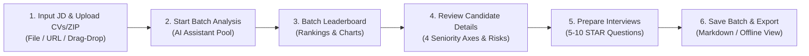

# RoleMatch User Guide for Recruiters

> **Purpose:** Help recruiters and hiring managers interpret AI analysis reports accurately, master 4-dimension seniority fit assessments, recognize candidate profile risks, and leverage the practical STAR interview battle guide to make verifiable, objective hiring decisions.

---

## 1. What does RoleMatch help recruiters do?

RoleMatch equips recruitment and talent acquisition teams with:

- **Batch Processing of Multiple CVs against a Single JD:** Upload up to 15 CVs or a compressed ZIP archive for fair, consistent evaluation against unified job criteria.
- **Visual Leaderboards & Batch Analytics:** Automatically ranks candidate profiles based on overall role fit, interview recommendations (`YES` / `MAYBE` / `NO`), and overall talent distribution.
- **4-Dimension Seniority Fit & Risk Mitigation Matrix:** Evaluates rank, project complexity, leadership autonomy, domain familiarity, and identifies candidate red flags with explicit interview talking points.
- **Practical Interview Battle Guide (5–10 STAR Questions):** Provides customized, deep-dive interview questions tailored to each candidate's authentic gaps, revealing interviewer intent and answer pitfalls for structured interviewing.
- **Offline Batch Reopening & Markdown Export:** Saves batches securely so you can reopen, review, and export candidate evaluations without consuming additional AI quota units.

> [!IMPORTANT]
> The AI Assistant functions as a powerful screening and interview prep tool; it does not replace the hiring manager's final judgment and recruitment accountability.

---

## 2. Quick workflow

1. Switch to **Recruiter** mode.
2. Provide a clear Job Description (JD): paste plain text, drag and drop files, or click **Import Link** to automatically scrape postings from LinkedIn, ITviec, TopCV, and other portals. If the job portal requires authentication, a popup opens for login, accompanied by a 1-click clipboard AI cleaner.
3. Upload candidate CVs (up to 15 separate files or a single `.zip` archive).
4. Click **Start Analysis**.
5. Review the batch summary: interview recommendations (`YES` / `MAYBE` / `NO`), score distributions, and the Top 10 candidate leaderboard.
6. Open individual candidate cards to examine match evidence, Must-Have requirements, 4-dimension seniority fit, and the risk mitigation matrix.
7. Open the candidate's **Interview Battle Guide (5–10 Qs)** to prepare structured interview questions using the STAR framework.
8. Record human hiring decisions; then click **Save Current Batch** or **Export Leaderboard (Markdown)**.

---

## 3. Prepare data before analysis

### 3.1. Job description preparation

The clearer the JD, the more insightful the AI evaluation. Before running analysis, verify:

- Job title and role scope are consistent.
- **Must-Have** prerequisites are clearly distinguished from **Nice-to-Have** bonuses.
- Experience is expressed through concrete responsibilities and expected deliverables, rather than raw years of tenure alone.
- Domain knowledge and tech stacks reflect genuine day-to-day requirements.

### 3.2. CV preparation

- Ensure uploaded CV files are uncorrupted and password-free. Accepted formats: `.pdf`, `.docx`, `.doc`, `.txt`, `.rtf`, `.md`.
- Scanned or image-based PDFs automatically invoke Gemini Vision OCR for text recognition.
- Unreadable or corrupted files are highlighted clearly on the interface and are not deducted from your daily quota.

---

## 4. Understand match scores and suitability levels

### 4.1. Four evaluation score dimensions

| Dimension | Meaning | Guidance for Recruiters |
|---|---|---|
| **Overall Score** | Multi-dimensional role fit score from 0–100 evaluated across the entire CV and JD. | Not a probability of candidate hiring; not a simple mathematical average of the 3 sub-scores. |
| **Keyword Alignment** | Alignment across specialized industry terminology, methodologies, and tools. | Low scores may stem from synonym usage; verify transferable skills. |
| **Experience Fit** | Alignment across tenure depth, project complexity, and verifiable achievements. | Evaluates hands-on operational ownership and execution rigor. |
| **Skills Fit** | Breadth and depth of core hard skills and essential soft skills. | Validates whether the candidate possesses the requisite toolkits for immediate contribution. |

### 4.2. Role suitability tier classification

| Overall Score | Display Level | Recommended Action for Recruiters |
|:---:|---|---|
| 85–100 | **Very High** | Priority for immediate interview; verify Must-Have criteria and prepare deep-dive technical questions. |
| 70–84 | **High** | Strong candidate; inspect specific qualification gaps and plan domain onboarding. |
| 50–69 | **Medium** | Evaluate transferable capabilities; use an initial screening call to assess adaptability. |
| Below 50 | **Low** | Significant capability gap; consider only in talent-scarce markets or for high-potential edge cases. |
| No Valid Score | **Not Available** | Extraction or processing error; inspect manually or re-run analysis. |

---

## 5. Review batch overview and analytics

### 5.1. Summary metrics

- Total processed candidates (Success vs. Failed).
- Recommendation distribution: counts for `YES`, `MAYBE`, and `NO`.
- Batch average score and highest achieved score.

### 5.2. Recommendation and score distribution charts

- **YES — Recommend for Interview:** Robust alignment with immediate hiring criteria.
- **MAYBE — Review and Verify Further:** Promising potential with specific gaps that warrant probing.
- **NO — Low Priority:** Substantial divergence from core requirements or missing critical Must-Haves.

---

## 6. Review candidate details

When selecting a candidate from the leaderboard, you can inspect their summary report or enter **Full-Screen Candidate Deep-Dive** mode to review all 4 analysis tabs:

### A. 4-Dimension Seniority & Scope Fit Assessment

Helps recruiters quickly ascertain whether a candidate operates at the intended organizational tier:

1. **Seniority & Experience Level:** Compares professional tenure and rank against JD expectations.
2. **Project Complexity & Scale:** Assesses system scale, concurrency, or project budgets personally managed.
3. **Scope of Autonomy & Leadership:** Determines whether the candidate is an Individual Contributor or an experienced engineering manager.
4. **Domain & Industry Fit:** Evaluates depth of specialized business domain experience.

### B. Risk Radar & Mitigation Matrix

Pinpoints potential red flags with an objective, multi-perspective view:

- **Identified Risk:** Frequent transitions, career pivots, lack of metrics, rank drops, employment gaps.
- **Recruiter's Concern:** Why hiring managers feel cautious about this trait.
- **CV Mitigation Strategy:** How the candidate frames their experience to ease concerns.
- **Interview Talking Points:** Key indicators to listen for during live questioning.

### C. Must-Have vs. Nice-to-Have Comparison Table

- Explicitly highlights essential prerequisites (`Must-Have`) so you never disqualify strong candidates or advance those missing critical skills.
- Inspects real-world evidence found in the CV alongside identifiable gaps.

---

## 7. Leverage the STAR Interview Battle Guide

RoleMatch provides recruiters with **5 to 10 dynamically generated deep-dive interview questions** structured around the STAR methodology:

### 7.1. Three standardized question categories

1. **CV Gap Verification:** Directly probes unproven Must-Have criteria, employment gaps, or unquantified project claims.
2. **Deep-Dive Technical & Scenario Questions:** Tests real-world troubleshooting, architectural trade-offs, and critical problem-solving under constraints.
3. **Seniority & Cultural Fit:** Assesses leadership philosophy, team dynamics, and 30–60–90 day value delivery.

### 7.2. Professional evaluation framework

Each question delivers:
- **Interviewer Intent:** Clarifies the exact competency being evaluated.
- **Expected STAR Response Framework:** Outlines what a top candidate should demonstrate across Situation, Task, Action, and Result based on their genuine CV.
- **Pitfalls to Watch For:** Identifies evasive answers, exaggerated claims, or tendency to deflect responsibility.

---

## 8. Multi-candidate comparison

- Select up to **3 candidates** for direct side-by-side comparison.
- Contrast component scores, AI recommendations, major strengths, core risks, and fulfillment of Must-Have criteria simultaneously.
- Empowers hiring committees to make objective, data-backed decisions free from unconscious bias.

---

## 9. Save, reopen, and export reports

- **Save Current Batch:** Persists the complete batch dataset (JD, candidate roster, scores, rankings, and full reports) to the database.
- **Reopen from Saved Batches:** Instant zero-latency access without consuming AI quota units.
- **Export Leaderboard (Markdown):** Download a comprehensive Markdown file to import into your internal ATS or share with hiring managers.

---

## 10. Recruiter interview and decision checklist

- [ ] JD clearly delineates Must-Have prerequisites from Nice-to-Have preferences.
- [ ] Processed roster has been inspected for unreadable or error-flagged files.
- [ ] 4-dimension seniority fit and risk matrix have been reviewed for top candidates.
- [ ] 3–5 targeted questions from the STAR Interview Guide have been integrated into interview briefs.
- [ ] Human committee notes and rationale for the final selection have been documented.
