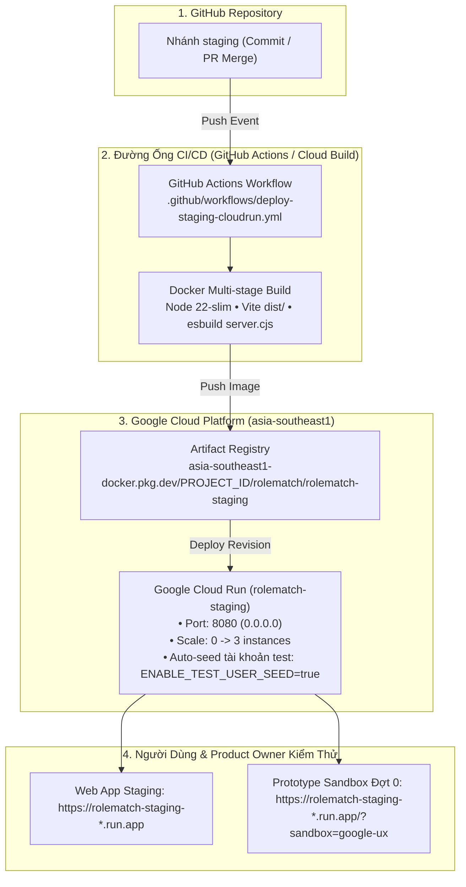

# Hướng Dẫn Triển Khai CI/CD Nhánh Staging Lên Google Cloud Run

> **Dự án:** RoleMatch 2  
> **Mục tiêu:** Tự động đóng gói và triển khai nhánh `staging` lên **Google Cloud Run** thông qua GitHub Actions hoặc Cloud Build, phục vụ kiểm thử giao diện mới và Prototype Sandbox Đợt 0 (`/?sandbox=google-ux`).  
> **Ngày tạo:** 03/11/2026  
> **Tác giả:** Antigravity Team  

---

## 1. Tổng Quan Kiến Trúc Triển Khai Staging



---

## 2. Các Tệp Tin Đã Được Cấu Hình

1. **`Dockerfile`**: 
   - **Stage 1 (Builder):** `node:22-slim`, cài đặt dependencies, chạy `npm run build` (gồm `vite build` ra thư mục `dist/` và `esbuild server.ts` ra tệp `dist/server.cjs`).
   - **Stage 2 (Runner):** `node:22-slim`, chỉ cài `dependencies` phục vụ runtime (`npm install --omit=dev`), sao chép `dist/`, thư mục dữ liệu `data/`, cấu hình non-root user `node`, cổng `8080`, probe `HEALTHCHECK` tại `/api/health`.
2. **`.dockerignore`**:
   - Loại bỏ `node_modules`, `dist`, `.git`, file logs, file `.env*` cục bộ.
   - **Lưu ý quan trọng:** Không ignore thư mục `docs/` vì các component tài liệu trong ứng dụng (`CandidateGuideDrawer.tsx`, `RecruiterGuideDrawer.tsx`) sử dụng tính năng import Markdown raw (`?raw`) của Vite.
3. **`.github/workflows/deploy-staging-cloudrun.yml`**:
   - Tự động kích hoạt khi có lệnh `push` vào nhánh `staging` hoặc kích hoạt thủ công qua `workflow_dispatch`.
   - Hỗ trợ cả 2 hình thức xác thực: Service Account Key (JSON) hoặc Workload Identity Federation (WIF).
   - Build và push image lên Artifact Registry với tag commit SHA và `latest`.
   - Triển khai lên Cloud Run `rolematch-staging` và in trực tiếp đường dẫn Sandbox vào GitHub Step Summary.
4. **`cloudbuild.yaml`**:
   - Cấu hình dự phòng dành riêng cho Google Cloud Build Trigger nếu bạn muốn quản lý CI/CD hoàn toàn trên GCP Console.

---

## 3. Hướng Dẫn Thiết Lập Google Cloud Platform (1 Lần Duy Nhất)

Nếu dự án GCP của bạn chưa bật các dịch vụ hoặc chưa có Service Account, thực hiện theo các bước sau:

### Bước 3.1: Kích hoạt các API cần thiết

Mở **Google Cloud Shell** hoặc terminal cục bộ (đã cài `gcloud`) và chạy:

```bash
gcloud services enable \
  run.googleapis.com \
  artifactregistry.googleapis.com \
  cloudbuild.googleapis.com \
  secretmanager.googleapis.com
```

### Bước 3.2: Tạo kho chứa Artifact Registry (Docker)

Tạo kho chứa Docker tên là `rolematch` tại khu vực `asia-southeast1` (Singapore):

```bash
gcloud artifacts repositories create rolematch \
  --repository-format=docker \
  --location=asia-southeast1 \
  --description="RoleMatch Docker Images Repository"
```

### Bước 3.3: Tạo Service Account cho CI/CD và gán quyền

```bash
# 1. Tạo Service Account tên là github-actions-sa
gcloud iam service-accounts create github-actions-sa \
  --display-name="GitHub Actions CI/CD Service Account"

# 2. Lấy email của Service Account vừa tạo
SA_EMAIL="github-actions-sa@$(gcloud config get-value project).iam.gserviceaccount.com"

# 3. Gán các quyền cần thiết
# Quyền quản lý Cloud Run:
gcloud projects add-iam-policy-binding $(gcloud config get-value project) \
  --member="serviceAccount:${SA_EMAIL}" \
  --role="roles/run.admin"

# Quyền đẩy Image vào Artifact Registry:
gcloud projects add-iam-policy-binding $(gcloud config get-value project) \
  --member="serviceAccount:${SA_EMAIL}" \
  --role="roles/artifactregistry.writer"

# Quyền mạo danh Service Account của Cloud Run:
gcloud projects add-iam-policy-binding $(gcloud config get-value project) \
  --member="serviceAccount:${SA_EMAIL}" \
  --role="roles/iam.serviceAccountUser"

# 4. Xuất khóa JSON (để thêm vào GitHub Secrets)
gcloud iam service-accounts keys create sa-key.json \
  --iam-account="${SA_EMAIL}"
```

> [!TIP]
> Tệp `sa-key.json` vừa tạo sẽ được copy toàn bộ nội dung để dán vào GitHub Secret `GCP_SA_KEY`. Sau khi lưu vào GitHub, hãy xóa tệp `sa-key.json` khỏi máy tính cá nhân để đảm bảo an toàn.

---

## 4. Cấu Hình GitHub Secrets & Variables

Truy cập repository trên GitHub: **Settings** ➔ **Secrets and variables** ➔ **Actions**:

### 4.1. Repository Secrets (Bảo Mật)

| Tên Secret | Giá trị cần điền | Bắt buộc |
| :--- | :--- | :---: |
| `GCP_SA_KEY` | Toàn bộ nội dung chuỗi JSON trong tệp `sa-key.json` ở bước 3.3 | **Có** |
| `JWT_SECRET` | Chuỗi ký bí mật session JWT (vd: `my_staging_jwt_secret_key_2026`) | Khuyến nghị |
| `GEMINI_API_KEY` | Khóa API Google Gemini phục vụ các tính năng phân tích AI | Khuyến nghị |

### 4.2. Repository Variables (Cấu Hình Môi Trường)

Vào tab **Variables** và thêm các biến sau:

| Tên Variable | Giá trị khuyến nghị | Ý nghĩa |
| :--- | :--- | :--- |
| `GCP_PROJECT_ID` | `id-du-an-gcp-cua-ban` | ID dự án Google Cloud của bạn |
| `GCP_REGION` | `asia-southeast1` | Khu vực triển khai (Singapore) |
| `GCP_ARTIFACT_REPO` | `rolematch` | Tên kho Artifact Registry đã tạo |
| `CLOUD_RUN_SERVICE_NAME` | `rolematch-staging` | Tên dịch vụ Cloud Run môi trường Staging |

---

## 5. Kích Hoạt Triển Khai (Trigger CI/CD)

### Cách 1: Tự động qua Git Push (Khuyến nghị)
Khi bạn push mã nguồn mới vào nhánh `staging`:
```bash
git add .
git commit -m "feat(ci): add Dockerfile and Cloud Run CI/CD setup for staging"
git push origin staging
```
GitHub Actions sẽ tự động nhận diện và kích hoạt pipeline `Deploy Staging to Google Cloud Run`.

### Cách 2: Kích hoạt thủ công từ giao diện GitHub
1. Vào tab **Actions** trên GitHub.
2. Chọn workflow **Deploy Staging to Google Cloud Run** ở danh sách bên trái.
3. Bấm nút **Run workflow** ➔ Chọn nhánh `staging` ➔ Bấm **Run workflow**.

---

## 6. Hướng Dẫn Kiểm Tra & Đánh Giá Giao Diện Trên Staging

Sau khi quá trình deploy hoàn tất (khoảng 3-5 phút), GitHub Actions sẽ xuất URL dịch vụ Cloud Run:

1. **Kiểm tra trực tiếp Prototype Sandbox Đợt 0 (Không cần đăng nhập):**
   - Mở trình duyệt và truy cập:  
     `https://<CLOUD_RUN_URL>/?sandbox=google-ux`
   - Hoặc truy cập trang chủ `https://<CLOUD_RUN_URL>/` rồi bấm vào nút nổi màu tím ở góc trái bên dưới:  
     **`[ ✨ Mở Sandbox UI (Đợt 0) ]`**
   - Trải nghiệm toàn bộ 8 kịch bản kiểm thử (Hero Card, Quick Win, chỉnh sửa block CV, xử lý câu không có số liệu, đối chiếu khi sửa tay `Xem lại đề xuất AI`, thanh hành động ghim đáy trên mobile).

2. **Kiểm tra luồng ứng dụng đầy đủ (Candidate & Recruiter):**
   - Trên môi trường Staging, biến môi trường `ENABLE_TEST_USER_SEED=true` được bật sẵn.
   - Tài khoản đăng nhập kiểm thử mặc định:
     - **Admin:** `admin` / `admin123`
     - **Ứng viên:** `user` / `user123`
   - Tải file CV/JD mẫu hoặc thử phân tích thực tế.

3. **Xem logs thời gian thực:**
   Nếu cần xem log backend hoặc xử lý lỗi:
   ```bash
   gcloud run services logs tail rolematch-staging --region=asia-southeast1
   ```
