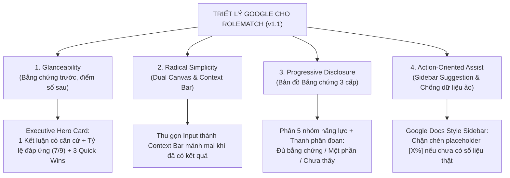
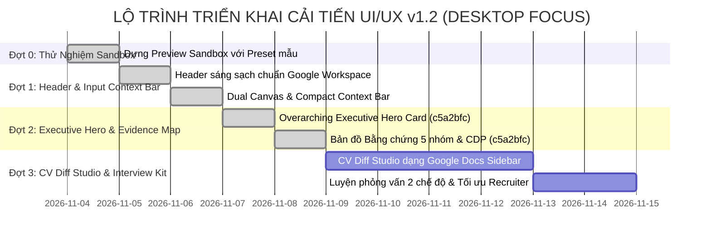

# RoleMatch 2 — Kế Hoạch Triển Khai Cải Tiến UI/UX (Google Design Mindset)

> **Tài liệu tham chiếu:** `docs/UI_UX_IMPLEMENTATION_PLAN.md`  
> **Phiên bản:** 1.1 (Tháng 11/2026 — Đã tích hợp phản biện & thống nhất kiến trúc giữa **Antigravity & ChatGPT**)  
> **Mục tiêu:** Tinh giản hóa giao diện, giải quyết triệt để vấn đề quá tải chữ (text-heavy), loại bỏ rủi ro chèn dữ kiện ảo, và xây dựng trải nghiệm trực quan, có căn cứ vững chắc theo tư duy thiết kế của **Google (Material Design 3, Google Workspace, NotebookLM & Gemini UX)**.

---

## 1. Bối Cảnh & UX Audit (Hiện Trạng vs. Điểm Nghẽn)

### 1.1. Các vấn đề cốt lõi của giao diện hiện tại
1. **Quá tải nhận thức (Cognitive Overload) — "Bức tường chữ":**
   - Sau khi bấm phân tích, hàng loạt khối thông tin nặng chữ xuất hiện đồng thời: Nhận xét 10 giây của HR, Ma trận rủi ro 4 chiều, Bảng đối chiếu từ khóa với hàng chục dòng, Đề xuất viết lại câu, Câu hỏi phỏng vấn...
   - Người dùng bị ngợp, không có điểm neo thị giác để nhận biết ngay mình đạt hay trượt và việc cần làm tiếp theo là gì.
2. **Thiếu tính năng Phân tầng thông tin (Progressive Disclosure):**
   - Chi tiết sâu đều mở toang mặc định thay vì tóm lược ở cấp cao và mở rộng theo nhu cầu người dùng.
3. **Mật độ thị giác quá dày & Phân mảnh màu sắc:**
   - Sử dụng quá nhiều viền xám đậm (`border-slate-800`), gradient màu nóng xen kẽ, thanh header tối màu tương phản gắt với nền sáng.
4. **Vòng lặp Input Section chưa tối ưu:**
   - Khi đã có kết quả phân tích, hai ô nhập liệu lớn vẫn chiếm trọn màn hình, buộc người dùng phải cuộn sâu xuống dưới mới xem được dữ liệu.

---

## 2. Bốn Trụ Cột Thiết Kế Đã Thống Nhất (Antigravity & ChatGPT Consensus)



### Chi tiết 4 trụ cột:
1. **Glanceability (Kết luận có căn cứ trước, điểm số bổ trợ sau):**
   - Không để vòng tròn điểm số chiếm trọn sự chú ý.
   - Nhấn mạnh vào câu kết luận thực tế: *"Hồ sơ phù hợp, đáp ứng 7/9 yêu cầu bắt buộc, cần làm rõ kinh nghiệm quản lý ngân sách."*
   - Phân biệt rõ ràng: **"Chưa có bằng chứng trong CV"** khác với **"Ứng viên không có kỹ năng"**.
2. **Radical Simplicity (Dual Canvas $\rightarrow$ Compact Context Bar):**
   - Giai đoạn nhập liệu: 2 cột phẳng sạch sẽ đối xứng (JD bên trái, CV bên phải).
   - Giai đoạn đã có kết quả: Tự động thu gọn thành thanh **Context Bar** mảnh mai `[ JD: Senior Frontend • CV: LeVanA_CV.pdf • ✏️ Chỉnh sửa ]`, nhường 100% không gian cho bảng điều khiển kết quả.
3. **Progressive Disclosure (Bản Đồ Bằng Chứng thay vì "Rừng Chips"):**
   - Không thay bảng văn bản bằng một đám chips hỗn loạn (dễ che lấp quan hệ *Yêu cầu $\rightarrow$ Bằng chứng $\rightarrow$ Mức độ quan trọng*).
   - Tổ chức theo **5 nhóm năng lực cốt lõi** với thanh ngang phân đoạn (Segmented Evidence Bar):
     - `Đủ bằng chứng (Xanh)` | `Một phần (Vàng)` | `Chưa thấy trong CV (Đỏ)`.
   - Chips chỉ đóng vai trò là **bộ lọc nhanh** (`Chưa có bằng chứng`, `Tiêu chí bắt buộc`). Bảng đối chiếu chi tiết được giữ nguyên khi bấm mở rộng.
4. **Action-Oriented Assist (Google Docs Sidebar Suggestions & Chống dữ kiện ảo):**
   - Bố cục 1 cột tài liệu sạch. Nhấp vào Quick Win sẽ tự động cuộn đến đúng đoạn trong CV và mở thẻ gợi ý bên lề.
   - **Chống bịa đặt dữ liệu (Anti-Hallucination):** Tuyệt đối không cho phép tự động áp dụng câu có chứa placeholder giả định (như `[X]%`, `[Doanh thu]`). Hệ thống bắt buộc hiển thị nút `[ ✏️ Nhập số liệu thực tế ]` để người dùng xác nhận số liệu thật trước khi đưa vào CV.

---

## 3. Kiến Trúc Redesign & Đặc Tả Giao Diện Mới

### 3.1. Header & Navigation (Chuẩn Google Workspace)
- **Phong cách:** Nền trắng/sáng (`bg-white/95 backdrop-blur-md`), viền phân cách mỏng nhẹ (`border-b border-slate-200/60`).
- **Logo & Thương hiệu:** Logo phẳng tối giản kèm nhãn sản phẩm `RoleMatch`.
- **Chuyển chế độ người dùng:** Pill Switch dạng viên thuốc tinh gọn: `[ 👤 Ứng viên ]` | `[ 🏢 Nhà tuyển dụng ]`.
- **Góc phải:** Nút Lịch sử, Bộ chọn ngôn ngữ tối giản `[ VI | EN ]`, Icon Trợ giúp (`Help circle`) mở Drawer, Avatar người dùng tích hợp menu thả xuống (ẩn các nút kỹ thuật như Error Logs, Admin Console).

---

### 3.2. Khu Vực Nhập Liệu (Input Dual Canvas & Compact Context Bar)
- **Khi chưa phân tích:**
  - **Cột trái (JD):** Dán văn bản hoặc Nhập đường dẫn URL / Tải tệp.
  - **Cột phải (CV):** Kéo thả tệp (`PDF, DOCX`) hoặc dán văn bản. Hiển thị trạng thái trích xuất rõ ràng kèm nút "Kiểm tra nội dung đã trích xuất".
  - **Nút CTA chính:** `[ ✨ Phân tích độ phù hợp ]` (Đặt chính giữa, phong cách Google Blue).
- **Khi đã có kết quả:**
  - Thu gọn thành **Compact Context Bar**: Chiều cao 48px, hiển thị tóm tắt vị trí JD và tệp CV đang chọn kèm nút `[ Thay đổi nội dung ]`.
  - Nếu người dùng sửa CV/JD sau khi đã phân tích, hệ thống gắn cờ cảnh báo: *"Dữ liệu đầu vào đã thay đổi — Vui lòng bấm Chấm điểm lại"*.

---

### 3.3. Executive Hero Card (Tổng Quan Bên Ngoài Các Tab)

Nằm độc lập phía trên thanh Tabs, cho phép người dùng nắm bắt bản chất kết quả trong **3–5 giây**:

```
+-----------------------------------------------------------------------------------------+
|  ✨ KẾT LUẬN CỦA HỆ THỐNG:                                                              |
|  "Hồ sơ rất phù hợp với vị trí Senior Frontend. Đã có bằng chứng cho 7/9 yêu cầu        |
|   bắt buộc; còn 2 yêu cầu về Cloud Architecture chưa được thể hiện rõ trong CV."        |
|                                                                                         |
|  [ Điểm phù hợp: 78/100 ]     [ Đáp ứng Yêu cầu Bắt buộc: 7/9 ]    [ ATS Pass: Rất cao ]|
|  =====================================================================================  |
|  ⚡ 3 HÀNH ĐỘNG CẦN LÀM NGAY ĐỂ TĂNG CƠ HỘI PHỎNG VẤN:                                  |
|  1. Bổ sung từ khóa AWS/GCP vào phần Dự án gần nhất             --> [ Xem vị trí & sửa ]|
|  2. Định lượng kết quả giảm thời gian tải trang tại Công ty A   --> [ Bổ sung số liệu ] |
|  3. Làm rõ phạm vi quản lý nhóm (Lead 5 engineers)             --> [ Xem gợi ý mẫu ]   |
+-----------------------------------------------------------------------------------------+
```

---

### 3.4. Bốn Phân Hệ Chuyên Sâu (Deep-Dive Workspaces)

Bên dưới Hero Card là 4 tab chuyên sâu, mỗi tab tập trung vào 1 nhiệm vụ duy nhất:

#### Tab 1: Bản Đồ Bằng Chứng (Evidence Map — Thay cho Keyword Match cũ)
- **Tầng 1 (Bộ lọc nhanh):** Các chip đếm số lượng: `Tất cả (15)`, `Bắt buộc (9)`, `Chưa có bằng chứng (2)`, `Có đề xuất sửa (4)`.
- **Tầng 2 (5 Nhóm năng lực):**
  - Chuyên môn kỹ thuật | Công cụ & quy trình | Kinh nghiệm thực tế | Kết quả đầu ra | Văn hóa làm việc.
  - Mỗi nhóm có thanh ngang tiến độ: `% Đủ bằng chứng` (Xanh lá) - `% Một phần` (Vàng) - `% Chưa thấy` (Đỏ).
- **Tầng 3 (Bảng đối chiếu chi tiết):**
  - Mở rộng để xem cụ thể: *Yêu cầu JD $\rightarrow$ Trích đoạn trong CV $\rightarrow$ Khoảng trống cần làm rõ $\rightarrow$ Câu văn mẫu gợi ý*.

#### Tab 2: CV Diff Studio (Biên Tập Bản Nháp & Đề Xuất Bên Lề)
- **Bố cục:** 1 cột tài liệu hiển thị nội dung CV sạch sẽ.
- **Tương tác:**
  - Khi click vào bất kỳ Quick Win hoặc đề xuất nào từ Tab 1, giao diện tự động cuộn đến đúng đoạn trong CV và viền sáng nhẹ đoạn đó.
  - Thẻ đề xuất mở ở lề phải (Sidebar) hiển thị:
    - Vấn đề của câu cũ.
    - Câu viết lại đề xuất (theo công thức Google XYZ).
    - Các nút hành động: `[ Chấp nhận ]`, `[ Bổ sung số liệu ]`, `[ Tự chỉnh sửa ]`, `[ Bỏ qua ]`.
- **Cơ chế An toàn & Hoàn tác:**
  - Hỗ trợ lưu bản nháp tạm thời (`cvDraft`).
  - Hỗ trợ nút `Hoàn tác (Undo)` mọi thay đổi.
  - Phân định rạch ròi giữa việc "Chỉnh sửa bản nháp" và "Chạy AI chấm điểm lại" (có thông báo rõ ràng về quota).

#### Tab 3: Thẩm Định Góc Nhìn Nhà Tuyển Dụng (Recruiter Scan Deep-Dive)
- **Đánh giá Tầm vóc (Seniority 4 trục):**
  - Trình bày dạng 4 hàng thẻ so sánh: *Cấp bậc & Thâm niên*, *Quy mô dự án*, *Phạm vi trách nhiệm*, *Chuyên môn ngành*.
  - Mỗi hàng hiển thị rõ 2 cột: `Kỳ vọng JD` vs `Thực tế thể hiện trong CV`, kèm nhãn đánh giá: `Đúng tầm (Sweet Spot)` / `Chưa tới tầm` / `Vượt tầm`.
- **Ma trận Hóa giải Rủi ro (Risk Mitigation Matrix):**
  - Liệt kê các mối e ngại của HR (khoảng trống thời gian, thiếu số liệu...) kèm kịch bản giải thích khi phỏng vấn.

#### Tab 4: Cẩm Nang Phỏng Vấn (Interview Prep Kit)
- **Hai chế độ xem linh hoạt:**
  - **Chế độ Danh Sách (Quick Scan View):** Dành cho người muốn đọc lướt toàn bộ câu hỏi và gợi ý khung STAR.
  - **Chế độ Luyện Tập Từng Câu (Focus Mode):** Hiển thị từng câu hỏi dạng thẻ lớn, cho phép ứng viên bấm xem gợi ý trả lời và điều HR muốn nghe.

---

## 4. Hệ Thống Design Tokens & Material You Specifications

### 4.1. Bảng Màu (Color Tokens)
| Token Name | Giá trị Hex / Tailwind | Ý nghĩa & Vùng áp dụng |
| :--- | :--- | :--- |
| **`surface-canvas`** | `#F8FAFC` (`bg-slate-50`) | Nền tổng thể toàn trang |
| **`surface-card`** | `#FFFFFF` (`bg-white`) | Thẻ chức năng, viền siêu mỏng `slate-200/60` |
| **`primary-brand`** | `#2563EB` (`indigo-600` / Google Blue) | Nút hành động chính, trạng thái active |
| **`status-matched`** | `#16A34A` (`emerald-600`) | Có đủ bằng chứng, tiêu chí đạt, Quyết định YES |
| **`status-partial`** | `#D97706` (`amber-600`) | Bằng chứng một phần, cần bổ sung, Quyết định MAYBE |
| **`status-gap`** | `#DC2626` (`rose-600`) | Chưa có bằng chứng trong CV, tiêu chí loại trừ (Knock-out) |
| **`text-headline`** | `#0F172A` (`text-slate-900`) | Tiêu đề chính, số liệu lớn (tương phản WCAG AAA) |
| **`text-body`** | `#334155` (`text-slate-700`) | Văn bản nội dung, nhận định (tương phản WCAG AA) |
| **`text-muted`** | `#64748B` (`text-slate-500`) | Nhãn phụ, gợi ý, số đếm |

### 4.2. Typography & Layout Rules
- **Font:** Google Sans / Inter / Plus Jakarta Sans.
- **Line-height:** `leading-relaxed` (tối thiểu 1.5) cho tất cả đoạn văn bản phân tích để bảo vệ mắt.
- **Bo góc (Border Radius):** `rounded-2xl` cho Cards (16px), `rounded-full` cho Badges và Primary Buttons.
- **Elevation:** Sử dụng bóng đổ nhẹ tự nhiên (`shadow-xs` / `shadow-sm`), loại bỏ hoàn toàn viền xám đậm cứng nhắc.

---

## 5. Lộ Trình Triển Khai Thực Tế (Phased Roadmap)

> **Lưu ý phân biệt trạng thái nghiệm thu và triển khai:**
> - **Nghiệm thu kỹ thuật (Technical Acceptance):** Xác nhận code, unit/integration tests (`157/157`) và kiểm chứng trình duyệt thật qua CDP (`43/43 assertions`) đã đạt toàn bộ tiêu chí trên nhánh `staging`.
> - **Đã deploy staging (Staging Deployed):** Chỉ cập nhật sang trạng thái này **sau khi** PO ra lệnh deploy bản commit đã nghiệm thu lên môi trường staging và hoàn tất smoke test sau deploy.

| Giai đoạn | Trọng tâm | Trạng thái Nghiệm Thu Kỹ Thuật | Trạng thái Deploy Staging | Ghi chú & Hồ sơ Bằng chứng |
| :--- | :--- | :---: | :---: | :--- |
| **Đợt 0 (Phase 0)** | Sandbox Prototype & Usability Guide | ✅ **Hoàn tất** (`f69923f`) | ✅ **Đã deploy staging** (`9683938`) | Preset mẫu độc lập, Test suite & Observation Protocol |
| **Đợt 1 (Phase 1)** | Google Header & Compact Context Bar | ✅ **Hoàn tất** (`b11f55d`, `50371fd`) | ⏳ Chờ deploy cùng đợt | Test suite 100% pass |
| **Đợt 2 (Phase 2)** | Executive Hero Card & Evidence Map (Desktop Scope) | ✅ **Hoàn tất nghiệm thu kỹ thuật** (`c5a2bfc`) | ⏳ **Chưa deploy staging** *(Chờ lệnh PO)* | RFC: [`docs/PHASE_2_PROPOSAL_RFC.md`](file:///c:/Users/User/Downloads/VU%20TA/GITHUB%20REPO/rolematch2/docs/PHASE_2_PROPOSAL_RFC.md) <br/>Hồ sơ CDP & Logs: [`docs/evidence/phase2-c5a2bfc/`](file:///c:/Users/User/Downloads/VU%20TA/GITHUB%20REPO/rolematch2/docs/evidence/phase2-c5a2bfc/VERIFICATION_SUMMARY_AND_LOGS.md) |
| **Đợt 3 (Phase 3)** | CV Diff Studio & Interview Kit | ⏸️ **Chưa bắt đầu** *(Chờ lệnh PO)* | ⏳ Chưa triển khai | Không tự mở code P3 trước khi PO yêu cầu |



---

## 6. Tiêu Chí Nghiệm Thu Định Lượng (Quantitative Acceptance Criteria)

| Tiêu chí | Trước cải tạo | Sau cải tạo (Mục tiêu nghiệm thu) | Phương pháp kiểm chứng |
| :--- | :---: | :---: | :--- |
| **Thời gian nhận biết kết quả cốt lõi** | ~90 giây cuộn trang | **< 5 giây** | Thử nghiệm với người dùng mới: nêu đúng kết luận và 2 lỗ hổng lớn nhất |
| **Thao tác tìm kiếm khoảng trống** | 4 click + cuộn trang | **1 click** | Click trực tiếp vào filter chip `Chưa có bằng chứng` |
| **Mật độ chữ nhìn thấy ban đầu** | Bão hòa chữ (100%) | **Giảm 65–70%** | Đo diện tích văn bản hiển thị trên First Viewport |
| **Độ an toàn dữ liệu CV** | Có nguy cơ chèn `[X%]` | **0% placeholder lọt vào CV** | Unit test chặn chèn văn bản chứa thẻ chưa điền |
| **Chuẩn tương phản màu sắc** | Phân mảnh | **100% đạt WCAG 2.1 AA** | Kiểm tra bằng công cụ tự động aXe / Lighthouse Accessibility |
| **Độ ổn định hệ thống** | Pass hiện tại | **100% tests tiếp tục pass** | Chạy `npm run test` trước và sau mỗi PR |
