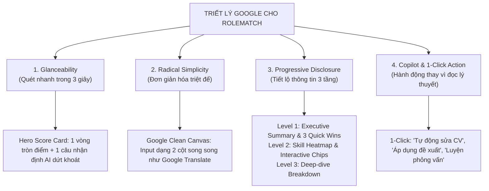
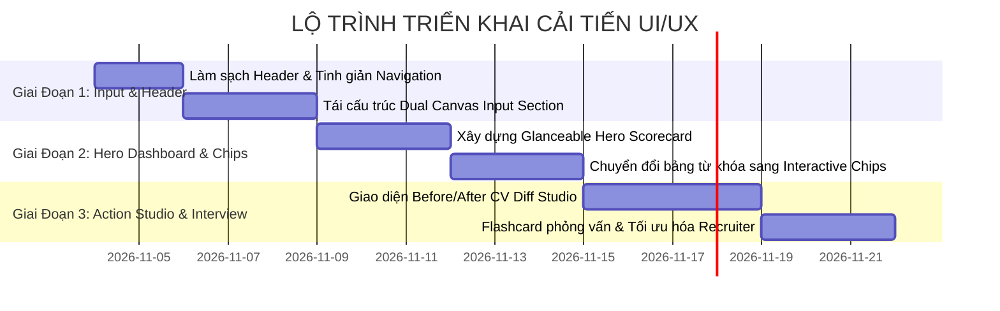

# RoleMatch 2 — Kế Hoạch Triển Khai Cải Tiến UI/UX (Google Design Mindset)

> **Tài liệu tham chiếu:** `docs/UI_UX_IMPLEMENTATION_PLAN.md`  
> **Phiên bản:** 1.0 (Tháng 11/2026)  
> **Mục tiêu:** Tinh giản hóa giao diện, loại bỏ bão hòa văn bản (text-heavy), nâng cao tính chuyên nghiệp, trực quan và đưa trải nghiệm người dùng về đúng chuẩn tư duy thiết kế của **Google (Material Design 3, Google Workspace, NotebookLM & Gemini UX)**.

---

## 1. Bối Cảnh & UX Audit (Hiện Trạng vs. Điểm Nghẽn)

### 1.1. Các vấn đề người dùng đang gặp phải
1. **Quá tải nhận thức (Cognitive Overload) — "Bức tường chữ":**
   - Sau khi bấm phân tích, hàng loạt khối thông tin nặng chữ xuất hiện cùng lúc: Phân tích 10s của Recruiter, Ma trận rủi ro 4 chiều, Bảng đối chiếu từ khóa với hàng chục dòng, Đề xuất viết lại câu, Câu hỏi phỏng vấn...
   - Người dùng không có điểm neo thị giác (visual anchor) để biết mình cần xem cái gì trước, dẫn đến việc bỏ qua thông tin quan trọng.
2. **Thiếu tính năng Phân tầng thông tin (Progressive Disclosure):**
   - Mọi chi tiết sâu đều được mở toang (fully expanded) mặc định thay vì chỉ hiển thị tóm lược cấp cao và cho phép người dùng click mở rộng khi có nhu cầu.
3. **Mật độ thị giác quá dày & Phân mảnh màu sắc:**
   - Sử dụng quá nhiều viền xám đậm (`border-slate-800`, `border-slate-300`), dải gradient màu nóng (amber, rose, emerald, indigo) làm mất đi sự yên tĩnh của không gian thị giác.
   - Header tối màu (`bg-slate-900`) tương phản gắt với thân trang sáng màu, tạo cảm giác đứt gãy giao diện.
4. **Khu vực nhập liệu (Input Section) bị rối loạn ưu tiên:**
   - Người dùng vừa vào trang đã thấy hàng loạt nút phụ trợ: Nút kiểm tra API OpenRouter, Nút Preview/Raw, Chọn preset mẫu, Dropzone, File tag... làm luồng thao tác chính (*Dán/Tải CV $\rightarrow$ Dán/Tải JD $\rightarrow$ Phân tích*) bị phân tâm.

---

## 2. Triết Lý Thiết Kế Của Google (Google Design Mindset) Áp Dụng Cho RoleMatch

### 4 Trụ cột cốt lõi:
1. **Focus on the user and all else will follow:**
   - Ứng viên chỉ muốn biết 2 điều đầu tiên: *CV của tôi được bao nhiêu điểm?* và *3 điều quan trọng nhất tôi phải sửa ngay là gì?*.
   - Nhà tuyển dụng chỉ muốn biết: *Ứng viên này có Pass vòng lọc không (Yes/No/Maybe)?* và *Rủi ro lớn nhất là gì?*.
2. **Glanceability (Hiểu kết quả trong 3 giây):**
   - Thay các đoạn văn bản dài bằng các thẻ chỉ số trực quan (Metric Chips), thanh tiến trình ngắn gọn và màu sắc ngữ nghĩa rõ ràng.
3. **Progressive Disclosure (Phân tầng 3 cấp):**
   - Giảm 65–70% lượng văn bản hiển thị ban đầu. Chi tiết chỉ xuất hiện khi người dùng chủ động bấm xem thêm (`Read more`, `Expand accordion`, `View breakdown`).
4. **Action-Oriented AI Assist (Trợ lý thông minh hướng hành động):**
   - Chuyển từ việc "đưa ra lời khuyên thụ động bắt người dùng tự sửa" sang **"Trợ lý đề xuất thay đổi sẵn, người dùng chỉ cần duyệt bằng 1 click"**.

---

## 3. Kiến Trúc Redesign & Đặc Tả Giao Diện Mới

### 3.1. Header & Navigation (Chuẩn Google Workspace)
- **Phong cách:** Nền trắng/sáng (`bg-white/90 backdrop-blur-md`), viền phân cách mỏng nhẹ (`border-b border-slate-200/60`).
- **Logo & Tiêu đề:** Biểu tượng tối giản kèm tên thương hiệu `RoleMatch` gọn gàng.
- **Segmented Switch (Chuyển chế độ):**
  - Thanh chuyển đổi dạng viên thuốc (Pill Switch): `[ 👤 Ứng viên ]` | `[ 🏢 Nhà tuyển dụng ]`.
- **Góc phải:**
  - Nút `Lịch sử` (History Drawer).
  - Bộ chọn ngôn ngữ tối giản `[ VI | EN ]`.
  - Icon Trợ giúp / Hướng dẫn (`Help circle`) mở Guide Drawer.
  - Avatar tài khoản dạng tròn (Google Account Style), ẩn các nút quản trị kỹ thuật (Error logs, Admin) vào menu thả xuống của Avatar.

---

### 3.2. Khu Vực Nhập Liệu (Input Dual Canvas — Chuẩn Google Translate / NotebookLM)
- **Bố cục 2 cột đối xứng sạch sẽ:**
  - **Cột trái — Mô tả Công Việc (JD):**
    - Tab chuyển đổi tinh giản: `Dán văn bản` hoặc `Nhập link JD / Tải file`.
    - Ô nhập liệu phẳng, viền xám sáng mờ, chỉ hiện border xanh Google khi `focus`.
  - **Cột phải — Hồ Sơ Của Bạn (CV):**
    - Khu vực kéo thả file trực quan (Drag & Drop zone) hiển thị biểu tượng tài liệu và gợi ý dạng file (`PDF, DOCX, TXT`).
    - Khi đã chọn file: Hiển thị 1 Chip gọn gàng `📄 NguyenVanA_CV.pdf (245 KB)` kèm icon xóa `✕`.
- **Nút CTA chính (Primary Action):**
  - Đặt chính giữa bên dưới 2 cột: Nút lớn bo tròn mềm mại `rounded-full`, màu Google Blue (`#1a73e8` hoặc Indigo-600) với nhãn:
    `✨ Bắt đầu phân tích hồ sơ`
- **Tùy chọn phụ (Presets mẫu & Nâng cao):**
  - Thu gọn vào nút dạng text link hoặc dropdown kín đáo: `[ Dùng thử dữ liệu mẫu ▾ ]` để không chiếm dụng diện tích thị giác.

---

### 3.3. Trang Kết Quả Phân Tích (Analysis Results Dashboard)

Cấu trúc lại toàn bộ thành **3 Tầng trực quan**:

#### Tầng 1: Executive Summary & Hero Scorecard (Xem trong 3 giây)
- **Khối Điểm Số Trung Tâm (Match Score Circle):**
  - Vòng tròn tiến trình SVG mượt mà hiển thị số điểm (VD: `78/100`).
  - Huy hiệu trạng thái dứt khoát: `Rất phù hợp (Strong Match)` / `Cần cải thiện (Needs Work)`.
  - 1 câu đúc kết từ AI (Bold insight summary) nêu bật bản chất hồ sơ.
- **3 Thẻ Chỉ Số Cốt Lõi (Glanceable Metric Cards):**
  1. *Khớp Từ Khóa JD (Keyword Fit)*: `75%` (Thanh bar mini).
  2. *Độ Phù Hợp Kỹ Năng (Skill Match)*: `82%` (Thanh bar mini).
  3. *Trải Nghiệm & Thành Tựu (Outcome Score)*: `70%` (Thanh bar mini).
- **Hộp "Top 3 Hành Động Cần Làm Ngay" (3 Quick Wins):**
  - Không liệt kê cả trang lỗi, chỉ rút gọn 3 việc có tác động lớn nhất (VD: *"Bổ sung từ khóa Docker & Kubernetes"*, *"Định lượng kết quả tại vị trí Tech Lead"*).
  - Kèm nút hành động nhanh `Sửa ngay ➔`.

#### Tầng 2: Interactive Visual Matrix (Trực quan hóa thay thế văn bản)
- **Từ khóa & Kỹ năng (Interactive Chips):**
  - Loại bỏ các bảng HTML nặng chữ.
  - Chuyển thành hệ thống **Thẻ từ khóa tương tác (Interactive Chips)**:
    - `Xanh (Đã khớp)`: Bấm vào xem vị trí được tìm thấy trong CV.
    - `Đỏ/Cam (Còn thiếu)`: Bấm vào hiện popover gợi ý câu văn mẫu để ứng viên đưa vào CV.
    - `Vàng (Cần nhấn mạnh thêm)`: Từ khóa có xuất hiện nhưng chưa làm nổi bật kết quả định lượng.
- **Biểu đồ Radar / Spider Chart (Recruiter Fit):**
  - Trực quan hóa 4 trục: *Thâm niên (Seniority)*, *Quy mô (Scale)*, *Trách nhiệm (Ownership)*, *Chuyên môn (Domain)*.

#### Tầng 3: Action Studio (Cập nhật CV & Phỏng vấn)
- **Before / After CV Diff Studio (Chuẩn Google Docs Suggestion Mode):**
  - Giao diện so sánh 2 cột song song:
    - Bên trái: Câu gốc trong CV (highlight đoạn thiếu số liệu).
    - Bên phải: Câu AI đã viết lại theo công thức **Google XYZ Formula** (`Đạt được [X], đo lường bằng [Y], thông qua việc làm [Z]`).
    - Nút 1-Click: `[ ✅ Áp dụng vào CV ]` hoặc `[ 📋 Sao chép ]`.
- **Trợ lý Phỏng Vấn (Interactive Interview Flashcards):**
  - Thay vì danh sách câu hỏi dài dòng, chuyển thành dạng **Thẻ câu hỏi lật (Flashcards)** hoặc chế độ **Hỏi - Đáp mô phỏng**:
    - Mặt trước: Câu hỏi tình huống tuyển dụng sẽ hỏi.
    - Mặt sau: Gợi ý trả lời theo khung STAR + Điều HR muốn nghe.

---

## 4. Hệ Thống Thiết Kế (Design System & Material You Tokens)

### 4.1. Bảng Màu (Color Palette)
| Nhóm màu | Mã Hex / Tailwind | Mục đích sử dụng |
| :--- | :--- | :--- |
| **Surface (Nền chính)** | `#F8FAFC` (`bg-slate-50`) | Nền tổng thể toàn bộ trang, tạo cảm giác nhẹ nhàng, dễ chịu cho mắt. |
| **Card Surface (Nền thẻ)** | `#FFFFFF` (`bg-white`) | Nền của các thẻ chức năng, phẳng, không bóng gắt. |
| **Primary (Chủ đạo)** | `#2563EB` hoặc `#4F46E5` | Màu thương hiệu cho nút CTA chính, active tabs, thanh tiến trình điểm cao. |
| **Success (Khớp tốt)** | `#10B981` (`emerald-500`) | Điểm số cao, từ khóa đã có, quyết định tuyển dụng `INVITE YES`. |
| **Warning (Cảnh báo)** | `#F59E0B` (`amber-500`) | Cần lưu ý, từ khóa xuất hiện ít, quyết định `MAYBE`. |
| **Danger (Thiếu sót)** | `#EF4444` (`rose-500`) | Từ khóa còn thiếu, rủi ro lớn, tiêu chí loại trừ Knock-out. |
| **Text Primary** | `#0F172A` (`text-slate-900`) | Tiêu đề, số liệu chính, đảm bảo tương phản chuẩn WCAG AAA. |
| **Text Secondary** | `#475569` (`text-slate-600`) | Nội dung diễn giải, văn bản mô tả, không gây chói mắt. |

### 4.2. Typography & Khoảng Thở (Spacing & Layout)
- **Font:** Google Sans / Inter / Plus Jakarta Sans.
- **Line Height:** Tăng khoảng cách dòng (`leading-relaxed` / `leading-normal`) để mắt người đọc không bị mỏi khi quét qua các đoạn phân tích.
- **Bo góc (Border Radius):** Bo tròn mềm mại đặc trưng của Google (`rounded-2xl` cho card, `rounded-full` cho buttons/chips).
- **Đổ bóng (Elevation):** Sử dụng bóng siêu nhẹ (`shadow-xs` hoặc `shadow-sm`), loại bỏ viền đen/xám dày cộp.

---

## 5. Lộ Trình Triển Khai Chi Tiết (Phased Roadmap)

### Chi tiết các bước thực hiện:

#### 🔹 Giai đoạn 1: Header Tinh Gọn & Dual-Canvas Input Section
- **File tác động:**
  - `src/components/Header.tsx`: Chuyển sang Light Theme chuẩn Google Workspace, gom các nút Admin/Logs vào Menu tiện ích, làm gọn Switch Ứng viên/Nhà tuyển dụng.
  - `src/components/InputSection.tsx`: Thiết kế lại bố cục 2 cột song song chuẩn Google Translate, ẩn nút debug API, tinh gọn quy trình kéo thả file CV và lấy JD từ URL.
- **Chỉ số đo lường (KPI):**
  - Giảm 50% số lượng nút bấm hiển thị ở màn hình ban đầu.
  - Người dùng có thể hoàn thành việc nhập CV + JD trong vòng 2 cú click.

#### 🔹 Giai đoạn 2: Glanceable Executive Dashboard & Interactive Chips
- **File tác động:**
  - `src/components/AnalysisProgressBar.tsx`: Animation thanh tiến trình nhẹ nhàng hơn.
  - `src/components/KeywordMatchTab.tsx`:
    - Thay thế bảng text HTML bằng hệ thống **Interactive Chips** có màu sắc phân loại.
    - Tạo khối **Hero Scorecard** với 3 thanh điểm trực quan và **Top 3 Quick Wins**.
  - `src/components/RecruiterScanTab.tsx`: Rút gọn nhận định 10 giây của HR thành thẻ tóm tắt trực quan, có nút mở rộng chi tiết.
- **Chỉ số đo lường (KPI):**
  - Thời gian để người dùng nắm được điểm tổng quát và 3 điểm cần sửa giảm từ 2 phút xuống dưới 5 giây.
  - Giảm 65% số dòng văn bản hiển thị mặc định trên màn hình kết quả.

#### 🔹 Giai đoạn 3: Before/After Action Studio & Interactive Interview Kit
- **File tác động:**
  - `src/components/BulletPointRewriteTab.tsx`: Thiết kế lại bảng so sánh Before vs After chuẩn Google Docs Version History với nút 1-Click Apply.
  - `src/components/InterviewPrepTab.tsx`: Chuyển danh sách câu hỏi thành dạng Flashcard hoặc Chatbot luyện tập tương tác.
  - `src/components/BatchProcessingTab.tsx`: Tối ưu hóa các bảng Kanban và Leaderboard của Nhà tuyển dụng cho thoáng mắt, chuyên nghiệp.

---

## 6. Tiêu Chí Nghiệm Thu (Acceptance Criteria & Verification)

1. **Về Thẩm Mỹ & Trải Nghiệm:**
   - [ ] Giao diện đồng nhất ngôn ngữ thiết kế Material You (sạch sẽ, nền sáng, khoảng thở rộng rãi).
   - [ ] Loại bỏ hoàn toàn cảm giác "ngợp text"; mọi khối thông tin lớn đều có tóm tắt cấp cao và cơ chế Progressive Disclosure (Xem thêm / Ẩn bớt).
2. **Về Tính Năng & Tương Tác:**
   - [ ] Các tính năng cốt lõi (Phân tích, Chấm điểm lại, Viết lại đạn CV, Xuất file) hoạt động ổn định 100%.
   - [ ] Người dùng có thể sao chép hoặc áp dụng đề xuất AI chỉ với 1 click.
3. **Về Hiệu Năng & Khả Năng Truy Cập (Accessibility):**
   - [ ] Đáp ứng chuẩn màu tương phản WCAG 2.1 AA/AAA cho văn bản và các nút bấm.
   - [ ] Mượt mà trên cả máy tính bàn, máy tính bảng và điện thoại di động (100% responsive).
   - [ ] Toàn bộ unit tests hiện có (`npm run test`) tiếp tục pass 100%.
